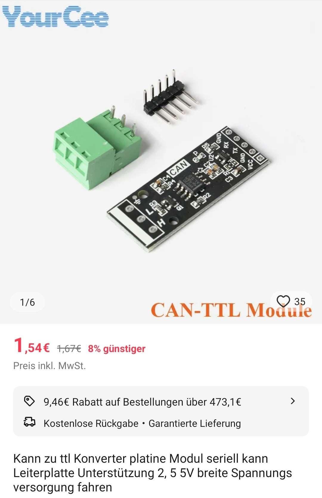

## General {#grundsatzliches}

This build is **not recommended for production use**. It is a temporary test platform for exploring the project's scope. Third-party boards may cause stability problems. Original hardware is tested, purpose-built and galvanically isolated, especially important with BMS units that disconnect the negative power path.

## Problems with Negative-Switching BMS Units {#probleme-bei-negativ-schaltenden-bms}

Some BMS units disconnect the negative path during a fault. If an alternative ground path exists, for example **BMS → RS485 → BSC → inverter**, battery current can flow through thin signal wires, creating a **cable-fire hazard**. The inverter may not notice and may continue drawing current. **Use galvanically isolated modules for these BMS types.**

## Hardware Modules {#hardware-module}

All modules must support the microcontroller's **3.3 V logic** and supply.

### ESP32 Microcontroller {#das-herz-des-ganzen-der-esp32-mikrocontroller}

#### Module Information {#modulinfos}

An ESP32 development kit can be used for initial testing. NodeMCU boards with an ESP32-DOWx chipset (e.g. ESP-WROOM-32), such as Berrybase NMCU-ESP32, are compatible.

#### Power Supply {#spannungsversorgung}

NodeMCU power supplies can be inadequate and cause instability:

1. Connect a quality **3.3 V / >= 1.5 A** supply directly to **3.3 V and GND**.
2. Add capacitors between these pins, for example **220 nF ceramic**, **22 µF** and **470 µF electrolytic**.

#### Module Connection Requirements {#modulanschluss-kriterien}

Use suitable level converters for external hardware. **ESP32 UART is 3.3 V logic, not RS485**. Incorrect connection can destroy the controller or connected equipment.

#### GPIOs {#gpios}

Communication module data pins; connect a Seplos BMS to **Serial 2**.

| Interface | RX | TX |
| --- | --- | --- |
| Serial 0 | GPIO 16 | GPIO 17 |
| Serial 1 | GPIO 23 | GPIO 25 |
| Serial 2 | GPIO 35 | GPIO 33 |
| CAN | GPIO 5 | GPIO 4 |

### CAN Converter {#can-konverter}

The module below has worked reliably in one prototype and is available from several suppliers. Connect **CANH, CANL and GND**.

{ width="450" }