## Important: Read This First {#wichtiger-hinweis-zuerst-lesen}

These settings are based on user experience with **LiFePO4 cells**. They are guidance and an **initial draft**, not universally applicable configuration instructions.

!!! warning "Outdated Screenshots"
    Screenshots come from an **older web app version** and may differ from the current interface. Values can serve as guidance; current labels/options are documented under [Inverter](settings_inverter.md), [Charging](settings_inverter_charge.md) and [Interfaces](settings_bsc_interfaces.md).

We cannot guarantee accuracy, completeness or suitability. Adapting settings to your system requires sound technical expertise. You are responsible for checking, understanding and adapting them before use. **Do not copy settings without understanding the whole configuration and checking suitability.** Incorrect use may damage equipment or batteries and endanger safety.

Use this information at your own risk. We accept no liability for direct or indirect damage resulting from these settings.

## Configuration Examples {#konfigurations-beispiele}

### 5× JK Inverter BMS 200 A (16S); 2× Victron MultiPlus 5000 {#5x-jk-inverterbms-200a-16s-2x-victron-multiplus-5000}

#### BSC Serial Settings {#bsc-einstellungen-serielle-schnittstelle}

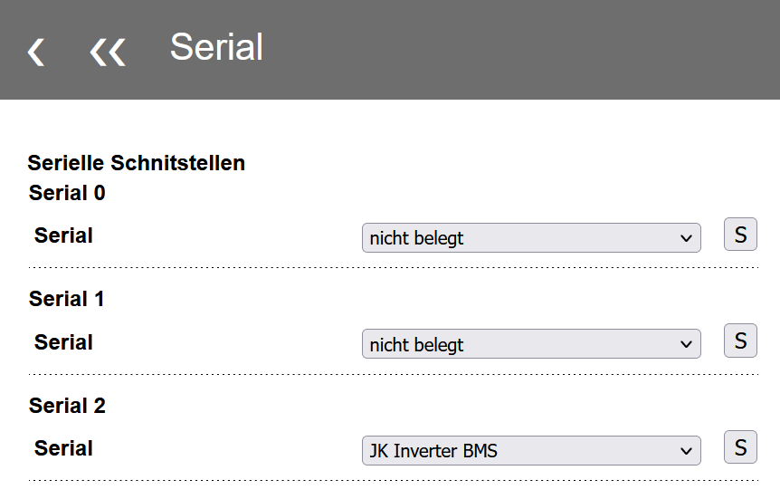{ width="450" }

#### BSC Inverter Settings {#bsc-einstellungen-inverter}

##### General {#allgemein}

Serial **6** was chosen as master because the top pack in this stack had the highest temperatures. Sensor **1** was usually warmest and supplied the battery temperature sent to Venus OS.

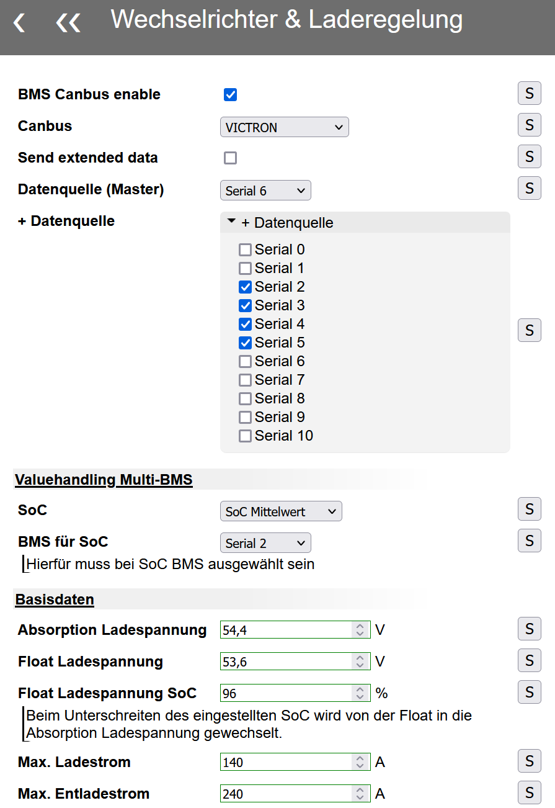{ width="450" }
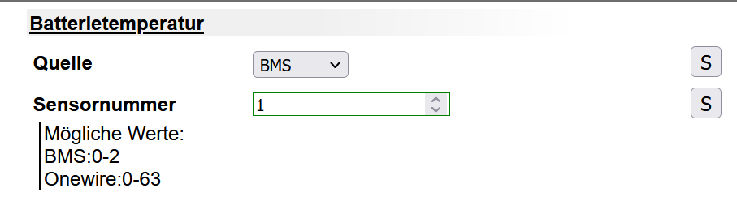{ width="450" }

##### Charging {#laden}

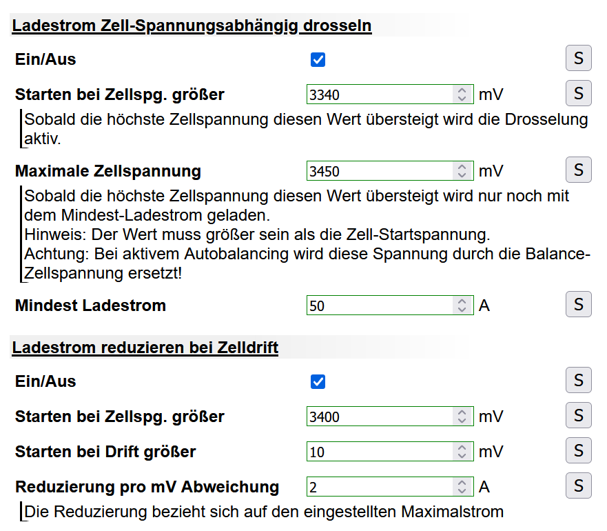{ width="450" }
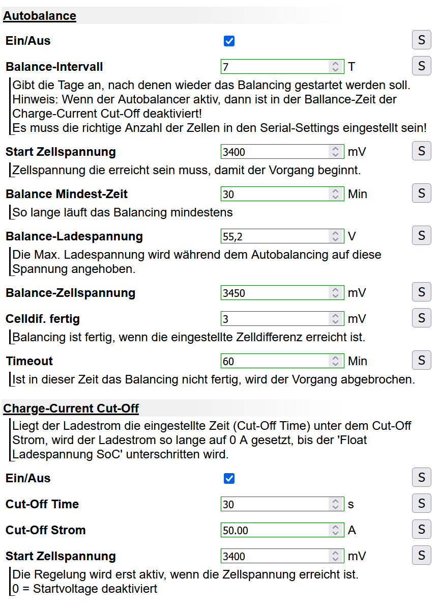{ width="450" }

##### Discharging {#entladen}

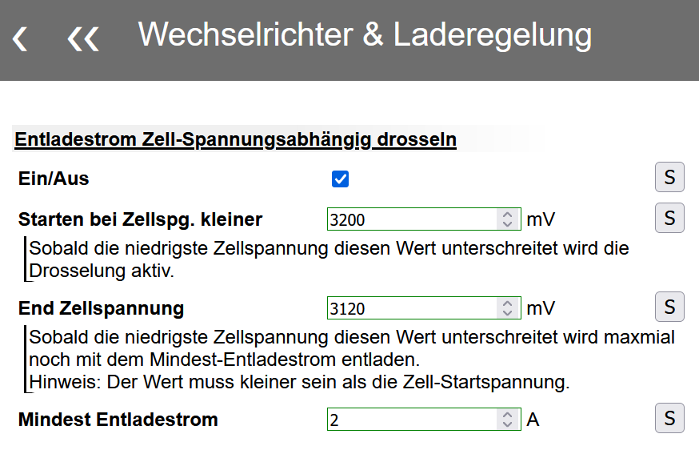{ width="450" }

#### BMS {#bms}

##### Settings {#settings}

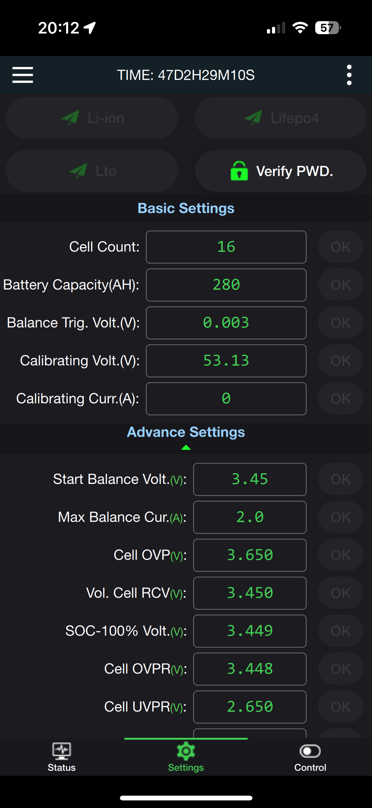{ width="350" }
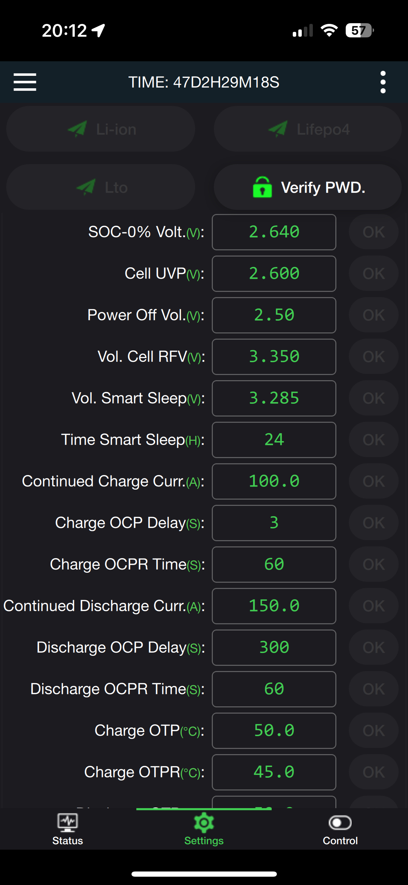{ width="350" }
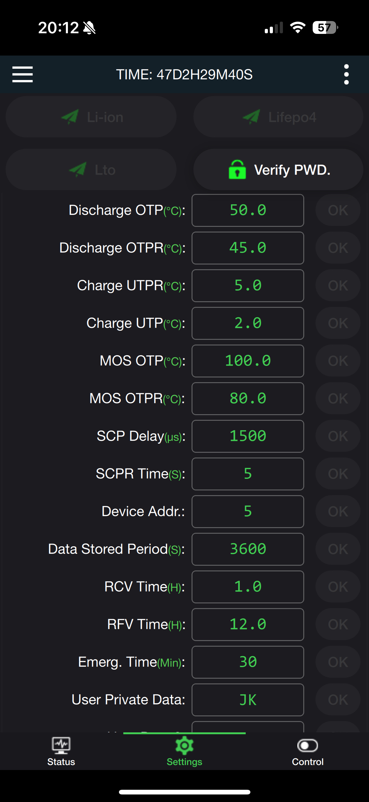{ width="350" }
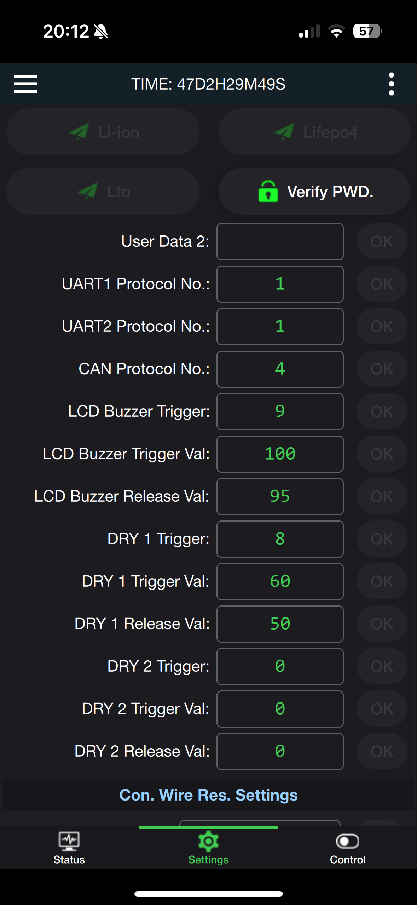{ width="350" }

##### Control {#control}

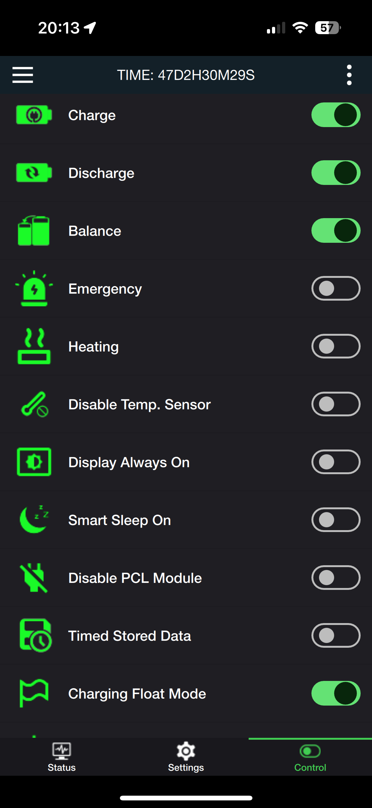{ width="350" }

### 1× Seplos 10E 200 A (16S); 3× Growatt SPF5000ES {#1x-seplos-10e-200a-16s-3x-growatt-spf5000es}

#### BSC Inverter Settings {#bsc-einstellungen-inverter_1}

##### General {#allgemein_1}

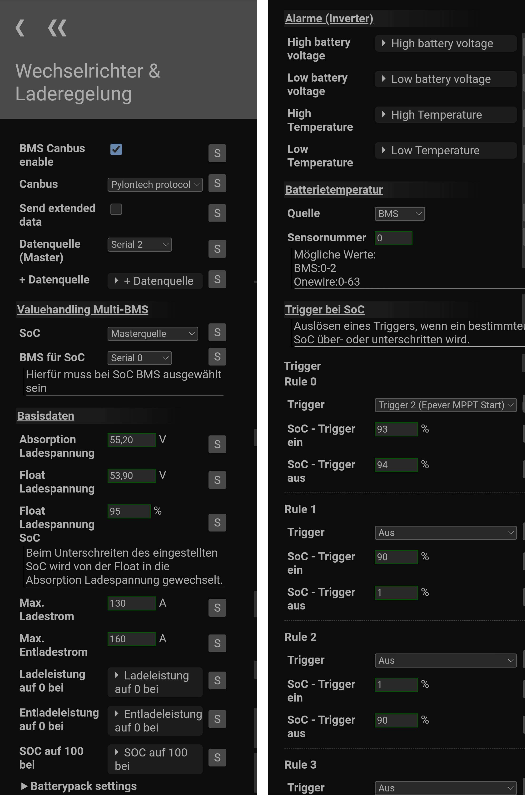{ width="1050" }

##### Charging {#laden_1}

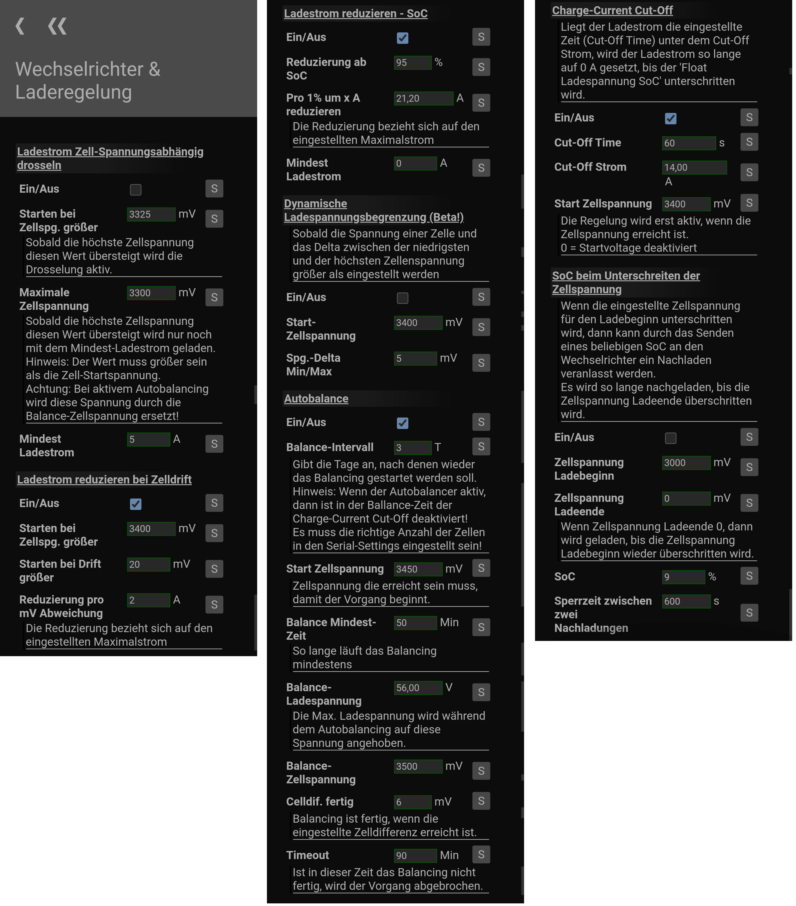{ width="1050" }

##### Discharging {#entladen_1}

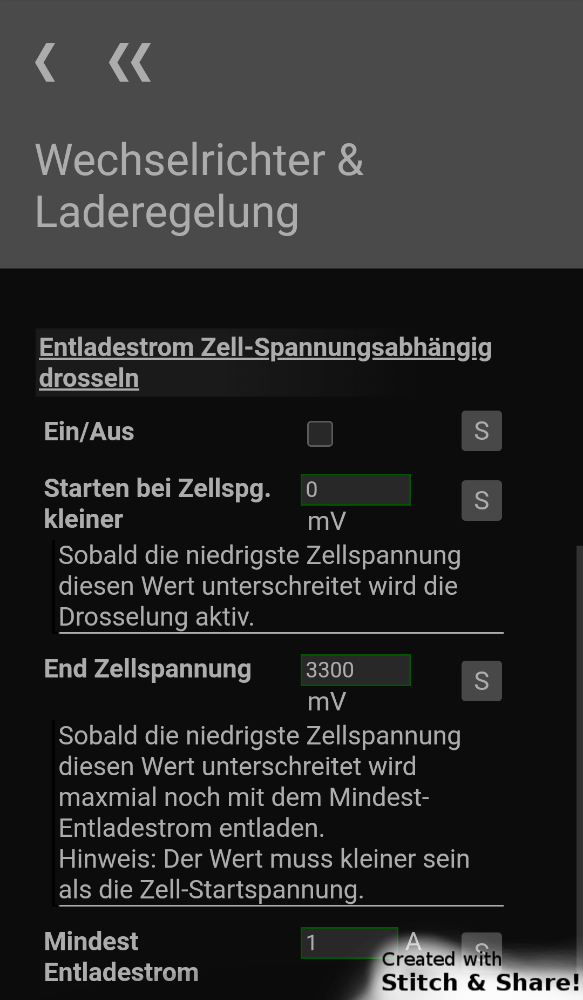{ width="350" }

#### BMS {#bms_1}

##### Parameters {#parameter}

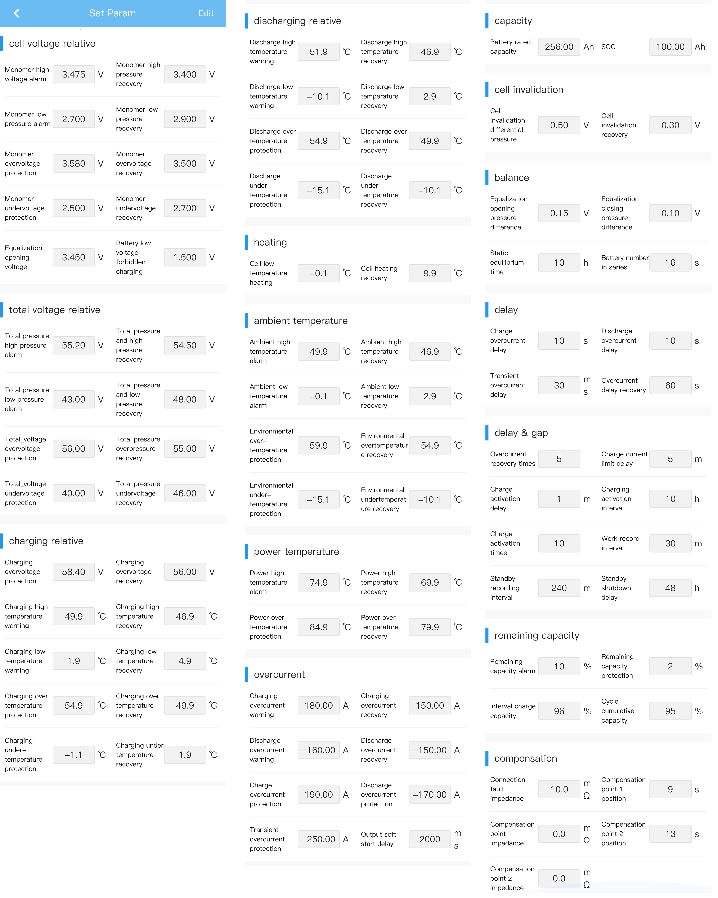{ width="1050" }

##### Switches {#switches}

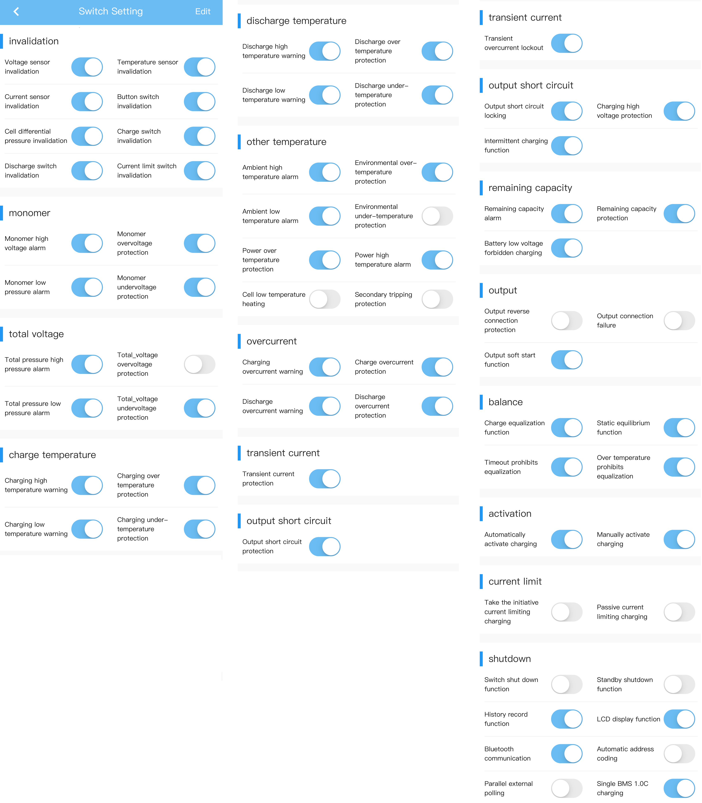{ width="1050" }