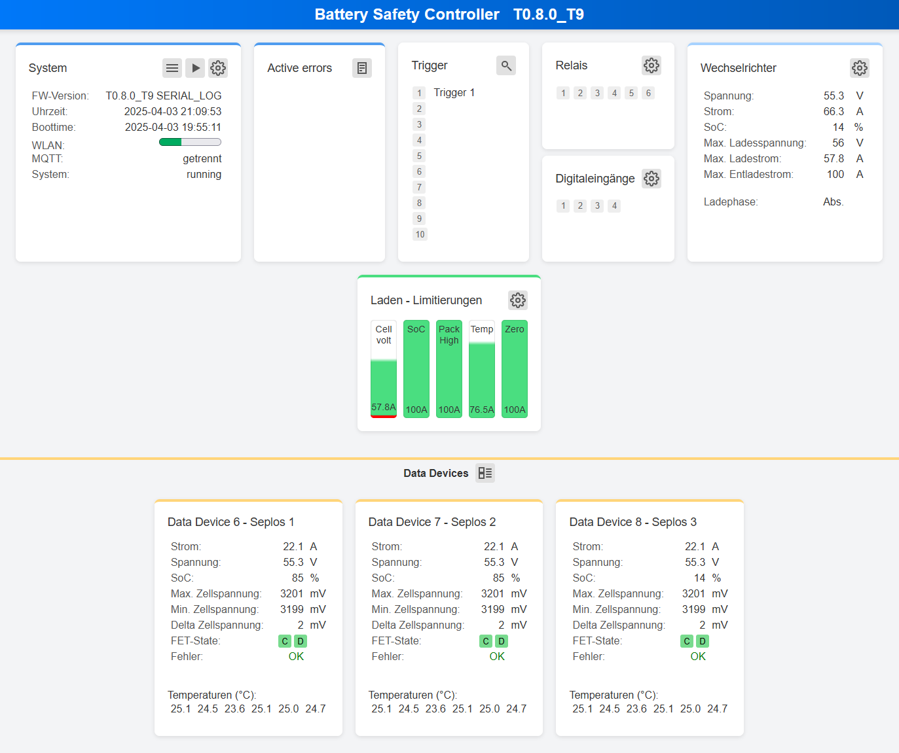

## General {#allgemeines}

### Web UI Versions {#hinweis-zu-den-webui-versionen}

The images and descriptions below refer to the **modern web UI**. The free firmware uses the **Classic web UI**, where functions may differ or be unavailable.

### General Operation {#allgemeine-informationen-zur-bedienung}

**Saving Settings:** Use **Save** in the settings page header. There is no need to save each row separately.

## Dashboard {#dashboard}

### Overview {#ubersicht}

The dashboard summarises system status, inputs and outputs, charge/discharge controls and connected data devices in tiles.

{ width="950" }

### Tiles {#kacheln}

#### System {#system}

Displays system status. Buttons:

 **Menu:** Opens the main menu.

 **Live data:** Opens live measurements.

 **Settings:** Opens system settings.

#### Active Errors {#active-errors}

Displays active system errors. **Not every log error appears as an Active Error.** Possible entries: **Data Device x Error**, **Plausibility Check Error**, **CANBUS Error**.

 **Log:** Opens the log file.

#### Triggers {#trigger}

Displays configured trigger states and descriptions. Active trigger numbers change from light grey to dark grey.

 **Trigger overview:** Detailed view of used triggers and functions.

#### Relays and Digital Inputs {#relais-und-digitaleingange}

Displays current states. Active inputs or outputs change from light grey to dark grey.

#### Inverter {#wechselrichter}

Displays values sent to the inverter: voltage (V), current (A), SoC (%), maximum charging/discharging values (V, A), and current charge phase (*Float*, *Absorption*).

#### Charging Limits {#laden-limitierungen}

Each enabled control has a bar indicating its maximum permitted charging current.

| Charge control | Dashboard label |
| --- | --- |
| Cell-voltage-dependent current reduction | **Cell volt** |
| SoC-dependent reduction | **SoC** |
| Cell voltage difference reduction | **Cell drift** |
| Charge-Current Cut-Off | **Cut Off** |
| Excessive pack current | **Pack High** |
| Temperature-dependent reduction | **Temp** |
| Temperature profile | **Temp Prf.** |
| Voltage control for current limiting | **Zero** |

#### Discharging Limits {#entladen-limitierungen}

Each enabled control has a bar indicating its maximum permitted discharging current.

| Discharge control | Dashboard label |
| --- | --- |
| Cell-voltage-dependent current reduction | **Cell volt** |
| Excessive pack current | **Pack High** |
| Temperature-dependent reduction | **Temp** |
| Temperature profile | **Temp Prf.** |

#### Data Devices {#data-devices}

Displays live data from connected devices.

 The header button switches to cell voltages.