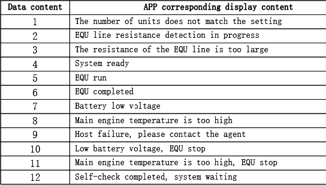
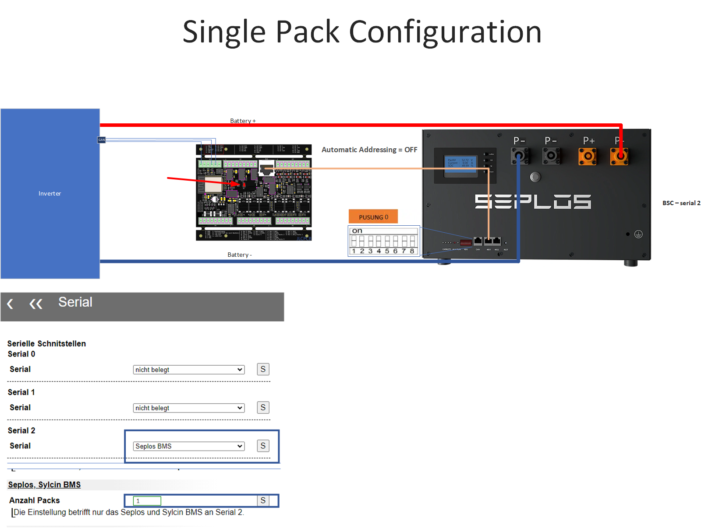
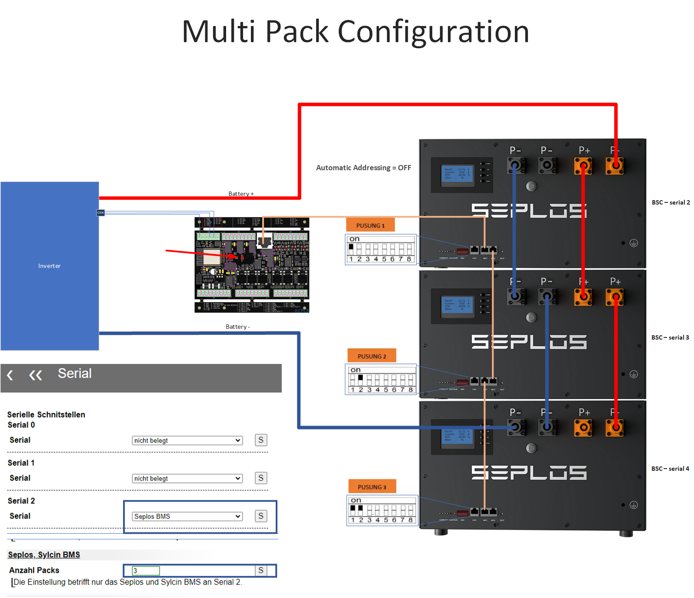
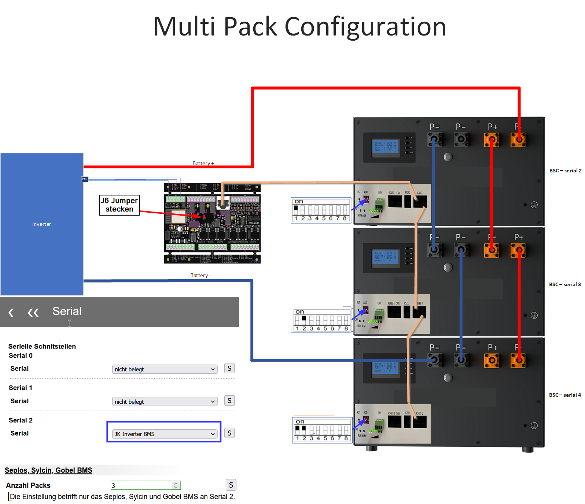
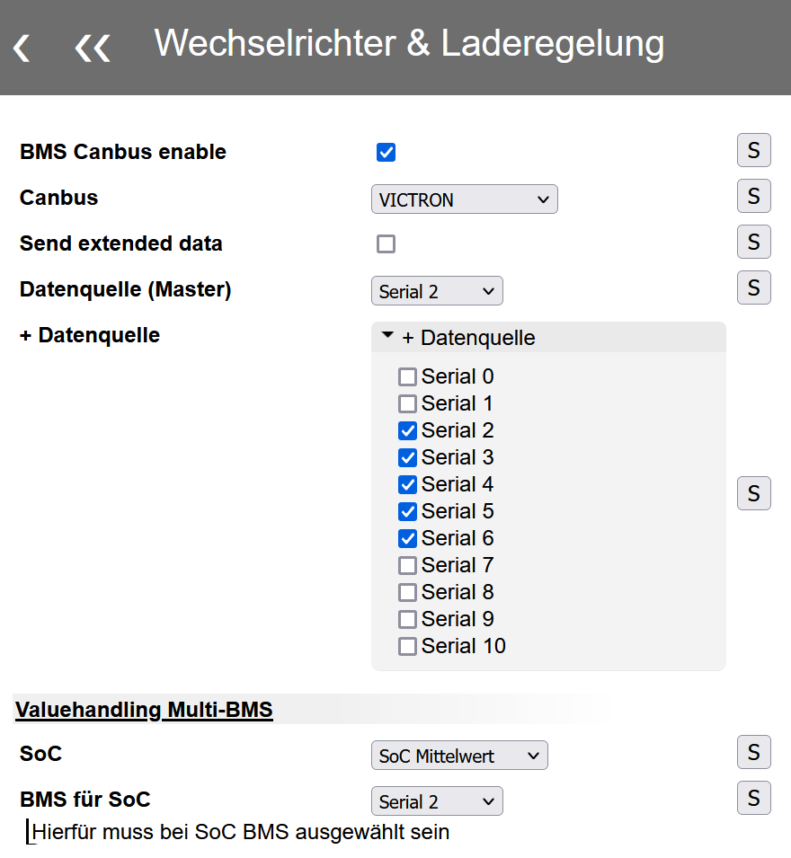
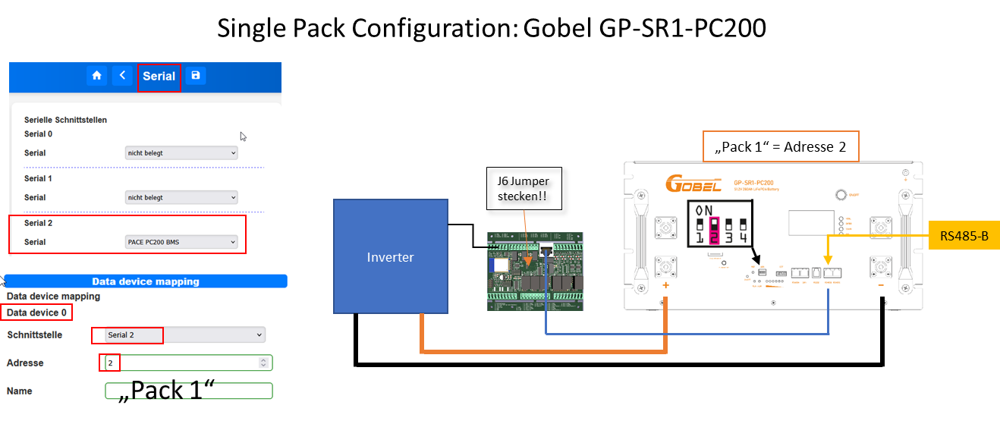
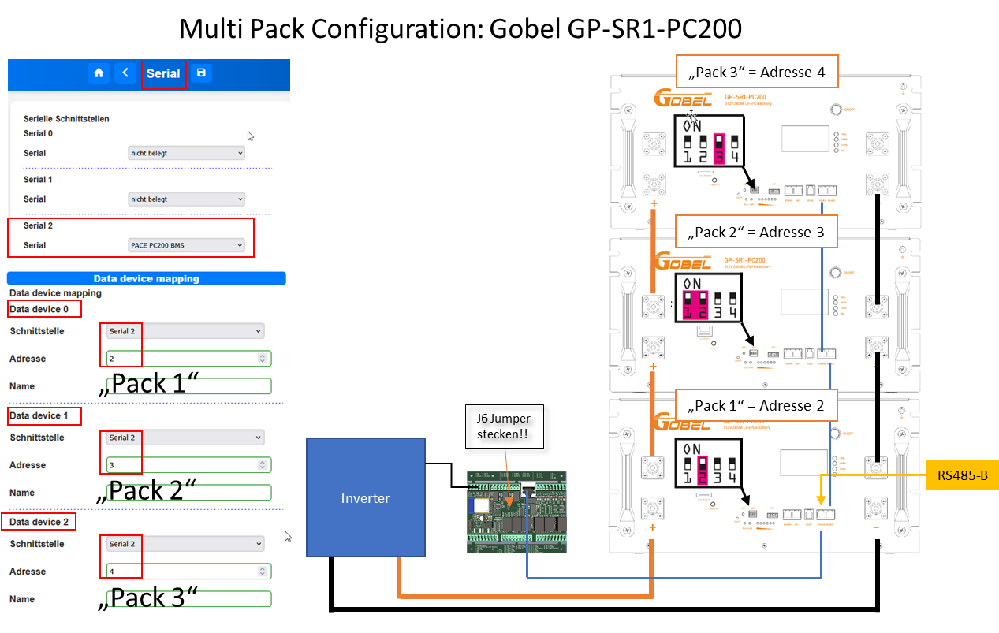
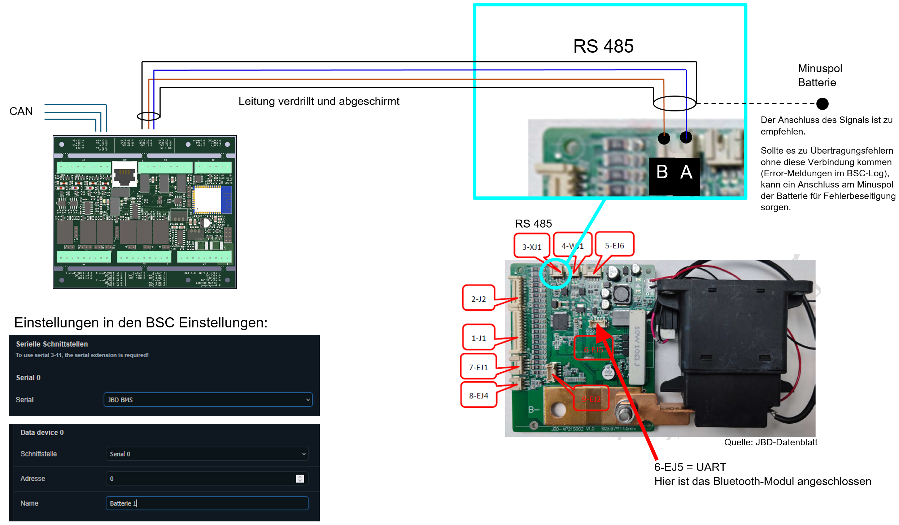

# Supported BMS Units {#unterstutzte-bms}

An overview of currently supported battery management systems (BMS).

## Integrating Other BMS Systems {#integration-weiterer-bms-systeme}

The BSC platform is not restricted to the systems below. Additional systems can be integrated if sufficiently complete manufacturer protocol documentation is available. In some cases, users may need to record communication with a logic analyser to verify implementation or investigate problems. This requires technical willingness to participate and some initiative.

If your BMS is not supported, contact the project. Integration is technically possible and can be implemented where there is sufficient demand and documentation.

## Addressing {#adsressierung}

The table gives addresses needed for configuration. Values separated by `/` mean **BMS address / BSC data-device address**. For example, `0 / 1` means set address **0 on the BMS** and address **1 in BSC data-device mapping**. These values may be the same or different.

- **Single-pack address:** Address on the BMS and in data-device mapping for a single BMS.
- **Multi-pack address:** Starting address for the first BMS in a multi-pack system. Further units in the chain use consecutive addresses starting there.

## Serial BMS {#serial-bms}

| Type | HW version | SW version | Single pack BMS / BSC | Multi-pack BMS / BSC | BMS connection |
| --- | --- | --- | --- | --- | --- |
| **Jiabaida/JBD** | | | | | |
| JBD-DP24S002 | | | - | - | |
| [AP21S002](#jiabaidajbd-ap21s002) | | | - | - | RS485 |
| **JK Smart-BMS** | | | | | |
| JK-B2A20S20P | V11.XW | 11.25H | - | | Single device extension (SDE) |
| JK-B2A24S20P | V10.XW | V10.09 | - | | Single device extension (SDE) |
| JK-B2A8S20P | V19 | V19.07 | - | | |
| JK BMS V1.3 (monitoring only) | | | - | - | |
| **JK Inverter-BMS** | | | | | |
| [JK-PB1A16S15P](#jk-inverter) | V14 | V14.20 | 1 / 1 | 1 / 1 | |
| [JK-PB1A16S15P](#jk-inverter) | V15 | V15.17 | 1 / 1 | 1 / 1 | |
| [JK-PB2A16S20P](#jk-inverter) | V15 | V15.17 | 1 / 1 | 1 / 1 | |
| [JK-PB2A16S20P](#jk-inverter) | V19 | V19.10 | 1 / 1 | 1 / 1 | |
| **Seplos** | | | | | |
| [V2](#typ-10c-10e) | 10C | | 0 / 0 | 1 / 1 | |
| [V2](#typ-10c-10e) | 10E | 16.4 | 0 / 0 | 1 / 1 | |
| [V3](#typ-v3) | | | ? | - | |
| **DALY Smart BMS** | | | | | |
| BMS-*A | | | | | Single device extension (SDE) |
| **Sylcin (e.g. Taico battery)** | | | | | |
| [Sylcin](#sylcin) | | | 0 / 1 | 0 / 1 | |
| **Pace (e.g. Gobel battery)** | | | | | |
| GP-SR1-RN150 (test) | | | 0 / 0 | - | |
| [GP-SR3-PC100](#pace-pc100200) | | | 2 / 2 | 2 / 2 | RS485B |
| [GP-SR1-PC200](#pace-pc100200) | | | 2 / 2 | 2 / 2 | RS485B |
| PC200 V1 (RS232) | | | 2 / 2 | - | RS232 |
| PC200 V2 (RS232) | | | 2 / 2 | - | RS232 |
| **Pylontech** | | | | | |
| US2000 | | | 1 / 1 | 1 / 1 | B/RS485 |
| US5000 | | | 1 / 1 | 1 / 1 | B/RS485 |
| **Felicity** | | | | | |
| LUX-Y series | | | 1 / 1 | 1 / 1 | |
| **Daren BMS** (testing; feedback welcome) | | | ? | ? | |

**Legend:** `-` = unsupported; `?` = undocumented; empty = not tested; `(test)` = test status.

**Connection Terms**

- **RS485:** Direct connection to a serial BSC interface.
- **Serial Extension:** Expansion board providing eight more serial interfaces, named **Serial 3–10** in software.
- **Single device extension (SDE):** Adapter for one non-RS485 device (UART/RS232, for example a Victron SmartShunt). It is **not** the Serial Extension.
- **B/RS485** and **RS485B:** RS485 port names on Pylontech and Pace BMS units respectively.

## Bluetooth Devices {#bluetooth-devices}

| Type | HW version | SW version |
| --- | --- | --- |
| NEEY Balancer 4A | 2.8.0 | 1.2.1 |
| NEEY Balancer 4A | 2.8.0 | 1.2.3 |
| NEEY GW-24S4EB | | |
| NEEY EK-24S4EB, EK-24S10EB | | |

NEEY status message reference:

{ width="520" }

## Connection Examples {#anbindungs-beispiele}

### Seplos {#seplos}

#### Type: 10C / 10E {#typ-10c-10e}

The BSC supports types 10E and 10C as a single device or a multi-pack daisy chain. Both modes use an RJ45 connection.

##### Multi-Pack Daisy-Chain Requirements and Tips {#bedingungen-tipps-fur-einen-multipack-daisy-chain-verbund}

- Disable automatic addressing in Seplos software (Upload Parameter, at the bottom on the right).
- Set DIP switches to the RS485 configuration.
- Connect the BMS to any BSC serial port. The [J6 jumper](../hardware.md#j6-fur-den-regularen-betrieb) must be closed.
- If Seplos units suddenly stop responding in a chain, firmware **16.06.04** or possibly later may help. In this fault condition, no serial connection is accepted until the BMS is rebooted.

##### Connection Diagrams {#anschlussmoglichkeiten-grafisch-dargestellt}

**When using RJ45, [this jumper](../hardware.md#j6-fur-den-regularen-betrieb) must be fitted.**

##### Special Features {#besonderheiten}

###### MQTT Temperature Sensor Mapping {#zuordnung-der-temperatursensoren-in-mqtt}

| Data topic | Sensor |
| --- | --- |
| 0–3 | External cable sensors |
| 4 | MOSFET |
| 5 | Ambient |

###### Error Handling {#errorhandling}

- A BSC warning corresponds to a Seplos **Warning** or **Alarm**.
- A BSC alarm corresponds to a Seplos **Protection**.

##### Further Information {#weiterfuhrende-informationen}

[Firmware Update Guide](../files/SEPLOS_BatteryMonitor_Firmware_updating_Guide.pdf) · [FAQ collection](https://akkudoktor.net/t/seplos-bms-faq-sammlung/8843) (Akkudoktor, German).

#### Type: V3 {#typ-v3}

##### Overview {#ubersicht}

Seplos V3 communicates via RS485. A direct 1:1 connection using a standard RJ45 cable is **not possible** because the Seplos V3 and BSC pinouts differ. Wire the connection using individual conductors.

!!! warning "Important Pinout Information"
    The GND pins listed as **3 and 6** in the Seplos V3 datasheet do not work as RS485 communication ground. Only **pin 5** is the common ground for both RS485 ports. Incorrect wiring causes communication failures.

##### Seplos V3 Pinout {#pinbelegung-seplos-v3}

Either RS485 port can be used.

| Seplos V3 pin | RS485 |
| --- | --- |
| 1/8 | B |
| 2/7 | A |
| 5 | GND |

##### Daisy-Chain Limitation {#daisy-chain-limitation}

!!! danger "No Usable Daisy-Chain Support"
    In daisy-chain mode, the BSC does **not** poll the master BMS because of a Seplos V3 protocol limitation.

Daisy-chain operation is therefore **not usable**. Connect each Seplos V3 BMS to its own dedicated serial interface.

##### Wiring {#verkabelung}

Standard RJ45 patch cables cannot be used directly. Prepare individual conductors from the Seplos V3 RJ45 port, connect **A, B and GND (pin 5)** to BSC RS485, keep cables short and use twisted conductors.

### Sylcin {#sylcin}

Multiple batteries can connect through BSC Serial 2.

- Set consecutive DIP addresses starting at 1 without gaps. **0000 means address 1; 0001 means address 2.**
- Connect to **RS485-1**, not RS485-2, on the BMS.
- Connect each additional battery in parallel to its RS485-1 port.
- RS485-1 uses pins **4 and 5**.
- Terminate both ends of the RS485 bus with **120 ohms**.
- Fit [this jumper](../hardware.md#j6-fur-den-regularen-betrieb) when using RJ45.
- Select Sylcin BMS under Serial 2 and configure the number of packs (see Seplos diagrams).

Each pack should then appear: battery 1 → BMS(2), battery 2 → BMS(3), etc.

### JK Inverter {#jk-inverter}

Use a standard RJ45 patch cable. The BSC RJ45 port is called **Serial 2** in software; JP6 must be closed to use it. Both single-pack and daisy-chain multi-pack configurations are supported.

#### Daisy-Chain Setting in the JK App {#einstellung-fur-daisychain-in-der-jk-app}

Set the UART protocol on **every BMS** to **protocol 1: JK BMS RS485 Modbus V1.0**.

#### Addressing {#adressierung}

The BSC is the master, so **DIP address 0 must not be assigned to any BMS**. Give each pack a unique DIP ID. Check it in the JK app: some older DIP switch covers had incorrect 0/1 markings.

#### Physical Connection {#physikalische-verbindung}

##### Single Pack {#einzel-pack-konfiguration}

Connect a right-hand RJ45 port of the JK BMS to the BSC with a patch cable.

##### Multi-Pack Daisy Chain {#multipack-konfiguration-als-in-reihe-geschalteten-daisychain-verbund}

Chain all packs through their right-hand RJ45 ports. Connect the BSC to one unused right-hand RJ45 port. This describes the communication chain, not a series connection of battery power terminals.

#### Configure BMS RS485 Communication in the BSC {#rs485-datenubertragung-bms-in-der-bsc-software-konfigurieren}

- For a direct Serial 2 connection, select **JK Inverter BMS** under Settings / Interfaces / Serial 2. One interface serves the whole chain.
- Configure [data-device mapping](../settings_bsc_data_devices.md#data-devices).
- Each pack should appear under Live Data / BMS Data.

#### Configure Inverter CAN Communication {#can-datenubertragung-inverter-konfigurieren}

To send data via CAN, for example to a Victron CerboGX, open Settings / Inverter & Charge Control / General:

1. Enable **BMS CANbus enable**.
2. Select the CAN protocol, e.g. **VICTRON**.
3. Set **Data source** to the corresponding Serial 2 data devices.
4. Under **Valuehandling**, select SoC calculation/transmission; **Average** sends the average of all connected BMS units.
5. Select **Battery temperature**. This does not change minimum and maximum temperatures across all packs. Include the appropriate serial source for each additional BMS in Data source.

{ width="550" }

#### Special Features {#besonderheiten_1}

##### Temperature Sensor Mapping {#zuordnung-der-temperatursensoren}

The JK Inverter BMS has four attachable temperature sensors. Mapping in the BSC:

| BSC ID | Before V0.7.2_T4 | From V0.7.2_T4 |
| --- | --- | --- |
| 0 | T1 | MOS |
| 1 | T2 | T1 |
| 2 | MOS | T2 |
| 3 | T4 | T4 |
| 4 | T5 | T5 |

### Pace PC100/200 {#pace-pc100200}

These BMS units are used, for example, in Gobel Power GP-SR1-PC200 packs. Single packs and daisy chains are supported through one BSC serial port. Use a standard RJ45 cable and the pack port labelled **RS485-B**, shown below. Configure the interface in both serial settings and device mapping.

#### Single Pack {#einzel-pack-konfiguration_1}

The BSC is master at **address 1**; set the battery pack DIP switches to **address 2**.

#### Multi-Pack Configuration {#multi-pack-konfiguration}

The BSC remains master at **address 1**. Give the packs consecutive addresses starting at **2**.

### Jiabaida/JBD AP21S002 {#jiabaidajbd-ap21s002}

### Known Problems {#bekannte-probleme}

#### “Other Error” on the BSC Display {#fehlermeldung-sonstiger-fehler-in-der-bsc-anzeige}

If “Other error” appears on first startup, reset the JBD BMS:

1. Disconnect both cell-wire connectors **1-J1 and 2-J2**. Wait about **5 minutes** for capacitors to discharge. Reconnect both and check whether the error is gone. If not, continue with step 2.
2. Disconnect both **1-J1 and 2-J2**, then disconnect the Bluetooth module connector **6-EJ5**. Reconnect **1-J1 and 2-J2 first**, then reconnect the Bluetooth module.

Check again whether the error has cleared.

#### Relay Activation After Reset {#relais-aktivierung-nach-reset}

After a reset or protection shutdown, the JBD relay may stay open. Battery voltage is measurable at the output through the bypass resistor, but no current flows. The BMS may not reliably detect current through the bypass resistor and therefore may not close the relay automatically.

A controlled current pulse can activate it:

- Set a laboratory supply to battery voltage (e.g. **55.2 V**) with a **maximum current limit of 5 A**.
- Connect supply negative to BMS output negative.
- Briefly connect supply positive to BMS output positive.
- Current flows through the BMS shunt into the battery, activating the relay.
- Alternatively, connect a small fused load to the BMS output.

**Warning: Without current limiting, dangerously high currents can flow!**