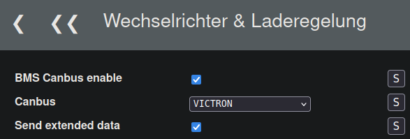
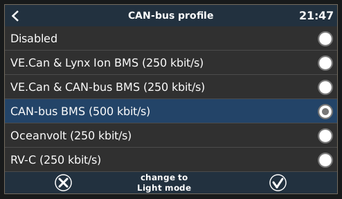
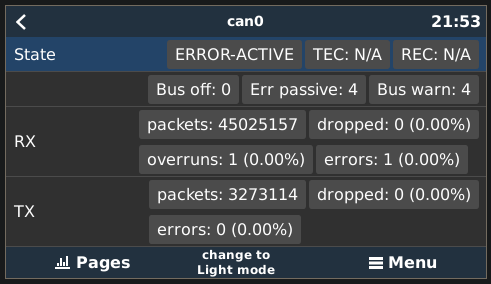
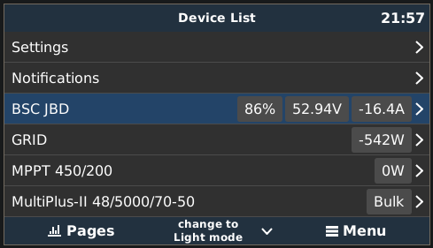
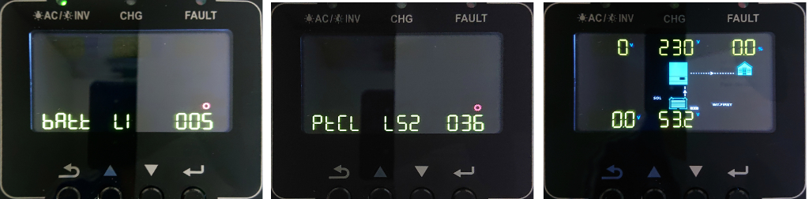
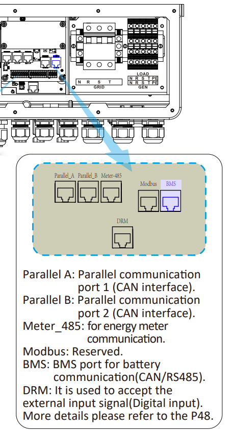
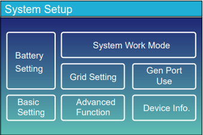
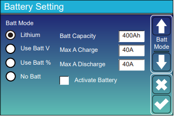
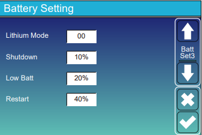

## Victron MP2 48/5000/70 {#victron-mp2-48500070}

**Other inverter models can probably be connected in a similar way.**

### Physical Connections {#physische-verbindung-der-komponenten}

- Internal Victron wiring: MP2 ↔ MK3-USB adapter ↔ Venus OS (e.g. CerboGX, Raspberry Pi + CAN shield).
- BSC connection: BSC CAN port ↔ CerboGX / Raspberry Pi + CAN shield.

### CAN Connection {#can-verbindung}

Fit the Victron RJ45 termination resistor at the end of the connection, usually on the Cerbo. Connect **H to H**, **L to L**, **GND to GND**.

| Signal | [Victron VE.Can port](https://www.victronenergy.com/live/battery_compatibility:can-bus_bms-cable) | RJ45 wire colour (T568B) |
| --- | --- | --- |
| CAN-GND | Pin 3 | Green/white |
| CAN-L | Pin 8 | Brown |
| CAN-H | Pin 7 | Brown/white |

!!! warning "Verify the Pinout"
    Colours shown follow T568B. Before connecting an existing RJ45 cable, measure and verify its actual wiring. Incorrect mapping can cause malfunctions or hardware damage.

### BSC Settings {#einstellungen-bsc}

Open **Settings / Inverter & Charge Control / General**.

**Send extended data** only works with [dbus-bsc-can](https://github.com/shining-man/dbus-bsc-can). It is **not recommended with CerboGX**, whose limited performance can cause problems: in rare cases, an SoC of **0 %** may be transmitted for about **30 seconds**.

### Venus OS Settings {#einstellungen-venusos}

Open **Menu / Settings / Services / can[0,1,2,3,...] / CAN bus profile**.

### BSC Log When an Inverter Is Detected {#bsc-log-ausgabe-wenn-inverter-erkannt-wurde}

### Known Behaviour {#bekannte-besonderheiten}

#### Battery Discharges into the Grid {#akku-wird-in-das-netz-entladen}

SoC reaches 100 %, then the battery discharges when switching to float voltage. This behaviour is **independent of the BSC**. With ESS and **DC-coupled PV feed-in of excess** enabled in Victron settings, the system attempts to lower voltage to float by discharging.

~~Previously suggested workaround: reduce the difference between float and absorption voltage to 0.4 V. To avoid repeated charging/discharging, do not set the BSC float-voltage SoC threshold too high, or it switches back to absorption and repeats the cycle.~~

#### Charge Current Limit (CCL) Is Ignored {#die-ladestrombegrenzung-ccl-wird-ignoriert}

When switching from absorption to float, the BSC sets CCL to **0 A**. Victron may ignore this under some circumstances. With ESS **DC-coupled PV feed-in of excess** enabled, DVCC does not apply its PV-to-battery charge current limit, allowing export. Charge voltage limits still apply. [Source: Victron](https://www.victronenergy.com/media/pg/CCGX/de/dvcc---distributed-voltage-and-current-control.html#UUID-0cda63b2-c80b-e81b-e174-f6a91ca5f848).

## Growatt SPF5000ES {#growatt-spf5000es}

Connect via CAN. Select the **Pylontech** protocol (Deye...) in the BSC; **Send extended data** need not be enabled. On the inverter set **Prg 005: LI**, confirm, then set **PRG 36: L52**. SoC and other data should then be available.

## Goodwe GW5048ES {#goodwe-gw5048es}

Connect via CAN. Select **Deye** as the BSC CAN inverter protocol. Set the inverter battery to **Goodwe 3x Secu-A5.4L**; no inverter protocol setting is needed. Example BMS: **2× Seplos V2**, configured for Pylontech and connected through BSC Serial 2.

## Solis S5-EH1P & RHI 5G {#solis-s5-eh1p-rhi-5g}

#### CAN Connection {#can-verbindung_1}

Connect **H to H** and **L to L**. Solis has no specified GND connection here.

| Signal | Connection | RJ45 wire colour (T568B) |
| --- | --- | --- |
| CAN-L | Pin 5 | Blue/white |
| CAN-H | Pin 4 | Blue |
| CAN-GND | ? | ? |

!!! warning "Verify the Pinout"
    Colours shown follow T568B. Measure existing cables before connecting them. Incorrect mapping can cause malfunctions or damage.

#### BSC Settings {#einstellungen-bsc_1}

Under **Settings / Inverter & Charge Control / General**, select **CANbus / Solis RHI**, save, enable **BMS CANbus enable**, then save again.

#### Solis Settings {#einstellungen-solis}

Open **Advanced Settings / Storage Energy Set / Battery Select / Battery Module** and select **Pylon**.

## Deye SUN-12K-SG04LP3-EU & SUN-20K-SG05LP3 {#deye-sun-12k-sg04lp3-eu-sun-20k-sg05lp3}

#### CAN Connection {#can-verbindung_2}

Use the inverter's **BMS Port** (manual page 10). Take three conductors from a standard network cable to the BSC CAN screw terminals: **CAN-H to CAN-H**, **CAN-L to CAN-L**, **GND to GND**.

| Signal | RJ45 connection | Wire colour (T568B) |
| --- | --- | --- |
| CAN-H | Pin 4 | Blue |
| CAN-L | Pin 5 | Blue/white |
| CAN-GND | Pin 6 | Green |

!!! warning "Verify the Pinout"
    Colours shown follow T568B. Measure existing cables before connecting them. Incorrect mapping can cause malfunctions or damage.

{ width="450" }

#### Inverter Settings {#einstellung-am-wechselrichter}

Set **Bat Set 1 / Batt Mode: Lithium** and **Bat Set 3 / Lithium Mode: 00**.

#### BSC Settings {#einstellungen-im-bsc}

Under **Settings / Inverter & Charge Control / General**, enable **BMS CANbus enable**, select **Pylontech** for CANbus protocol and **Serial 2** for data source (master).