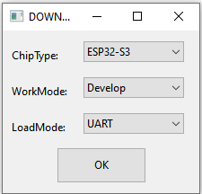
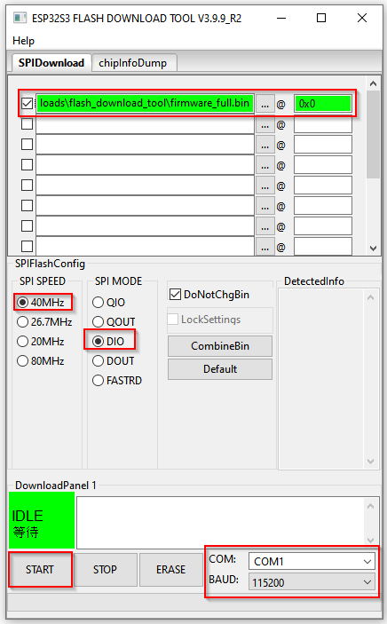
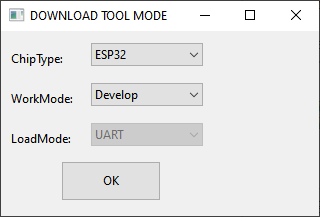
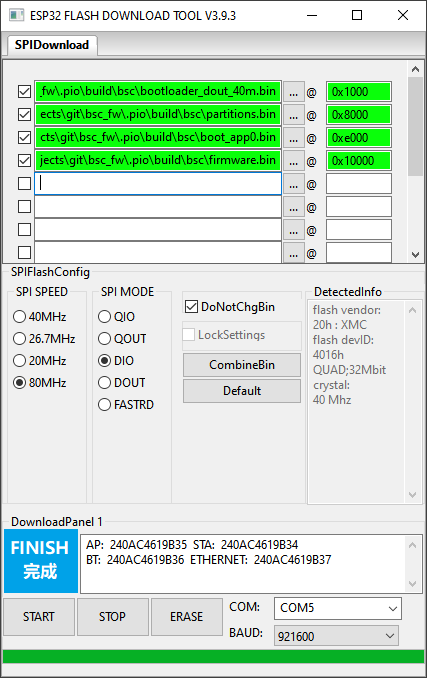

!!! info "Support"
    For problems or questions, contact the community support channels.

## Flashing Guide: LILYGO T-CONNECT {#flashanleitung-lilygo-t-connect}

For **initial setup**, the firmware must be flashed manually to the LILYGO T-CONNECT board. Standard firmware is available from [GitHub Releases](https://github.com/shining-man/bsc_fw/releases).

### Step 1: Download the Firmware {#schritt-1-firmware-herunterladen}

Download `firmware_tconnect_full_xx_xx.bin`. Here, `xx_xx` is the required language, for example `de_DE` or `en_US`.

!!! info "Important"
    Use **only** the file whose name includes `full`.

### Step 2: Prepare the Board {#schritt-2-board-vorbereiten}

Connect the T-CONNECT board to your computer via USB. To enter **download mode**:

1. Hold down **BOOT**.
2. Briefly press **RESET**.
3. Release **BOOT**.

The board is now in flashing mode.

### Step 3a: Espressif Flash Download Tool (Windows Only) {#schritt-3a-flashen-mit-dem-espressif-flash-download-tool-nur-windows}

Download the official [ESP Flash Download Tool](https://www.espressif.com/en/support/download/other-tools).

1. Start the tool and select **ESP32-S3** as the target device.

2. Enter the firmware files and configure the settings as shown.

3. Check that the correct COM port is selected, the checkboxes are checked and the rows are highlighted in green.

Click **START** to begin flashing.

### Step 3b: esptool.py (Linux and Windows) {#schritt-3b-flashen-mit-dem-esptoolpy-linux-windows}

Alternatively, flash with the Python tool `esptool.py`. Example command, including flash erasure:

```bash
esptool.py --chip esp32s3 --port /dev/ttyUSB0 --baud 921600 write_flash -e 0x0 firmware_tconnect_full_xx_xx.bin
```

!!! note "File Location"
    Make sure the `.bin` file is in the current working directory.

### Step 4: Restart the Board {#schritt-4-neustart-des-boards}

After flashing successfully, briefly press **RESET** once. The board loads the new firmware and starts normally. You can then [connect to the BSC](#verbinden-mit-dem-bsc) and configure it.

## Flashing Guide: Original BSC Supplied by LILYGO {#flashanleitung-orginal-bsc-von-lilygo}

The current PCB supplier ships boards with special firmware that must be upgraded to the current release. Download and extract `bsc_firmware.zip` from [Releases](https://github.com/shining-man/bsc_fw/releases). The extracted `firmware.bin` is the firmware to upload.

1. At first startup, this supplier firmware provides a Wi-Fi access point named `ESP-*` without a Wi-Fi passphrase. Connect to it.
2. Open `http://192.168.4.1/update`, entering the URL exactly. If a smartphone cannot open the address, disable mobile data for this procedure.
3. Upload the extracted `firmware.bin`. No other files, such as a filesystem image, are required.
4. Wait a few seconds for the device to restart.
5. If successful, an LED on the board flashes. You can now [connect to the BSC](#verbinden-mit-dem-bsc) to configure it.

## Flashing Guide: Unprogrammed Original BSC {#flashanleitung-unprogrammierter-orginal-bsc}

For initial setup of an unprogrammed board, manually flash all four files available in the [current release](https://github.com/shining-man/bsc_fw/releases).

On original BSC hardware, connect a USB-to-serial converter with **3.3 V logic levels** to the three-pin J2 header at the upper left of the board, labelled `Prog`. **A 5 V converter can damage the controller.** ESP32 development boards usually have a USB port. Subsequent updates can be installed through the web interface.

- Before flashing, disconnect power, fit jumper J4 and reconnect power to enter download mode. Remove J4 after successful flashing so the board starts normally.
- PCB version >= V2.3: J6 must **not** be fitted during flashing, but **must** be refitted afterwards.
- You can use 921600 baud. If this causes problems, reduce it to 230400 baud.
- Erase the module's existing flash memory before programming with the tools below.

### Flashing Options {#flash-moglichkeiten}

#### Manufacturer's Download Tool (Windows Only) {#nutzen-des-hersteller-download-tools-only-windows}

Download the ESP32 manufacturer's Flash Download Tools from [Espressif](https://www.espressif.com/en/support/download/other-tools). Apply the settings shown below:



Enter the firmware files on the next screen and apply the settings. Check the box next to every file and make sure each row is highlighted in green.



Click **Start** to begin uploading.

#### esptool (Linux and Windows), Including Erasure {#flashen-mit-dem-esptool-linux-windows-inkl-zuvorigen-loschen}

```bash
esptool.py --port /dev/ttyUSB0 --chip auto write_flash -e -ff 80m -fm dio 0x01000 bootloader.bin 0x08000 partitions.bin 0x0e000 boot_app0.bin 0x10000 firmware.bin
```

#### Flashing in a Browser {#flashen-uber-den-browser}

In Chrome, you can use the [Adafruit online tool](https://adafruit.github.io/Adafruit_WebSerial_ESPTool/). After connecting to the controller, flash the four release files at these addresses:

- `bootloader.bin`: `0x1000`
- `partitions.bin`: `0x8000`
- `boot_app0.bin`: `0xe000`
- `firmware.bin`: `0x10000`

### Flashing Test Versions {#test-versionen-flashen}

1. Flash the individual test `firmware.bin` through the BSC web frontend's OTA function under Settings / Update.
2. Alternatively, flash that `firmware.bin` together with the other three release files using the full procedure above.

## Connecting to the BSC {#verbinden-mit-dem-bsc}

The board must already be programmed.

- On first startup, BSC firmware provides an access point named `bsc_*`.
- Once connected, open `192.168.4.1` or `bsc.info` to configure the device.
- Username: `bsc`
- Password: `admin`