## Hardware Requirements {#hardwarevoraussetzungen}

Using every firmware feature requires the hardware belonging to the BSC system. Detailed hardware documentation, including the [circuit diagram](https://github.com/shining-man/bsc_hw/blob/main/circuit.pdf?raw=true), is in the [hardware repository](https://github.com/shining-man/bsc_hw).

We currently recommend **LILYGO T-CONNECT**. The original BSC mainboard is no longer regularly available and is no longer a recommended purchasing option. See [Obtaining Hardware](first_steps.md#beschaffung-der-hardware).

An ESP32 development kit can be used for initial testing, but some functions are restricted or untested. See [Testing Without Original Hardware](BSC_ohne_orig_hardware.md).

## LILYGO T-CONNECT {#lilygo-t-connect}

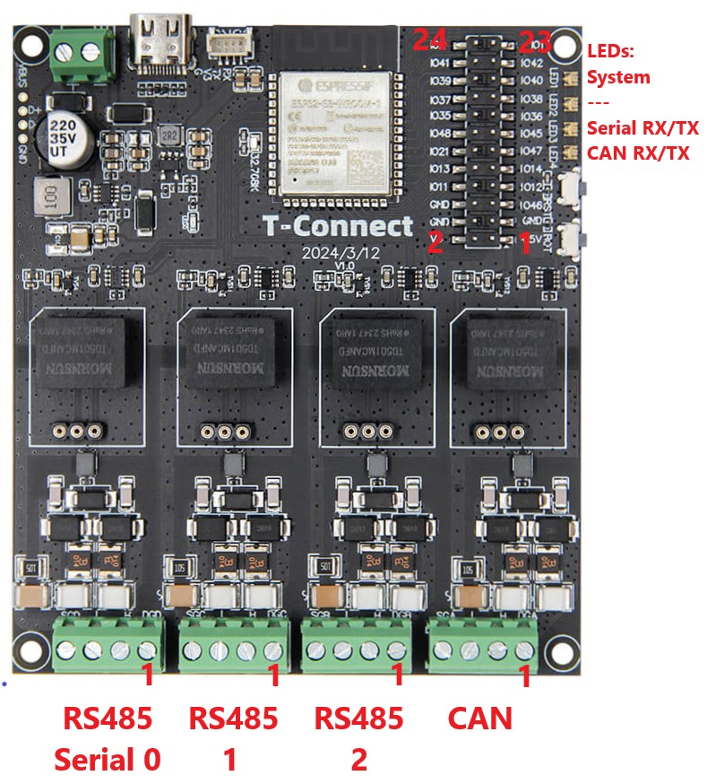{ width="550" }

#### Connector Pinout {#steckerbelegung}

| Pin | Serial 0–2 (RS485) | CAN |
| --- | --- | --- |
| 1 | --- | --- |
| 2 | B | H |
| 3 | A | L |
| 4 | GND | GND |

#### LED Functions {#funktion-der-leds}

| LED | Colour | Function |
| --- | --- | --- |
| System | Blue | System is booting |
| System | Flashing green | System is operating without errors |
| System | Flashing red | One of the system tasks is not responding |
| Serial RX/TX | Flashing red | Communication with a BMS |
| CAN RX/TX | Flashing red | Sending a CAN message |

#### Pin Header Assignment {#belegung-des-pin-headers}

=== ">= V0.10.0"
    The documented firmware provides **OneWire** and **I²C** (for example for the [display](#bsc-display)) on the pin header.

    | Pin | GPIO | Standard | W5500 | MCP2518 |
    | ---: | ---: | --- | --- | --- |
    | 1 | | 5 V | 5 V | 5 V |
    | 2 | | 3.3 V | 3.3 V | 3.3 V |
    | 3 | | GND | GND | GND |
    | 4 | | GND | GND | GND |
    | 5 | 46 | | | INT |
    | 6 | | GND | GND | GND |
    | 7 | 12 | I²C SCL | SPI SCK | |
    | 8 | 11 | I²C SDA | SPI MOSI | |
    | 9 | 14 | SE RX | | SE RX (without W5500 only) |
    | 10 | 13 | SE TX | SPI MISO | SE TX (without W5500 only) |
    | 11 | 47 | | | SPI MISO |
    | 12 | 21 | | INT | |
    | 13 | 45 | | | SPI SCK |
    | 14 | 48 | | | SPI MOSI |
    | 15 | 36 | | | |
    | 16 | 35 | | | |
    | 17 | 38 | OneWire | OneWire | OneWire |
    | 18 | 37 | | | |
    | 19 | 40 | | | |
    | 20 | 39 | | I²C SDA | |
    | 21 | 42 | | | |
    | 22 | 41 | | I²C SCL | |
    | 23 | 1 | | | CS |
    | 24 | 2 | | CS | |
    | – | 43 | | SE TX | |
    | – | 44 | | SE RX | |

=== "< V0.10.0"
    The firmware documented for this version provides **OneWire**, **relay outputs**, **digital inputs** and **I²C** (for example for the [display](#bsc-display)) on the pin header.

    | Pin | GPIO | Function |
    | --- | --- | --- |
    | 1 | | 5 V |
    | 2 | | 3.3 V |
    | 3 | | GND |
    | 4 | | GND |
    | 5 | 46 | --- |
    | 6 | | GND |
    | 7 | 12 | I²C SCL |
    | 8 | 11 | I²C SDA |
    | 9 | 14 | SE RX |
    | 10 | 13 | SE TX |
    | 11 | 47 | --- |
    | 12 | 21 | OneWire |
    | 13 | 45 | --- |
    | 14 | 48 | --- |
    | 15 | 36 | Digital input 1 |
    | 16 | 35 | Digital input 2 |
    | 17 | 38 | Digital input 3 |
    | 18 | 37 | Digital input 4 |
    | 19 | 40 | Relay 1 |
    | 20 | 39 | Relay 2 |
    | 21 | 42 | Relay 3 |
    | 22 | 41 | Relay 4 |
    | 23 | 1 | Relay 5 |
    | 24 | 2 | Relay 6 |

## BSC Display {#bsc-display}

The display and its firmware are maintained in a [separate project](https://github.com/shining-man/bsc_display).

### Supported Display {#unterstutzes-display}

We have tested display hardware version 3.3. The display is available from the <a href="https://bsc-shop.com" target="_blank">BSC Shop</a>.

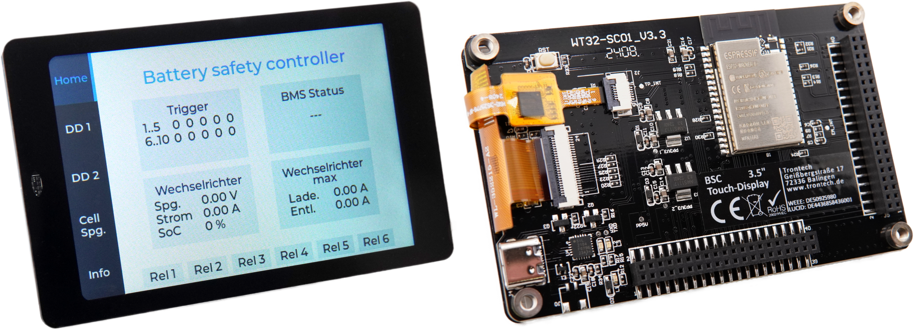{ width="1000" }

### Connecting to the BSC Mainboard {#anschluss-an-das-bsc-mainboard}

**Recommended: Mainboard-Display Connection Kit**

For tool-free assembly without soldering or wiring mistakes, we recommend the [Mainboard-Display Connection Kit](https://bsc-shop.com/produkt/mainboard-display-connection-kit/). It contains two adapter boards and a ribbon cable.

- No manual soldering.
- Tool-free plug-in assembly.
- Mechanically keyed connections help prevent wiring errors.
- Status LED for function checking.
- Compatible with every mainboard revision.

**Alternative: Manual Connection**

Connect manually through extension port **J3**: the I²C data connection uses **SCL/SDA**, and the port's **5 V** and **GND** can power the display.

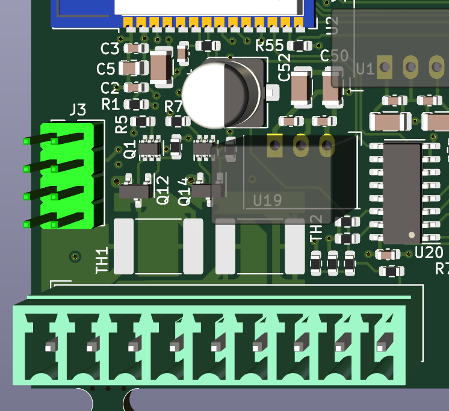{ width="400" }
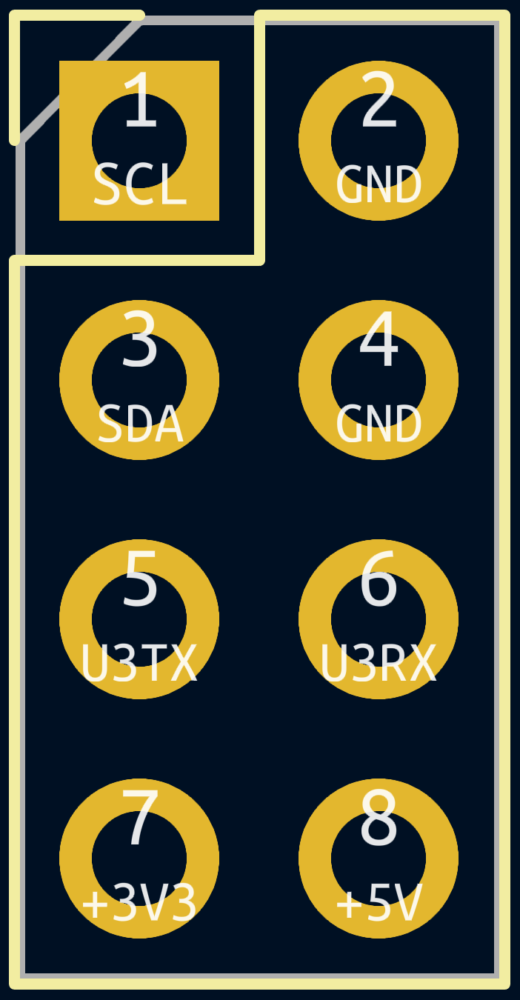{ width="200" }

### WT32-SC01 Display Pinout {#pinout-des-displays-wt32-sc01}

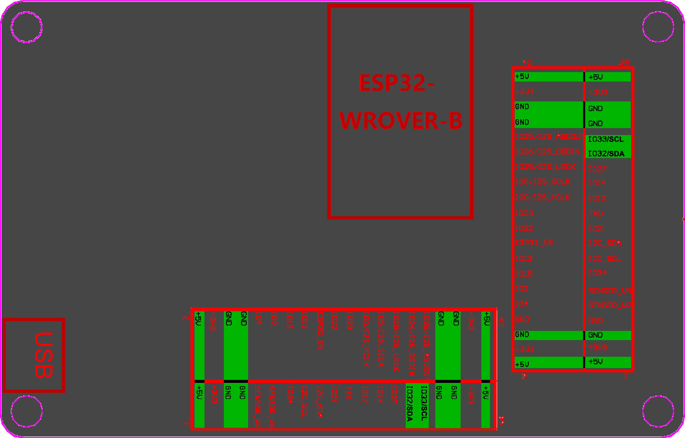{ width="700" }

## Original BSC Mainboard {#originales-bsc-mainboard}

!!! note "Availability"
    The original BSC mainboard is no longer regularly available. Use [LILYGO T-CONNECT](#lilygo-t-connect) for new installations instead.

### Handling Connections {#anschluss-handling}

A technical talk about connections is available on [YouTube](https://youtu.be/zwu_jJifkF4?si=2ktcM57JjkR39Dph).

**Connecting Screw Terminals Correctly**

1. **Pin 1 marking:** Each screw terminal has a `1` identifying its first pin. Use it as your connection reference.
2. **Function labels:** Read the function labels beside the pin-1 marking carefully before connecting wires.
3. **Safety:** Incorrect connections can damage the BSC or connected components.
4. **Illustrations:** Images in this documentation are illustrative only. Always verify the markings and labels on your own PCB.

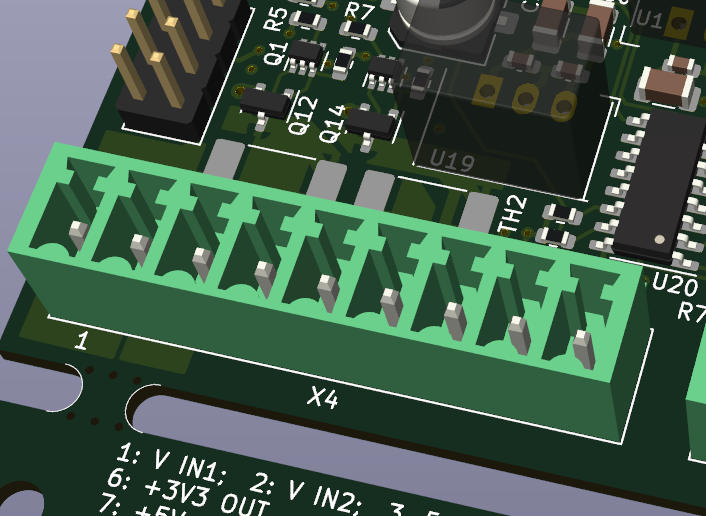{ width="300" }
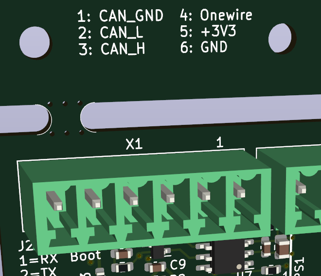{ width="300" }

### Power Supply {#stromversorgung}

The PCB labels identify **V IN1** as positive and **GND** as negative. The standard BSC hardware is designed for **5 V (>= 1.5 A)**. Meanwell DIN-rail supplies, available from the [BSC Shop](https://bsc-shop.com), have proven reliable.

Use a redundant supply so that a second supply takes over without interruption if the first fails. For example, connect a battery-powered DC/DC supply and a grid-powered AC/DC supply to the two separate inputs. Set the preferred primary source about **0.2 V higher**; the supply with the higher voltage powers the BSC.

**Increasing the Supply Voltage**

Supply voltages above 5 V, such as 12 V or 24 V, are possible under these conditions. PCB reference designators changed between revisions; the pairs below mean **HwRev < 2.5 / HwRev >= 2.5**.

- **JP28 / R61 (BSC component supply):** Normally bridged; open this connection for supply voltages above 5 V. It is labelled on the PCB underside, beside U19's solder connections.
- **JP29 / R91 and JP25 (relay supply):** No changes are needed for 5 V relays. If JP25 connects relay COM contacts to the supply, use **no more than 24 V**. To power higher-voltage relays above 5 V without loading U19:
    - HwRev < 2.5: open connection 2–1 and solder-bridge 3–2. **On BSC V2.3, JP29 is mislabelled: pin 1 is on the right, although the print places it on the left.**
    - HwRev >= 2.5: remove R91 and close solder jumper JP25.
- Above **19 V**, reversed polarity can damage components. Check polarity explicitly.
- For a supply above 5 V, fit a **DC/DC converter at U19**. The [BSC Shop](https://bsc-shop.com) offers modules for input voltages up to **34 V**, and separate 5 V supplies for redundancy or higher voltages. The square U19 pad is the converter's **5 V output**: observe polarity. If using 5 V relays, use a converter rated **>= 1 A**, since U19 also powers them.

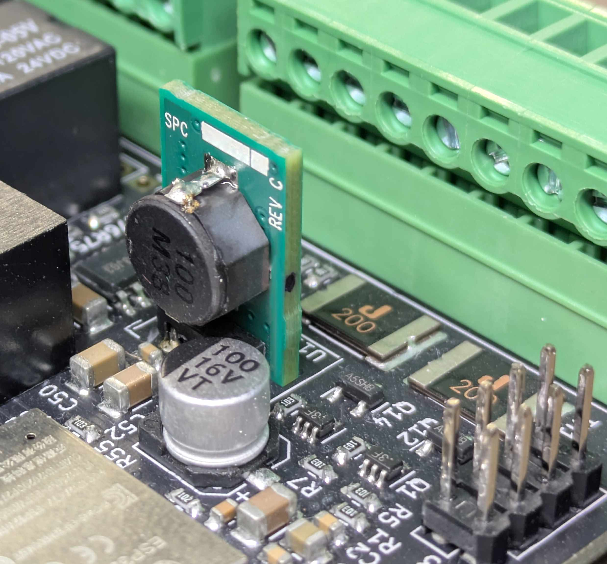{ width="400" }

### CAN/RS485 {#canrs485}

All interfaces are galvanically isolated and can connect directly, without adapters, to an RS485 BMS (Serial 0–10) or CAN inverter. Their voltage levels are standardised.

### RS485 (BMS) {#rs485-bms}

Some common BMS types connect directly through RJ45. Multiple devices may be connected by daisy chain where supported, or with the RJ45 Serial Distributor from the [BSC Shop](https://bsc-shop.com).

### OneWire {#onewire}

Temperature sensors can connect without additional hardware. The required pull-up resistors are already on the BSC PCB.

### Thermal Management {#temperaturmanagement}

The top of the BSC PCB needs gentle airflow for cooling. Do not unnecessarily enclose or cover the board; provide continuous ventilation.

### Digital Inputs {#digitale-eingange}

#### Technical Specification {#technische-spezifikation}

- 4 inputs, **3–27 V DC**.
- Galvanic isolation via optocouplers.
- Positive trigger edge (low to high); configurable software inversion.

#### Electrical Properties {#elektrische-eigenschaften}

Each input is isolated from the rest of the circuit. All four inputs share their own GND reference, exposed on the connector for an external supply or signal source. A separate 5 V connection is available for each input; these outputs share that GND and can directly supply push-buttons.

#### Software Inversion {#software-invertierung}

Inverting the positive trigger edge makes a high-to-low transition trigger the input. This is useful for inverse logic or normally closed contacts.

#### Typical Applications {#typische-anwendungen}

- **Push-button:** Connect 5 V to the button and its output to DI. Pressing it applies 5 V and triggers the input.
- **Relay contact:** Connect 5 V to one side of the contact and the other to DI. Closing the contact triggers it.
- **External voltage, e.g. 24 V DC:** Connect external GND to the GND pin and the signal directly to DI (**3–27 V DC**).

### Relay Outputs {#relais-schaltausgange}

#### Overview {#ubersicht}

Six electromechanical outputs (Rel1–Rel6) provide external switching, controlled by configurable trigger events and timing options.

#### Hardware Specification {#hardware-spezifikation}

##### Maximum Switching Ratings {#maximale-schaltwerte}

- DC: **24 V / 3 A**
- AC: **120 V / 3 A**

##### Available Contacts {#verfugbare-kontakte}

Relays **1–3** expose **NO** (normally open), **NC** (normally closed) and **COM** (common). Relays **4–6** expose only **NO** and **COM**; their NC contacts are not brought out because of connector pin limitations.

#### Software Configuration {#software-konfiguration}

Configure each relay individually and assign one or more trigger events.

##### Configurable Parameters {#konfigurierbare-parameter}

- **Pulse duration [ms]:** Time the relay stays switched after an event, adjustable from **100–10000 ms**. To keep it switched until the event ends, select **Permanent**, not **Pulse**.
- **Delay after trigger event [s]:** Delay between the event and switching, for sequential or staggered actions.
- **Inversion:** Reverses the switching logic: a trigger switches the relay off rather than on, or vice versa.

##### Trigger Events {#trigger-events}

Several configured events can be assigned to a relay at once. The relay activates if **at least one** assigned event occurs.

#### Application Examples {#anwendungsbeispiele}

**Load Shedding in Critical Battery Conditions**

- Trigger: plausibility check (BMS data outside valid ranges).
- Delay: **0 s**; pulse: **200 ms**; inversion: **yes**.
- Use external DC contactors with a control input for high battery-pack currents, driven by the relay.

**Periodic Fan Control**

- Trigger: temperature threshold.
- Delay: **0 s**; pulse: **10000 ms** (maximum); inversion: **no**.
- For longer run-on times (e.g. 1 minute), use **Permanent** instead: the relay then stays switched until the trigger ends. Alternatively, implement the desired run-on behaviour with the alarm rule's temperature hysteresis.

**Delayed Alarm Output**

- Trigger: critical battery event.
- Delay: **10 s**; pulse: **500 ms**; inversion: **no**.
- In a critical event, first reduce inverter current demand through commands before triggering a hard disconnection using a contactor. This reduces hardware stress during faults.

#### Usage Notes {#hinweise-zur-verwendung}

- PCB layout limits switching capacity. Use external contactors or solid-state relays for higher voltage or power.
- For inductive loads (motors, coils), use flyback diodes or snubbers.
- The NC contacts on relays 1–3 permit fail-safe arrangements for safety-critical applications.
- Pulse duration runs independently of the trigger event's duration.

### Opening Solder Jumpers {#wie-trennt-man-lotjumper}

Some factory-closed solder jumpers must be opened mechanically. A rotary tool can remove only the surface copper. **Do not damage the internal copper layers.**

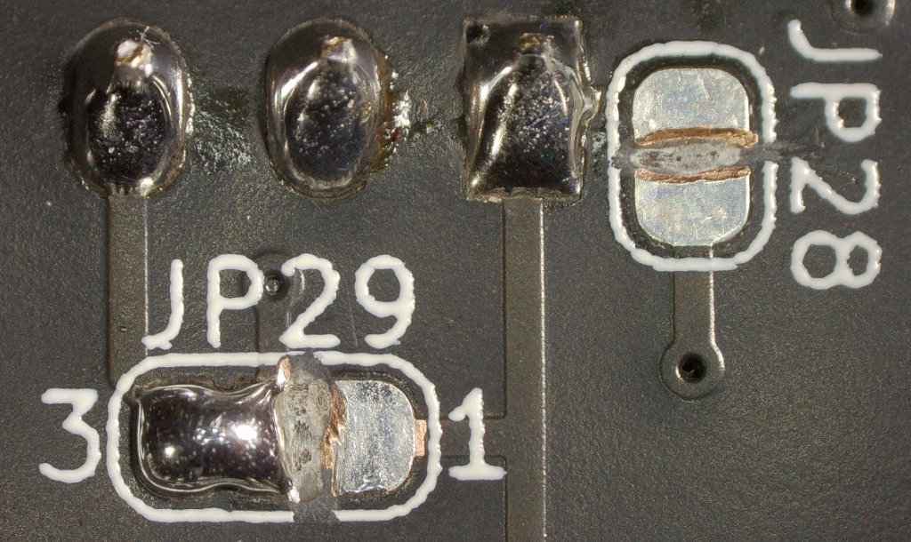{ width="600" }

### Jumper Configuration {#jumper-konfiguration}

#### J6 for Normal Operation {#j6-fur-den-regularen-betrieb}

Open J6 to program an unprogrammed board. **Fit it for normal operation.**

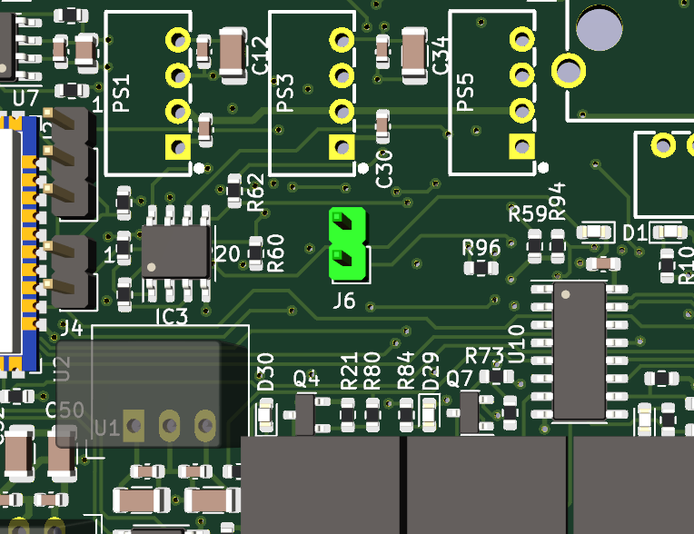{ width="400" }

#### J4 for Programming {#j4-zur-programmierung}

Fit J4 to program an unprogrammed board. **Leave it open for normal operation.**

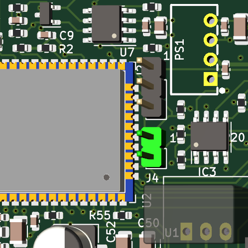{ width="400" }

#### Connecting Relay COM Contacts to Vin {#mittelabgriffe-der-relais-mit-vin-verbinden}

Fit the corresponding jumpers to connect the relay common contacts to the board's Vin.

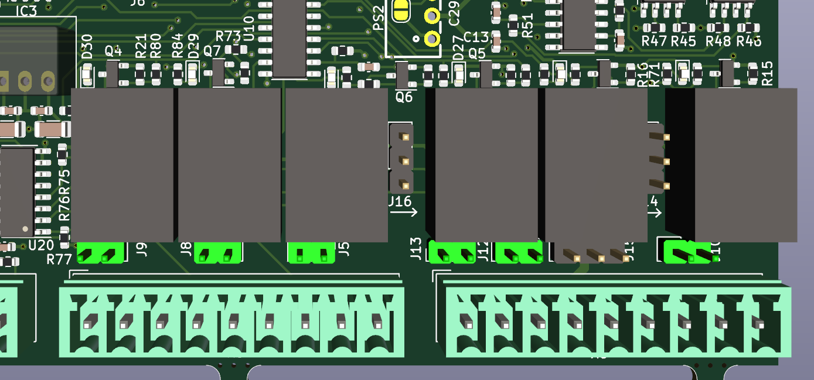{ width="600" }

#### J14–J16: Enabling Outputs {#j14-j16-aktivieren-der-ausgange}

These relays have additional functions not currently supported by firmware. Set the jumpers to the positions marked blue.

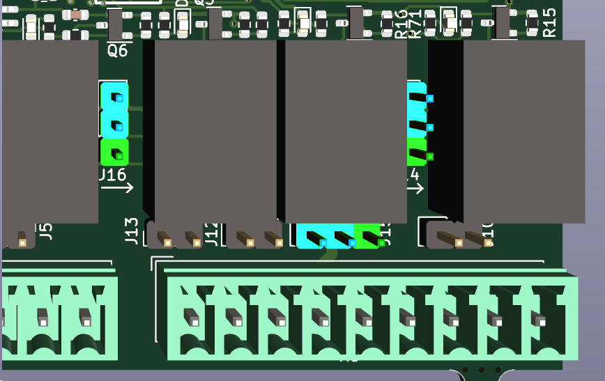{ width="600" }