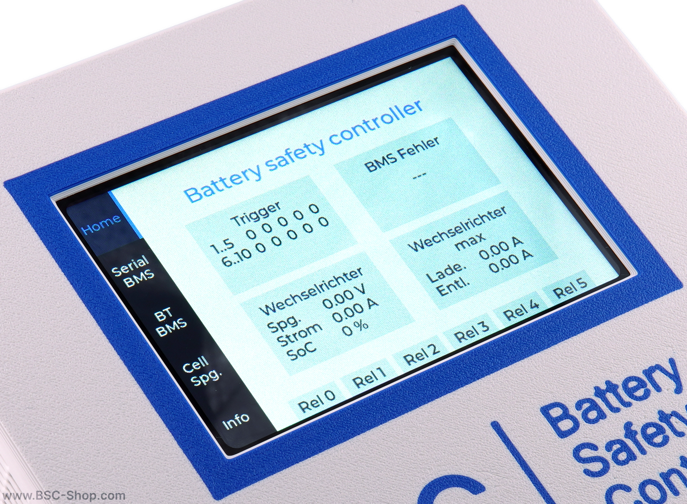
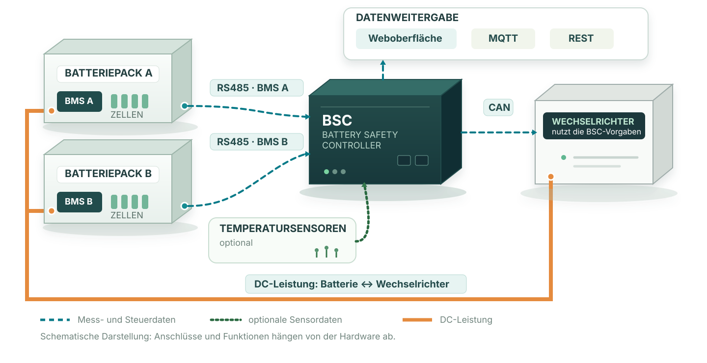

# Battery Safety Controller (BSC)
{ width="600" }

A **battery management system (BMS)** monitors the battery cells and provides their protection functions. The **Battery Safety Controller (BSC)** complements the BMS by connecting supported BMS units and sensors to a compatible inverter.

The BSC consists of suitable hardware and the BSC software running on it. Available connections and functions depend on the hardware used.

!!! important "The BSC does not replace a BMS"
    The BSC reads BMS data but does not write settings to the BMS. The BMS protection functions remain independent. The BSC configuration must still match the battery and inverter; do not use example values without checking them.

## What Does the BSC Do? {#was-macht-der-bsc}

In a supported system, the BSC sits between the battery management systems (BMS units) and the inverter. It receives information about the battery packs, processes it according to the configured rules, and sends appropriate limits to the inverter. Depending on the hardware, additional sensors and outputs can also be connected. The diagram shows two separate paths: measurements and control signals pass through the BSC, while current flows between the battery and inverter along the power path.

{ width="100%" }

- **Display measurements:** The BSC reads the values supported by each BMS, such as cell voltages, temperatures and state of charge. You can view them in the web interface or forward them to other programs.
- **Limit charging and discharging:** Configured rules can, for example, reduce the maximum charging current when a cell voltage is high. The BSC sends the limit to a compatible inverter.
- **Monitor other devices:** With suitable hardware, you can connect temperature sensors and digital inputs or outputs, among other devices.

## Comparison: With and Without a BSC {#vergleich-mit-und-ohne-bsc}

A direct connection may be sufficient if the BMS and inverter are compatible and provide all the functions you need. The BSC adds a central point for reading and processing supported battery data. This requires additional hardware and configuration.

| Task | Without a BSC | With a BSC |
| --- | --- | --- |
| Connect BMS and inverter | Both devices must be able to communicate directly | The BSC connects supported BMS units to compatible inverters |
| Use measurements from multiple batteries | Capabilities depend on the BMS and inverter | The BSC can combine selected values such as voltage, current and state of charge (SoC) from multiple supported BMS units. Currents can be added, for example; the combined SoC can be weighted by battery capacity. Available options depend on firmware and configuration. |
| Monitor and forward battery data | Depends on the devices' capabilities | Display in the web interface; forwarding via MQTT or REST, for example to Home Assistant |
| Control charging and discharging | Depends on the devices' capabilities | During charging, the BSC can limit current based on cell voltage, cell voltage difference, SoC or temperature, for example. Maximum currents can also be set for each battery pack; the BSC sends the limit to the inverter. |

## Frequently Asked Questions {#haufige-fragen}

### Can I Combine Battery Packs of Different Capacities and BMS Brands? {#kann-ich-batteriepakete-unterschiedlicher-kapazitat-und-mit-bms-verschiedener-hersteller-kombinieren}

The BSC can combine selected measurements from several battery packs, provided each BMS is supported. For a common electrical connection, cell chemistry, cell count and battery voltage must be technically compatible. Permissible charging and discharging currents can differ between packs and must be configured correctly. If capacities have been entered and capacity-weighted calculation is enabled, a larger pack contributes more to the combined state of charge (SoC). The BSC does not check whether the electrical connection is suitable and does not replace any BMS protection function.

## Example: Two Battery Packs During Charging {#beispiel-zwei-batteriepakete-beim-laden}

Pack A has a higher capacity than pack B. Both packs have a supported BMS. During charging, the cell voltage rule considers the highest reported cell voltages of both packs. If a cell in pack B reaches the configured threshold first, the BSC reduces the permitted charging current for the storage system and sends the lower limit to the inverter. The inverter then reduces the charging current. If capacity-weighted SoC calculation is also enabled, pack A has a greater influence on the combined state of charge because of its higher capacity.

Before buying hardware, check whether your **BMS** and, where applicable, your **inverter** are supported. Available functions vary by hardware: the currently recommended LILYGO T-CONNECT has no built-in relays or digital inputs, for example; the free firmware does not support a display on that board.

## Getting Started {#erste-schritte}

A separate step-by-step guide takes you from checking supported devices and choosing hardware to connecting and configuring the BMS: [Getting Started and Commissioning](first_steps.md).

Further information: [System Overview](system_overview.md) · [Hardware](hardware.md) · [Example Configurations](beispiel_konfigurationen.md)
