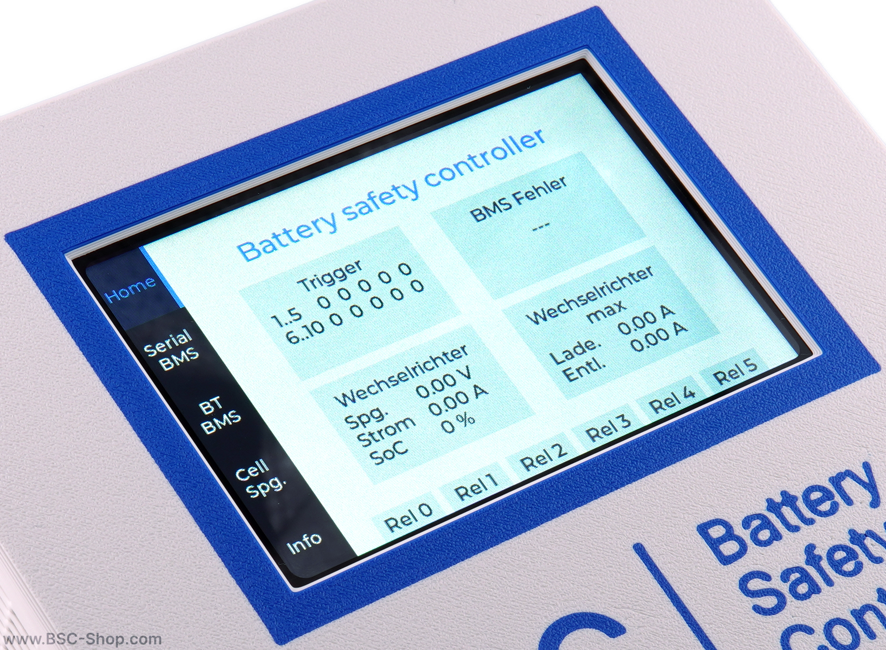
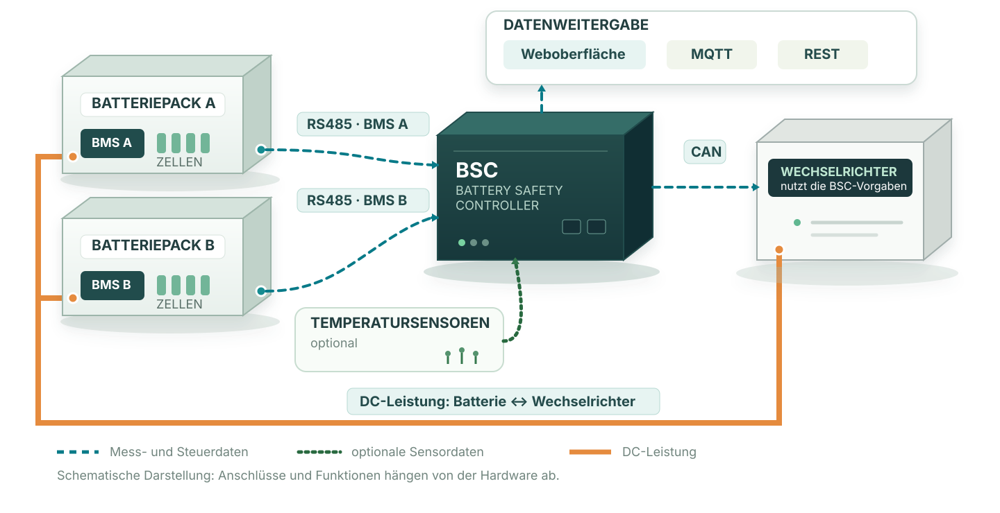

# Battery Safety Controller (BSC)

Ein **Batterie-Management-System (BMS)** überwacht die Batteriezellen und übernimmt deren Schutzfunktionen. Der **Battery Safety Controller (BSC)** ergänzt das BMS, indem er unterstützte BMS und Sensoren mit einem kompatiblen Wechselrichter verbindet.

Der BSC besteht aus passender Hardware und der darauf laufenden BSC-Software. Welche Anschlüsse und Funktionen verfügbar sind, hängt von der verwendeten Hardware ab.

!!! important "Der BSC ersetzt kein BMS"
	Der BSC liest Daten aus dem BMS, schreibt aber keine Einstellungen dorthin. Die Schutzfunktionen des BMS bleiben davon unabhängig. Die Konfiguration des BSC muss trotzdem zu Batterie und Wechselrichter passen; Beispielwerte sollten nicht ungeprüft übernommen werden.

## Was macht der BSC?

Der BSC sitzt bei einem unterstützten System zwischen den Batterie-Management-Systemen (BMS) und dem Wechselrichter. Er erhält Informationen über den Zustand der Batteriepakete, verarbeitet diese nach den eingerichteten Regeln und gibt passende Vorgaben an den Wechselrichter weiter. Zusätzliche Sensoren und Ausgänge können je nach Hardware ebenfalls eingebunden werden. Die Grafik zeigt dabei zwei getrennte Wege: Messwerte und Steuersignale laufen über den BSC, während der Strom zwischen Batterie und Wechselrichter über den Leistungspfad fließt.

{ width="100%" }

- **Messwerte anzeigen:** Der BSC liest die vom jeweiligen BMS unterstützten Werte aus, zum Beispiel Zellspannungen, Temperaturen und Ladezustand. Du kannst sie in der Weboberfläche ansehen oder an andere Programme weitergeben.
- **Ladung und Entladung begrenzen:** Eingerichtete Regeln können zum Beispiel bei hoher Zellspannung den maximalen Ladestrom reduzieren. Den Grenzwert übermittelt der BSC an einen kompatiblen Wechselrichter.
- **Weitere Geräte überwachen:** Mit geeigneter Hardware lassen sich unter anderem Temperatursensoren und digitale Ein- oder Ausgänge einbinden.

## Vergleich: mit und ohne BSC

Eine direkte Verbindung kann ausreichen, wenn BMS und Wechselrichter miteinander kompatibel sind und ihre Funktionen genügen. Der BSC ergänzt diese Geräte um eine zentrale Stelle zum Auslesen und Verarbeiten unterstützter Batteriedaten. Dafür werden zusätzliche Hardware und Konfiguration benötigt.

| Aufgabe | Ohne BSC | Mit BSC |
| --- | --- | --- |
| BMS und Wechselrichter verbinden | Beide Geräte müssen direkt miteinander kommunizieren können | Der BSC verbindet unterstützte BMS mit kompatiblen Wechselrichtern |
| Messwerte mehrerer Batterien nutzen | Möglichkeiten hängen von BMS und Wechselrichter ab | Der BSC kann ausgewählte Werte wie Spannung, Strom und Ladezustand (SoC) mehrerer unterstützter BMS zusammenführen. Stromwerte lassen sich zum Beispiel summieren; der gemeinsame SoC kann nach Batteriekapazität gewichtet werden. Welche Optionen verfügbar sind, hängt von Firmware und Konfiguration ab. |
| Batteriedaten überwachen und weitergeben | Hängt von den Funktionen der Geräte ab | Anzeige in der Weboberfläche; Weitergabe über MQTT oder REST, zum Beispiel an Home Assistant |
| Regeln für Laden und Entladen | Hängt von den Funktionen der Geräte ab | Beim Laden kann der BSC den Strom z. B. anhand von Zellspannung, Zellabweichung, Ladezustand oder Temperatur begrenzen. Zusätzlich lassen sich Höchstströme pro Batteriepaket einstellen; den Grenzwert übermittelt der BSC an den Wechselrichter. |

## Häufige Fragen

### Kann ich Batteriepakete unterschiedlicher Kapazität und mit BMS verschiedener Hersteller kombinieren?

Der BSC kann ausgewählte Messwerte mehrerer Batteriepakete zusammenführen, sofern jedes BMS unterstützt wird. Für eine gemeinsame elektrische Verschaltung müssen Zellchemie, Zellzahl und Batteriespannung technisch kompatibel sein. Die maximal zulässigen Lade- und Entladeströme können je Paket unterschiedlich sein und müssen korrekt eingestellt werden. Sind die Kapazitäten eingetragen und ist die kapazitätsgewichtete Berechnung aktiviert, fließt ein größeres Pack stärker in den gemeinsamen Ladezustand (SoC) ein. Der BSC prüft nicht, ob die elektrische Verschaltung geeignet ist, und ersetzt keine Schutzfunktion des BMS.

## Beispiel: Zwei Batteriepakete beim Laden

Pack A hat eine größere Kapazität als Pack B. Beide Packs haben ein vom BSC unterstütztes BMS. Beim Laden berücksichtigt die Zellspannungsregel die höchsten gemeldeten Zellspannungen beider Packs. Erreicht eine Zelle in Pack B zuerst die konfigurierte Schwelle, reduziert der BSC den erlaubten Ladestrom für den Speicher und übermittelt den niedrigeren Grenzwert an den Wechselrichter. Dieser reduziert daraufhin den Ladestrom. Ist zusätzlich die kapazitätsgewichtete SoC-Berechnung aktiviert, fließt Pack A wegen seiner größeren Kapazität stärker in den gemeinsamen Ladezustand ein.

Vor dem Kauf solltest du prüfen, ob dein **BMS** und gegebenenfalls dein **Wechselrichter** unterstützt werden. Die verfügbaren Funktionen unterscheiden sich je nach Hardware: Das aktuell empfohlene LILYGO T-CONNECT hat zum Beispiel keine integrierten Relais oder Digitaleingänge; die freie Firmware unterstützt dort kein Display.

## Erste Schritte

Für die Einrichtung gibt es eine eigene Schritt-für-Schritt-Anleitung. Sie führt von der Prüfung der unterstützten Geräte über die Hardwareauswahl bis zum Anschließen und Konfigurieren des BMS: [Erste Schritte und Inbetriebnahme](first_steps.md).

Weitere Informationen: [Systemübersicht](system_overview.md) · [Hardware](hardware.md) · [Beispielkonfigurationen](beispiel_konfigurationen.md)
