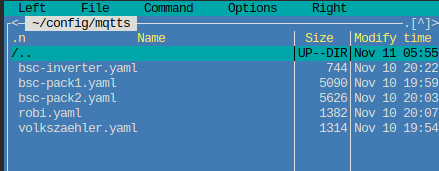
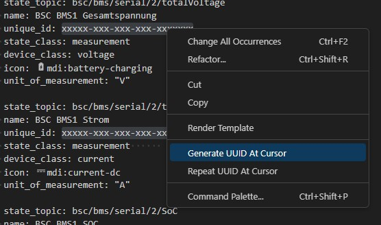
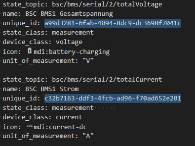

## Virtual Triggers {#virtual-trigger}

Each of the **27** internal triggers has a corresponding externally controllable **vTrigger**, set through MQTT or the [REST API](restapi.md#5-vtrigger-post). Each vTrigger contributes its Boolean state (**0/1**) to the matching internal trigger.

### State Persistence {#zustands-speicherung}

Two ways preserve state across a reboot:

1. Publish MQTT trigger commands with **retain**. When the BSC reconnects, the broker restores the last published state.
2. Mark individual vTriggers persistent in the BSC's [System / MQTT settings](settings_bsc.md#mqtt).

### MQTT Example {#mqtt-beispiel}

vTriggers are not initially visible in tools such as MQTT Explorer; they appear after being set externally.

#### MQTT Address {#adresse-der-vtrigger-in-mqtt}

```text
{Device Name}/input/vtrigger/{Trigger Number}
```

**Device Name** is **MQTT Device Name** from System settings. **Trigger Number** is **1–27**.

#### Payload {#zu-sendende-payload}

**0** = trigger low; **1** = trigger high.

## Home Assistant Auto-Discovery {#home-assistant-auto-discovery}

Built-in auto-discovery creates Home Assistant entities for known values at the press of a button, avoiding manual YAML maintenance.

```bsc-settings
version: v010
file: mqtt.json
profile: off
label: Home Assistant
```

- **Home Assistant Discovery Prefix:** Discovery topic prefix, default `homeassistant`.
- **Send HA Discovery:** Publishes discovery messages.

!!! note "Manual Setup Remains Available"
    The YAML method below remains useful for special cases and customisations. Built-in discovery is recommended for standard integration.

## MQTT Filters {#mqtt-filter}

Select what is published to reduce unnecessary traffic and keep topics manageable.

### Data Devices {#data-devices}

```bsc-settings
version: v010
file: mqtt.json
profile: off
label: Data Devices
```

- **Send Data Devices:** Enabled by default.
- **Data Devices selection:** Devices to publish.
- **Data classes:** All **7** enabled by default: total voltage/current, SoC and FET state; cell voltages; other cell data; balancing data/status; errors/warnings; temperatures; capacity/energy/statistics.

The `valid` and `maintenance` topics are **always published**, regardless of class selection.

### Group Devices {#group-devices}

```bsc-settings
version: v010
file: mqtt.json
profile: off
label: Group Devices
```

Same structure: enable publishing, select groups and data classes. Relevant only when [group devices](settings_bsc_group-devices.md#group-devices-batterie-gruppen) are enabled.

### Other Data {#weitere-daten}

```bsc-settings
version: v010
file: mqtt.json
profile: off
label: Weitere Daten
```

**OneWire**, **Inverter**, **Trigger** and **System** are enabled by default. System includes free heap and task states. **Cell voltage drop (Debug)** publishes diagnostics from cell-voltage-during-charging monitoring and is **off by default**.

## MQTT with Home Assistant {#mqtt-in-verbindung-mit-home-assistant}

### Integration {#integration}

For maintainable `configuration.yaml`, use separate MQTT configuration files, for example one per device.

!!! note "Usually Unnecessary with Discovery"
    Built-in [auto-discovery](#home-assistant-auto-discovery) normally replaces manual configuration.

Add to Home Assistant's `config/configuration.yaml`:

```yaml
mqtt:
  - sensor: !include_dir_merge_list mqtts/
```

Create the `mqtts` directory manually and put the individual `.yaml` files there. Home Assistant reads them at startup.



#### Example Configurations {#beispielkonfigurationen}

Examples cover internal BSC values, BMS, inverter and NEEY balancer.

##### Adapting the Files {#konfiguration-anpassen}

Rename downloaded `.txt` files to `.yaml` for use with Home Assistant.

###### Data Devices {#datadevices}

Replace `{DataDeviceName}` with the configured plain-text name from BSC data-device mapping.

###### Unique IDs {#uniqueid}

Assign a unique ID to each sensor. You can generate UUID version 1 at <https://www.uuidgenerator.net/version1>. Alternatively, use Home Assistant's Visual Studio Code Server add-on, or VS Code with **UUID Generator by netcorext**:

- Select placeholder `xxxxx-xxx-xxx-xxx-xxxxx`.
- Right-click **Change All Occurrences**.



- Right-click **Generate UUID at Cursor**, then save.




##### Files {#dateien}

- [BSC Internal](files/mqtt_internal.txt)
- [BSC Inverter](files/mqtt_inverter.txt)
- [BSC BMS Data Device](files/bsc_bms_datadevice.txt)
- [BSC NEEY1 BLE](files/mqtt_neey1_ble.txt)

#### Moving Existing MQTT Configuration {#vorhandene-mqtt-konfiguration-in-neuem-verzeichnis-integrieren}

Move an existing dedicated `mqtt.yaml` from the configuration root into `mqtts`. Remove its top-level `sensor:` key and shift the remaining definitions one indentation level left.

```yaml
- state_topic: bsc/inverter/chargeCurrentSoll
  name: DC charging current setpoint
  unique_id: xxxxx-xxx-xxx-xxx-xxxxxxx
  state_class: measurement
  device_class: current
  icon: mdi:current-dc
  unit_of_measurement: "A"
  device:
    identifiers: ["BSC-Inverter"]
    manufacturer: "BSC"
    model: "BSC"
    name: "BSC-Inverter"

- state_topic: bsc/inverter/dischargeCurrentSoll
  name: DC discharging current setpoint
  unique_id: xxxxx-xxx-xxx-xxx-xxxxxxx
  state_class: measurement
  device_class: current
  icon: mdi:current-dc
  unit_of_measurement: "A"
  device:
    identifiers: ["BSC-Inverter"]
    manufacturer: "BSC"
    model: "BSC"
    name: "BSC-Inverter"
```

#### Creating a vTrigger Switch {#generieren-eines-vtrigger-schalters}

Add this example to Home Assistant's `configuration.yaml`, adapting it to your system. It controls **vTrigger 1**:

```yaml
mqtt:
  - switch:
      unique_id: xxxxx-xxx-xxx-xxx-xxxxxxx
      name: "BSC Autobalance"
      state_topic: "bsc/trigger/1"
      command_topic: "bsc/input/vtrigger/1"
      payload_on: "1"
      payload_off: "0"
      state_on: "1"
      state_off: "0"
      qos: 0
      retain: false
      optimistic: false
```

The switch displays **internal trigger 1** state. To display the **vTrigger** state instead, replace `trigger` with `vtrigger` in `state_topic`.

#### Useful Tools {#nutzliche-tools}

[Automatic BSC MQTT discovery for Home Assistant](https://github.com/dominikfe/ha_bsc_discovery_automation).