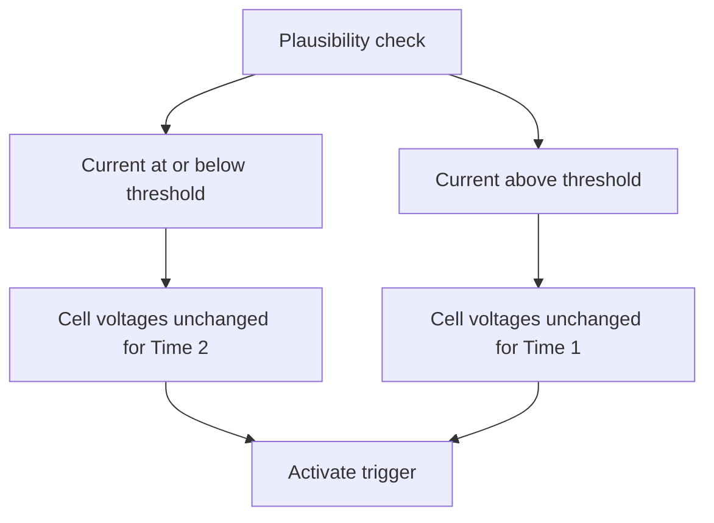

# Alarm Rules {#alarmregeln}

Select which values from which devices are monitored.

## BMS {#bms}

Ten BMS alarm rules monitor configured data devices and activate triggers when thresholds are reached.

```bsc-settings
version: v010
file: alarmBms.json
profile: off
groups: 1
index: 1
```

- **Monitored data device:** Device to which the rule applies.
- **No BMS data:** Select a trigger (**1–27**) and a timeout in seconds without incoming data.
- **Cell min/max monitoring:** Select a trigger (**1–27**), monitored cell count, minimum voltage (default **2500 mV**), maximum voltage (default **3650 mV**) and hysteresis in mV. A fault activates below minimum or above maximum. Example: maximum **3.65 V**, hysteresis **50 mV** → reset below **3.60 V**.
- **Total min/max voltage:** Select a trigger (**1–27**), minimum (default **48.00 V**), maximum (default **54.00 V**) and hysteresis in V. Voltage must move back by the configured hysteresis before a fault clears.

## Plausibility Check {#plausibility-check}

### Plausibility Check {#plausibility-check_1}

!!! note "Firmware Availability"
    Not available in every firmware version.

Continuously checks pack current and cell voltages. Cell voltages that stop changing for an extended time can indicate a BMS is no longer sending valid data. Different checking times apply above and below a current threshold, allowing early warning without excessive low-load alarms.



```bsc-settings
version: v010
file: plausibilityCheck.json
profile: off
section: UI_SECT_PLAUSIBILITYCHECK_PLAUSIBILITY_CHECK
```

- **Cellvoltage plausibility check:** Trigger activated when checking detects a fault. Configure its consumers to produce warnings or protective actions.
- **Monitored devices:** Data devices whose voltages are checked.
- **Current threshold [A]:** Boundary between checking times, default **200 A**.
- **Time 1 [s]:** Used **above** the threshold, default **30 s**.
- **Time 2 [s]:** Used **at or below** the threshold, default **240 s**; usually longer to avoid low-load false alarms.

### Value Comparison {#wertevergleich}

!!! note "Firmware Availability"
    Not available in every firmware version.

Ten comparison rules activate an assigned trigger when selected devices' values diverge too far.

```bsc-settings
version: v010
file: plausibilityCheck.json
profile: off
groups: 1
section: UI_SECT_PLAUSIBILITYCHECK_WERTEVERGLEICH
```

- **Trigger:** **1–27**.
- **Compare:** Data devices to compare.
- **Values:** Total voltage, cell voltage or battery current. Current monitoring also checks that no more than **100 mA** flows in the charging direction with the charge FET open; the discharge FET is checked analogously in the opposite direction. The tolerance accounts for measurement inaccuracy.
- **Maximum deviation:** Total voltage default **50 mV**, cell voltage **5 mV**, battery current **5 A**.
- **Delay [s]:** Required persistence, default **5 s**, to ignore brief fluctuations.

Examples: check even current sharing across data devices, or compare cell voltages reported by a BMS and balancer in the same pack. **This function does not check whether devices are online**; monitor availability separately.

### Cell Voltage During Charging {#zellspannung-bei-ladestrom}

The plausibility principle is: **during charging, cell voltage should not fall**. A repeatable drop with sufficient charging current may indicate a weak cell, loose/corroded connection or measurement contact, or unusual BMS measurements. This checks **voltage direction relative to charging current**, not fixed voltage limits; see [Min/Max Comparison](#abgrenzung-zu-den-minmax-alarmen).

```bsc-settings
version: v010
file: plausibilityCheck.json
profile: off
section: 2
```

#### Detection Logic {#so-funktioniert-die-erkennung}

**Charging window:** Evaluate only while charging at **at least 5 A**. A window must remain valid for **30 seconds** before a confirmed drop can alarm, ignoring startup transients. Below 5 A or during discharging, discard the window; a new charge starts with fresh references.

**Per-cell reference:** Build a reference from the **median of 5 consecutive measurements**. If voltage rises, increase the reference only after **5 readings above the previous reference**, again using their median. **Never lower the reference** in response to a falling value.

**Confirming a drop:** A value **more than 5 mV below reference** is a candidate. Require **3 consecutive measurements** and a window at least **30 s** old. Values within 5 mV or above reference reset the confirmation counter.

**Trigger and message:** A confirmed drop sets the selected trigger each second. Example: `D0 C3, 3302/3310 mV` identifies device 0, cell 3, current **3302 mV**, reference **3310 mV**. If multiple cells drop, retain the worst drop per device. The trigger remains active while at least one monitored device has a confirmed drop.

**Automatic reset:** Without latching, clear the fault after all cells stay within **5 mV** of reference for **60 seconds**. Also clear it if charging current stays below **5 A for more than 60 seconds**. This reset delay prevents chatter.

**Hold until manual reset:** With latching enabled, recovery or the end of charging does not clear the fault. Reset it in the web app under **Expert Actions / Manual Actions / Reset cell voltage drop / Reset**. The next charge then builds fresh references. Disabling monitoring always resets the trigger.

#### Requirements {#voraussetzungen}

Only **data devices**, not groups, are supported. Evaluation requires monitoring enabled, a trigger selected, the device selected, recognition as a **BMS** (not balancer/shunt), no maintenance mode, a valid **1–24-cell** count with at least one cell voltage, and charging current **>= 5 A**.

#### Parameters {#parameter}

- **On/Off:** Default **off**.
- **Monitored devices:** Default **none**.
- **Trigger:** **1–27**, default **off**. A selection is required for operation.
- **Hold until manual reset:** Default **off**.

Detection constants are fixed: **5 A**, **30 s**, **5 mV**, **3 confirmations**, **60 s reset time**.

#### Example Sequence {#beispielablauf}

!!! example "Internal Default Thresholds"
    1. At **10:00**, charging starts at **20 A** and opens the window.
    2. Cell 3 reports **3300, 3301, 3300, 3302, 3301 mV**; median/reference = **3301 mV**.
    3. Five later readings above reference raise its median to **3310 mV**.
    4. At **10:05**, readings **3304**, **3303**, **3302 mV** are 6, 7 and 8 mV below reference. The third confirms the drop; message: `D0 C3, 3302/3310 mV`.
    5. The cell recovers to **3305 mV or higher**. After **60 s** without a qualifying drop, the fault resets, unless manual-reset latching is enabled.

#### Difference from Min/Max Alarms {#abgrenzung-zu-den-minmax-alarmen}

[BMS min/max rules](#bms) use absolute thresholds such as **2500/3650 mV**, regardless of charging. This rule compares with the cell's **own charging reference**, catching small millivolt drops well above the minimum threshold, but only while charging at least **5 A**.

#### Interpreting a Fault {#hinweise-zur-bewertung}

A drop is **not proof** of a defective cell. Check whether it repeatedly affects the same cell, whether connectors and sense wires are sound, and whether the BMS reports warnings. Repeated faults warrant closer examination of that cell and its wiring. MQTT diagnostics are available through **Cell voltage drop (Debug)**, default off, under `cell_sag`. See [MQTT](mqtt.md).

## Temperature {#temperatur}

### OneWire Sensor Error Alarm {#alarm-bei-onewire-sensorfehler}

```bsc-settings
version: v010
file: alarmTemp.json
profile: off
section: UI_SECT_ALARMTEMP_ALARM_BEI_SENSORFEHLER
```

Select trigger **1–27** for missing/invalid sensor data and a timeout of **5–240 s**, default **5 s**, to tolerate short interruptions.

### Temperature Monitoring {#temperatur-uberwachung}

Ten rules monitor built-in or extended sensors and activate triggers when limits are crossed.

```bsc-settings
version: v010
file: alarmTemp.json
profile: off
groups: 1
section: UI_SECT_ALARMTEMP_TEMPERATUR_220_BERWACHUNG
```

- **Source:** Data-device sensors **0–5**, data-device extended sensors **0–31**, or group equivalents when [groups](settings_bsc_group-devices.md#group-devices-batterie-gruppen) are enabled.
- **Monitored sources:** Selected data/group devices.
- **Sensors:** Select sensors within that source's range.
- **Monitoring type:** **Above maximum** alarms above Value 1; **Below minimum** alarms below Value 1; **Above maximum (reference)** compares selected sensors to the reference sensor with Value 1 as permitted temperature offset; **Difference monitoring** compares the highest and lowest selected temperatures with Value 1 as maximum difference.
- **Reference sensor:** **0–255**, relevant only to reference-based monitoring.
- **Value 1:** Numeric threshold, **−20 to +100 °C**.
- **Hysteresis:** Configurable **−20 to +100 °C**. Specifies the return margin required before an active alarm clears, avoiding repeated switching near a threshold.
- **Trigger:** **1–27**.

**Example:** Extended data-device sensor **12**, above-maximum monitoring, Value 1 **60.00 °C**, hysteresis **2.00 °C**, trigger **2**. Above 60 °C, trigger 2 activates; it resets only below **58 °C**.