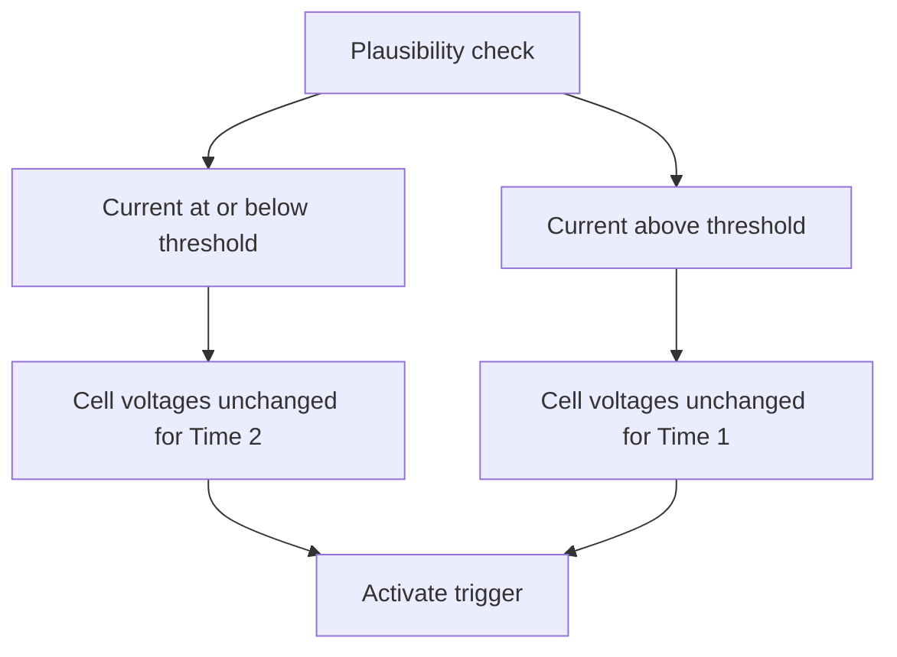
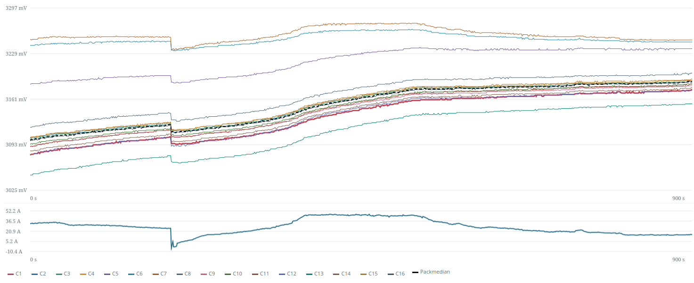
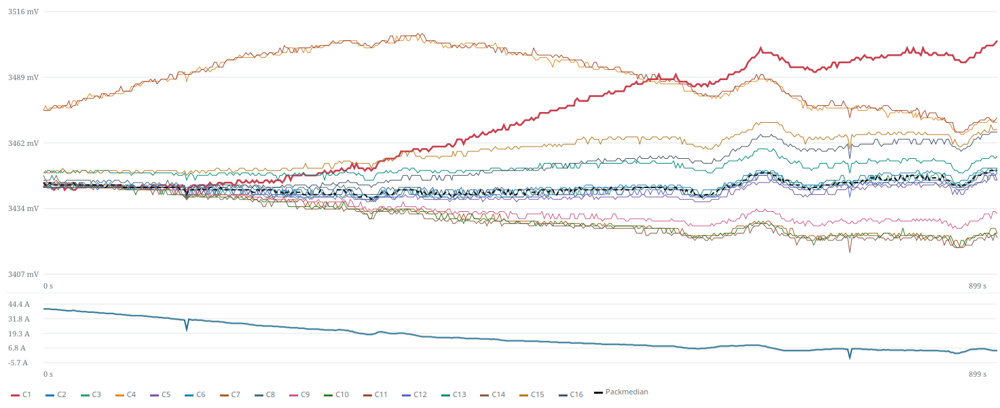
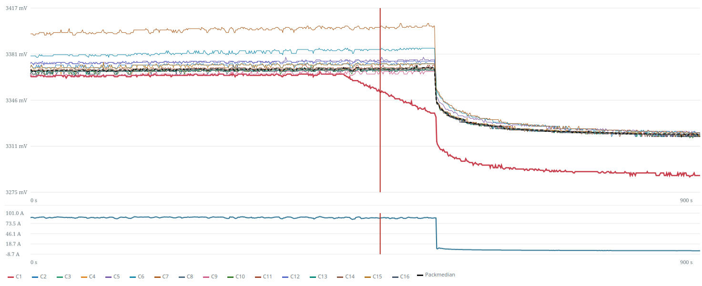

# Alarm Rules {#alarmregeln}

Select which values from which devices are monitored.

## BMS {#bms}

Ten BMS alarm rules monitor configured data devices and activate triggers when thresholds are reached.

```bsc-settings
version: v010
file: alarmBms.json
profile: off
groups: 1
index: 1
```

- **Monitored data device:** Device to which the rule applies.
- **No BMS data:** Select a trigger (**1–27**) and a timeout in seconds without incoming data.
- **Cell min/max monitoring:** Select a trigger (**1–27**), monitored cell count, minimum voltage (default **2500 mV**), maximum voltage (default **3650 mV**) and hysteresis in mV. A fault activates below minimum or above maximum. Example: maximum **3.65 V**, hysteresis **50 mV** → reset below **3.60 V**.
- **Total min/max voltage:** Select a trigger (**1–27**), minimum (default **48.00 V**), maximum (default **54.00 V**) and hysteresis in V. Voltage must move back by the configured hysteresis before a fault clears.

## Plausibility Check {#plausibility-check}

### Plausibility Check {#plausibility-check_1}

!!! note "Firmware Availability"
    Not available in every firmware version.

Continuously checks pack current and cell voltages. Cell voltages that stop changing for an extended time can indicate a BMS is no longer sending valid data. Different checking times apply above and below a current threshold, allowing early warning without excessive low-load alarms.



```bsc-settings
version: v010
file: plausibilityCheck.json
profile: off
section: UI_SECT_PLAUSIBILITYCHECK_PLAUSIBILITY_CHECK
```

- **Cellvoltage plausibility check:** Trigger activated when checking detects a fault. Configure its consumers to produce warnings or protective actions.
- **Monitored devices:** Data devices whose voltages are checked.
- **Current threshold [A]:** Boundary between checking times, default **200 A**.
- **Time 1 [s]:** Used **above** the threshold, default **30 s**.
- **Time 2 [s]:** Used **at or below** the threshold, default **240 s**; usually longer to avoid low-load false alarms.

### Value Comparison {#wertevergleich}

!!! note "Firmware Availability"
    Not available in every firmware version.

Ten comparison rules activate an assigned trigger when selected devices' values diverge too far.

```bsc-settings
version: v010
file: plausibilityCheck.json
profile: off
groups: 1
section: UI_SECT_PLAUSIBILITYCHECK_WERTEVERGLEICH
```

- **Trigger:** **1–27**.
- **Compare:** Data devices to compare.
- **Values:** Total voltage, cell voltage or battery current. Current monitoring also checks that no more than **100 mA** flows in the charging direction with the charge FET open; the discharge FET is checked analogously in the opposite direction. The tolerance accounts for measurement inaccuracy.
- **Maximum deviation:** Total voltage default **50 mV**, cell voltage **5 mV**, battery current **5 A**.
- **Delay [s]:** Required persistence, default **5 s**, to ignore brief fluctuations.

Examples: check even current sharing across data devices, or compare cell voltages reported by a BMS and balancer in the same pack. **This function does not check whether devices are online**; monitor availability separately.

### Cell Voltage During Charging {#zellspannung-bei-ladestrom}

This monitor warns when the voltage of an individual cell or many cells in a battery pack drops abnormally during charging, even though the charging current is sufficiently stable. It can detect such changes within the normal voltage range and therefore complements the [min/max alarms](#bms).

An alarm is a reason to check the cells, cell connectors, sense wires and BMS measurements, but **not conclusive evidence of a defective cell**. This function does not replace the BMS protection functions or monitoring for missing data.

#### Setting Up Monitoring {#uberwachung-einrichten}

1. Select the required **Data Devices** under **Monitored devices**. Detection operates separately for each device; Group Devices are not supported.
2. Select a **Trigger** (1-27). Monitoring is inactive if the selection is "Off".
3. Configure **the action this trigger should activate** in the relevant function. The cell voltage monitor does not stop charging on its own.
4. Use **Hold until manual reset** to choose whether an alarm may clear automatically or must remain stored until manually acknowledged. The reset conditions are [described below](#rucksetzen-eines-fehlers).
5. Enable **On/Off** and save the settings.

By default, monitoring and manual holding are disabled, no device is selected and the trigger is set to "Off".

```bsc-settings
version: v010
file: plausibilityCheck.json
profile: off
section: 2
```

#### When Is Monitoring Active? {#wann-wird-uberwacht}

- The selected device must be recognized as a **BMS** and supply valid cell voltages. Balancers, shunts and devices in maintenance mode are not evaluated.
- At least **4 A of charging current must flow at the individual Data Device**. The combined charging current of several battery packs is not used for this threshold.
- After the first three valid data updates, detection requires a **120-second warm-up period**. An alarm therefore cannot occur immediately after charging starts.
- New BMS data updates must arrive regularly. Below 4 A, with invalid cell voltages or after an excessive gap between updates, the charging window is discarded. Detection of new alarms then restarts with initial values and a new warm-up period.

!!! warning "Check the Cell Count"
    Monitoring uses the cell count from the **serial configuration**. It must match the BMS data being evaluated and be between **1 and 24 cells**. Check this setting even when monitoring several Data Devices.

#### Understanding Alarm Messages {#alarmmeldung-verstehen}

A detected drop is stored. While monitoring is enabled and at least one stored fault exists, this alarm rule activates the selected trigger.

| Example message | Meaning |
| --- | --- |
| `D0 C3, 3290/3300 mV` | Abnormal drop at **Data Device 0, cell 3**. The smoothed current voltage is 3290 mV and the reference is 3300 mV. |
| `D0 Pack, 3316/3330 mV` | Common drop affecting many cells at **Data Device 0**. The values describe the pack's typical cell voltage level, **not its total voltage**. |

**Data Device numbering starts at 0**, whereas **cell numbering in the message starts at 1**. The voltages belong to the stored detection event; they are not continuously updated raw measurements.

#### What to Do When an Alarm Occurs {#was-tun-bei-einem-alarm}

1. Identify the Data Device and the cell or pack named in the message.
2. Check the BMS measurements and any BMS warnings. Was the charging current actually stable, and are its direction and measurement plausible?
3. If abnormalities recur, have the affected cells, cell connectors and sense wires checked by a qualified person. An alarm alone does not justify replacing a cell.
4. After checking, clear a manually held fault using the action described below. If it occurs again, investigate the cause further.

#### Resetting a Fault {#rucksetzen-eines-fehlers}

**Automatic reset**

With "Hold until manual reset" disabled, a fault clears when the detector remains **without an active drop condition for at least 60 seconds**. If a condition becomes active again, this reset delay starts over. Returning fully to the earlier reference voltage is not required, because the moving references also change.

New data updates showing less than 4 A of charging current also discard the charging window and allow the fault to clear after this reset delay. **Resetting is evaluated with new BMS data updates, not by an independent timer.** If data stops arriving completely, automatic clearing after 60 seconds is therefore not guaranteed. With unstable current, a previously active local drop condition is initially retained; a current change alone does not confirm recovery.

**Hold until manual reset**

If this option is enabled when the fault is detected, the fault remains stored even if the voltage recovers, charging ends or the device is later removed from monitoring. In the web app, open **Expert Actions / Manual Actions / Reset cell voltage drop** and select **Reset**. This resets the faults and detection histories of **all Data Devices**. If sufficient charging current is still flowing, detection then starts with new initial values and a new warm-up period; a new charging session is not required.

!!! warning "Disabling Is Not a Manual Reset"
    When monitoring is disabled or the trigger is set to "Off", this rule no longer activates the associated trigger. However, a manually held fault remains stored and can activate the trigger again after monitoring is re-enabled. Use the reset action to clear it explicitly.

#### Examples from Real Measurements {#beispiele-aus-echten-messdaten}

The following screenshots show **real measurements, not artificially generated curves**. Cell voltages and the pack median are shown at the top, with battery current below. The examples illustrate why a voltage drop must be evaluated in relation to charging current. A trace without an alarm does not automatically mean the battery is fault-free!

**No alarm: Voltage drop during a current change**

[](img/settings/cell_sag_ohne_alarm_stromwechsel.png)

The pronounced downward voltage step coincides with a sharp current reduction. The cell voltages then rise again as charging current increases. No alarm was detected in this example; the voltage step alone is not evidence of a cell fault.

**No alarm: Different cell voltage trends as charging current decreases**

[](img/settings/cell_sag_ohne_alarm_sinkender_strom.png)

Charging current decreases significantly over time. Some cell voltages fall, while others remain approximately constant or rise. No alarm was detected here either. Different voltage levels or individual falling curves alone are not sufficient.

**Alarm: One cell drops while charging current remains nearly constant**

[](img/settings/cell_sag_alarm_einzelzelle.png)

The red **C1** trace already falls substantially while the other cell voltages and charging current initially remain largely stable. The **red vertical line** marks the detected alarm. Only later does charging current fall sharply, followed by the other cell voltages. The image alone does not establish what caused this later current reduction.

Click an image to open it at full size.

#### Technical Details {#technische-details}

**Charging window and gaps between updates**

A gap discards the charging window if the interval between two updates exceeds **10 seconds or three times the learned typical update interval**, whichever is greater. A change in cell count also restarts detection. All evaluated cells must have voltage values that are not marked as invalid. An existing stored fault remains subject to the [reset conditions](#rucksetzen-eines-fehlers), independently of the charging window restarting.

**Smoothed voltage trends**

First, the median of the last **three measurements** is calculated for each cell and for current. The median is the middle value of a list sorted by magnitude, reducing the effect of individual outliers. Fast, medium and slow voltage trends are then calculated, with time constants of **10, 60 and 120 seconds**. These are moving filters, not fixed time windows or additional waiting periods.

The slow trend serves as the reference and the fast trend as the current voltage level. **Both can rise and fall.** For each trend, a median across all cells is also calculated. This pack median describes the pack's typical cell voltage level, not its total voltage. With an even number of values, the average of the two middle values is used.

**Detection path 1: An individual abnormal cell**

For a new local drop, all of the following conditions must be met simultaneously after the warm-up period:

- The fast cell voltage is at least **8 mV below that cell's slow reference**.
- This drop is at least **8 mV greater than the corresponding drop in the pack median**. The cell must therefore stand out relative to the rest of the pack.
- The comparison between the medium and fast trends also shows at least **4 mV of additional drop relative to the pack median**. This checks whether the drop is still apparent in the more recent trend.
- The fast cell voltage is **at or below the fast pack median**.
- Charging current is stable: The fast and slow smoothed currents differ by no more than **0.5 A or 10% of their average**, whichever tolerance is greater.

A cell that merely rises less strongly than the others does not automatically meet the alarm conditions. An alarm is triggered as soon as all the stated conditions are met simultaneously after the warm-up period.

**Detection path 2: A common drop across the pack**

A common drop can also be detected when no individual cell stands out relative to the others. All of the following conditions must be met after the warm-up period:

- The fast pack median is at least **12 mV below the slow pack median**.
- For at least approximately **three quarters of the cells**, the fast trend is also at least **12 mV below the respective slow trend**. The required cell count is rounded to a whole number; for 16 cells, it is 12.
- The difference between the medium and fast pack medians is at least **4 mV greater** than the difference between the slow and medium pack medians. The drop must therefore become stronger in the more recent trend.
- The range between the lowest and highest charging currents over approximately the last **120 to 160 seconds** is within a tolerance of **0.5 A or 10% of the average of the fast and slow smoothed currents**, whichever is greater. This detection path therefore checks more than just the difference between two smoothed current values.

**Stored fault values and fixed thresholds**

One fault record is retained per Data Device; a later new detection event with a larger voltage drop can replace it. For an individual cell, the alarm message shows the fast and slow cell voltages; for a common drop, it shows the fast and slow pack medians.

Minimum charging current, warm-up period, filter time constants, current tolerances, drop thresholds and reset delay are **fixed in the firmware** and cannot be changed through these settings.

**Worked example**

!!! example "An Individual Abnormal Cell"
    1. Data Device 0 is charged continuously at **20 A** and supplies valid cell voltages. After the initial measurements and the 120-second warm-up period, detection is ready.
    2. Later, cell 3 has these smoothed values: slow **3300 mV**, medium **3296 mV**, fast **3290 mV**. All three pack medians remain at **3300 mV**, and current is stable.
    3. The absolute drop is **10 mV**, and the additional drop relative to the pack is also **10 mV**. The more recent trend still shows **6 mV** of additional drop. The fast cell voltage is below the pack median. The local detection conditions are therefore met.
    4. The trigger activates; the message is `D0 C3, 3290/3300 mV`.
    5. Without manual holding, the fault clears after at least **60 seconds without an active drop condition**, provided further BMS updates arrive. With manual holding enabled, it remains stored until reset.

## Temperature {#temperatur}

### OneWire Sensor Error Alarm {#alarm-bei-onewire-sensorfehler}

```bsc-settings
version: v010
file: alarmTemp.json
profile: off
section: UI_SECT_ALARMTEMP_ALARM_BEI_SENSORFEHLER
```

Select trigger **1–27** for missing/invalid sensor data and a timeout of **5–240 s**, default **5 s**, to tolerate short interruptions.

### Temperature Monitoring {#temperatur-uberwachung}

Ten rules monitor built-in or extended sensors and activate triggers when limits are crossed.

```bsc-settings
version: v010
file: alarmTemp.json
profile: off
groups: 1
section: UI_SECT_ALARMTEMP_TEMPERATUR_220_BERWACHUNG
```

- **Source:** Data-device sensors **0–5**, data-device extended sensors **0–31**, or group equivalents when [groups](settings_bsc_group-devices.md#group-devices-batterie-gruppen) are enabled.
- **Monitored sources:** Selected data/group devices.
- **Sensors:** Select sensors within that source's range.
- **Monitoring type:** **Above maximum** alarms above Value 1; **Below minimum** alarms below Value 1; **Above maximum (reference)** compares selected sensors to the reference sensor with Value 1 as permitted temperature offset; **Difference monitoring** compares the highest and lowest selected temperatures with Value 1 as maximum difference.
- **Reference sensor:** **0–255**, relevant only to reference-based monitoring.
- **Value 1:** Numeric threshold, **−20 to +100 °C**.
- **Hysteresis:** Configurable **−20 to +100 °C**. Specifies the return margin required before an active alarm clears, avoiding repeated switching near a threshold.
- **Trigger:** **1–27**.

**Example:** Extended data-device sensor **12**, above-maximum monitoring, Value 1 **60.00 °C**, hysteresis **2.00 °C**, trigger **2**. Above 60 °C, trigger 2 activates; it resets only below **58 °C**.