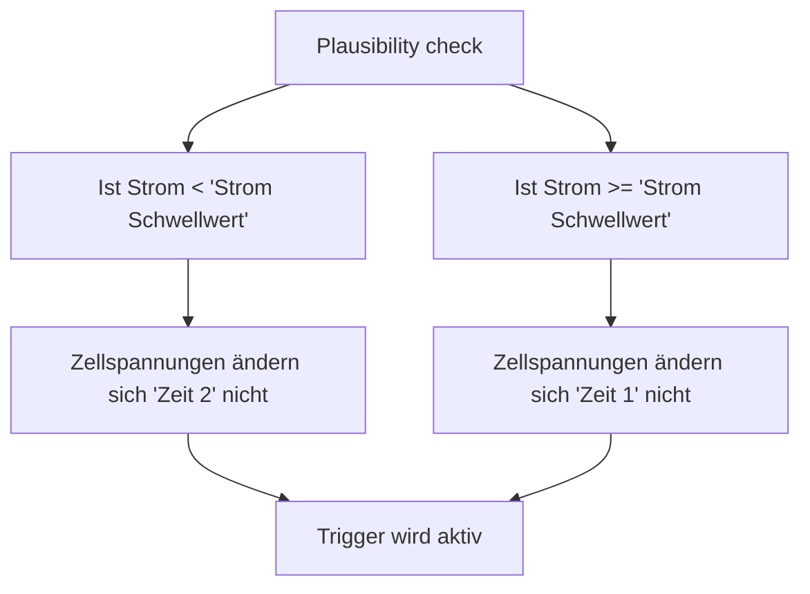
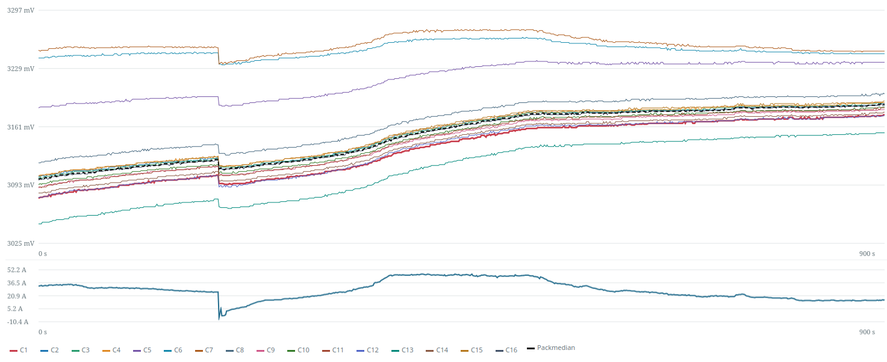
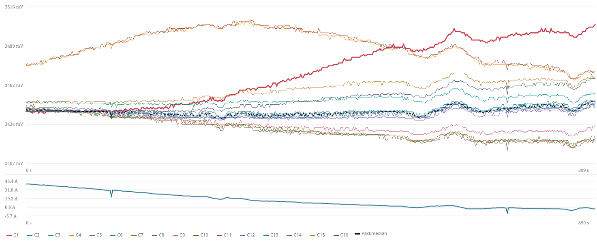
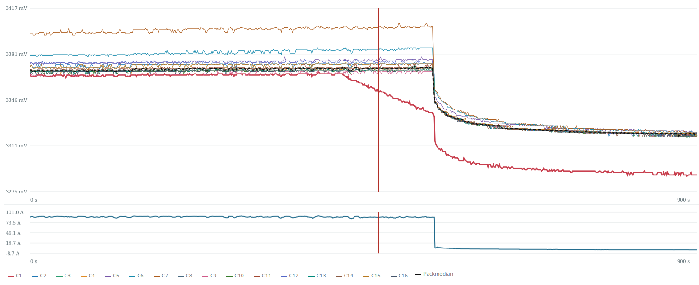

# Alarmregeln 
In den Alarmregeln kann eingestellt werden, welche Daten von welchen Devices überwacht werden sollen.  

## BMS
Die BMS Alarmregeln ermöglichen die Überwachung der konfigurierten Data-Devices. Es können verschiedene Parameter des Data-Device überwacht werden, um Alarme zu konfigurieren und automatische Aktionen auszulösen, wenn bestimmte Schwellenwerte erreicht werden.

```bsc-settings
version: v010
file: alarmBms.json
profile: off
groups: 1
index: 1
```

Es stehen **10 BMS-Alarmregeln** zur Verfügung. Pro Alarmregel:

**Zu überwachendes Data-Device**  
Hier wird festgelegt, für welches Data-Device die Alarmregel gilt.

**Keine Daten vom BMS**  
Überwacht, ob vom zugeordneten Data-Device über einen definierten Zeitraum keine Daten empfangen werden.

- **Aktion bei Trigger**  
  Auswahl des Triggers (Trigger 1–27), der bei Auslösen der Bedingung aktiviert werden soll.
- **Trigger keine Daten (s)**  
  Zeit in Sekunden, nach deren Ablauf ohne eingehende Daten der Trigger aktiviert wird.

**Spannungsüberwachung Zelle Min/Max**  
Überwacht die minimalen und maximalen Spannungswerte der einzelnen Zellen.

- **Aktion bei Trigger**  
  Auswahl des Triggers (Trigger 1–27), der bei Auslösen der Bedingung aktiviert werden soll.
- **Anzahl Zellen Monitoring**  
  Anzahl der zu überwachenden Zellen.
- **Zellspannung Min (mV)**  
  Unterer Grenzwert der Zellspannung (Standard 2500 mV).  
  Wird dieser unterschritten, löst die Alarmregel aus.
- **Zellspannung Max (mV)**  
  Oberer Grenzwert der Zellspannung (Standard 3650 mV).  
  Wird dieser überschritten, löst die Alarmregel aus.
- **Hysterese Min/Max (mV)**  
  Definiert den Spannungsbereich, um den sich die Spannung bei aktivem Trigger mindestens verändern muss, damit der erkannte Fehler wieder zurückgesetzt wird.
  Beispiel: Wird der Trigger bei einer Zellspannung Max. von 3,65 V ausgelöst und die Hysterese ist auf 50 mV eingestellt, muss die Spannung unter 3,60 V fallen, damit der Trigger wieder deaktiviert wird.

**Spannungsüberwachung Gesamt Min/Max**  
Überwacht die minimalen und maximalen Spannungswerte des gesamten Systems.

- **Aktion bei Trigger**  
  Auswahl des Triggers (Trigger 1–27), der bei Auslösen der Bedingung aktiviert werden soll.
- **Spannung Min (V)**  
  Unterer Grenzwert der Gesamtspannung (Standard 48,00 V).
- **Spannung Max (V)**  
  Oberer Grenzwert der Gesamtspannung (Standard 54,00 V).
- **Hysterese Min/Max (V)**  
  Definiert den Spannungsbereich, um den sich die Spannung bei aktivem Trigger mindestens verändern muss, damit der erkannte Fehler wieder zurückgesetzt wird.  


## Plausibility check
### Plausibility check

!!! note "Hinweis zur Firmware-Version"
    Der Plausibility Check ist nicht in allen Firmware-Versionen verfügbar.

Der "Plausibility Check" ist eine wichtige Funktion, die kontinuierlich den Stromfluss sowie die Zellspannungen der an das System angeschlossenen Data-Devices überwacht.  

Wenn sich die Werte für Strom und Zellspannungen über einen längeren Zeitraum hinweg nicht mehr regelmäßig ändern, deutet dies darauf hin, dass das BMS keine gültigen Daten mehr sendet. In diesem Fall kann davon ausgegangen werden, dass ein Problem im BMS vorliegt.

Der "Plausibility Check" bietet so eine frühzeitige Warnung bei Unregelmäßigkeiten und unterstützt die zuverlässige Funktion und Sicherheit des gesamten Systems.  

**Funktionsweise des Plausibility checks**:



**Parameter:**

```bsc-settings
version: v010
file: plausibilityCheck.json
profile: off
section: UI_SECT_PLAUSIBILITYCHECK_PLAUSIBILITY_CHECK
```

**Cellvoltage plausibility check**  
Hier kann eingestellt werden, **welcher Trigger aktiviert wird**, falls ein Fehler bei der Plausibilitätsprüfung der Zellspannungen erkannt wird.  
Der Trigger sorgt dafür, dass im Fehlerfall entsprechende Aktionen ausgelöst werden, z. B. Alarmmeldungen oder Schutzmaßnahmen.

**Zu überwachende Geräte**  
Hier werden die Data Devices ausgewählt, deren Zellspannungen geprüft werden sollen.  

**Strom-Schwellwert (A)**  
Definiert den Grenzwert für den Batteriestrom, ab dem unterschiedliche Prüfzeiten (*Zeit 1* oder *Zeit 2*) angewendet werden (Standard: 200 A).  

**Zeit 1 (s)**  
Wird verwendet, wenn der Strom im Batterypack **größer** als der eingestellte *Strom-Schwellwert* ist (Standard: 30 s).  
Diese Zeit legt fest, wie lange ein auffälliger Zellspannungswert bestehen muss, bevor er als fehlerhaft gewertet wird.  

**Zeit 2 (s)**  
Wird verwendet, wenn der Strom im Batterypack **kleiner oder gleich** dem eingestellten *Strom-Schwellwert* ist (Standard: 240 s).  
In der Regel wird hier eine längere Zeit eingestellt, um Fehlalarme bei geringen Lasten zu vermeiden.


### Wertevergleich

!!! note "Hinweis zur Firmware-Version"
    Der Wertevergleich ist nicht in allen Firmware-Versionen verfügbar.

Mit dieser Funktion können die Werte ausgewählter Data Devices überwacht und miteinander verglichen werden. Bei Überschreiten der definierten Abweichungen wird der zugewiesene Trigger aktiviert.  
Es stehen **10 Wertevergleichs-Regeln** zur Verfügung.

```bsc-settings
version: v010
file: plausibilityCheck.json
profile: off
groups: 1
section: UI_SECT_PLAUSIBILITYCHECK_WERTEVERGLEICH
```

**Trigger**  
Hier kann ausgewählt werden, welcher Trigger (Trigger 1–27) ausgelöst werden soll, wenn eine Abweichung erkannt wird.  

**Vergleichen**  
Wählen Sie die Data Devices aus, deren Werte miteinander verglichen werden sollen.  

**Werte**  
Legt fest, welche Werte verglichen werden:  

- **Gesamtspannung**  
- **Zellspannung**  
- **Batteriestrom**  
  Zusätzlich wird überwacht, dass bei einem offenen Lade-FET nur ein Ladestrom von maximal **100 mA** fließen darf.  
  Die 100 mA dienen als Toleranz aufgrund von Messungenauigkeiten.  
  Das Gleiche gilt auch für den Entlade-FET, jedoch in umgekehrter Stromrichtung.

**Maximale Abweichung**  

- **Gesamtspannung (mV)**  
  Die maximal zulässige Abweichung der Gesamtspannung zwischen den ausgewählten Geräten (Standard: 50 mV).  
- **Zellspannung (mV)**  
  Die maximal zulässige Abweichung der einzelnen Zellspannungen (Standard: 5 mV).  
- **Batteriestrom (A)**  
  Die maximal zulässige Abweichung des Batteriestroms (Standard: 5 A).  

**Verzögerung (s)**  
Definiert die Zeitspanne, die die Abweichung bestehen muss, bevor der Trigger ausgelöst wird (Standard: 5 s). Dies verhindert Fehlalarme durch kurzzeitige Schwankungen.  

---

**Einsatzbeispiele:**  

- Prüfen, ob sich der Batteriestrom gleichmäßig zwischen den ausgewählten **Data Devices** aufteilt.  
- Prüfen, ob die Zellspannungen zwischen zwei in einem Batteriepack verbauten Geräten, z. B. einem **BMS** und einem **Balancer** gleich sind.

**Hinweis:**  
Der Wertevergleich prüft nicht, ob die **Data Devices** tatsächlich online sind. Diese Überwachung kann an anderer Stelle erfolgen und entsprechend darauf reagiert werden.  


### Zellspannung bei Ladestrom

Diese Überwachung warnt, wenn die Spannung einer einzelnen Zelle oder vieler Zellen eines Batteriepacks während der Ladung auffällig abfällt, obwohl der Ladestrom ausreichend stabil ist. Sie kann solche Veränderungen auch innerhalb des normalen Spannungsbereichs erkennen und ergänzt damit die [Min/Max-Alarme](#bms).

Ein Alarm ist ein Anlass, Zellen, Zellverbinder, Messleitungen und die BMS-Messwerte zu prüfen, aber **kein sicherer Nachweis einer defekten Zelle**. Die Funktion ersetzt weder die Schutzfunktionen des BMS noch die Überwachung auf ausbleibende Daten.

#### Überwachung einrichten

1. Wählen Sie unter **Zu überwachende Geräte** die gewünschten **Data-Devices** aus. Die Erkennung arbeitet für jedes Device getrennt; Group Devices werden nicht unterstützt.
2. Wählen Sie einen **Trigger** (1–27). Mit der Auswahl „Aus“ ist die Überwachung nicht aktiv.
3. Legen Sie an der gewünschten Funktion fest, **welche Reaktion dieser Trigger auslösen soll**. Die Zellspannungsüberwachung allein schaltet den Ladestrom nicht ab.
4. Entscheiden Sie mit **Fehler bis manuellem Reset halten**, ob ein Alarm automatisch verschwinden darf oder bis zur manuellen Bestätigung gespeichert bleiben soll. Die Rücksetzbedingungen sind [unten beschrieben](#rucksetzen-eines-fehlers).
5. Aktivieren Sie **Ein/Aus** und speichern Sie die Einstellungen.

Standardmäßig sind die Funktion und das manuelle Halten ausgeschaltet, kein Gerät ist ausgewählt und der Trigger steht auf „Aus“.

```bsc-settings
version: v010
file: plausibilityCheck.json
profile: off
section: 2
```

#### Wann wird überwacht?

- Das ausgewählte Device muss als **BMS** erkannt sein und gültige Zellspannungen liefern. Balancer, Shunts und Geräte im Wartungsmodus werden nicht ausgewertet.
- Es müssen mindestens **4 A Ladestrom am jeweiligen Data-Device** fließen. Der Gesamtladestrom mehrerer Batteriepacks ist dafür nicht maßgeblich.
- Nach den ersten drei gültigen Datensätzen benötigt die Erkennung **120 Sekunden Einlaufzeit**. Ein Alarm ist daher nicht sofort nach Ladestart möglich.
- Neue BMS-Datensätze müssen regelmäßig eintreffen. Bei weniger als 4 A, ungültigen Zellspannungen oder einer zu großen Messlücke wird das Ladefenster verworfen. Für neue Alarme beginnt die Erkennung danach erneut mit Anfangswerten und Einlaufzeit.

!!! warning "Zellanzahl prüfen"
    Die Überwachung verwendet die Zellanzahl aus der **seriellen Konfiguration**. Sie muss zu den ausgewerteten BMS-Daten passen und zwischen **1 und 24 Zellen** liegen. Prüfen Sie diese Einstellung auch dann, wenn Sie mehrere Data-Devices überwachen.

#### Alarmmeldung verstehen

Ein erkannter Einbruch wird gespeichert. Solange die Funktion eingeschaltet ist und mindestens ein gespeicherter Fehler vorliegt, aktiviert diese Alarmregel den ausgewählten Trigger.

| Beispielmeldung | Bedeutung |
| --- | --- |
| `D0 C3, 3290/3300 mV` | Auffälliger Einbruch an **Data-Device 0, Zelle 3**. Der geglättete aktuelle Spannungswert beträgt 3290 mV, der Vergleichswert 3300 mV. |
| `D0 Pack, 3316/3330 mV` | Gemeinsamer Einbruch vieler Zellen an **Data-Device 0**. Die Werte beschreiben das typische Zellspannungsniveau des Packs, **nicht dessen Gesamtspannung**. |

Die **Data-Device-Nummer beginnt bei 0**, die **Zellnummer in der Meldung bei 1**. Die Spannungen gehören zum gespeicherten Erkennungsereignis und sind keine laufend aktualisierten Rohmesswerte.

#### Was tun bei einem Alarm?

1. Ordnen Sie die Meldung dem Data-Device und der genannten Zelle bzw. dem Pack zu.
2. Prüfen Sie die BMS-Messwerte und vorhandene BMS-Warnungen. War der Ladestrom tatsächlich stabil, und sind Stromrichtung und Strommessung plausibel?
3. Lassen Sie bei wiederholten Auffälligkeiten die betroffenen Zellen, Zellverbinder und Messleitungen fachgerecht prüfen. Ein Alarm allein rechtfertigt noch keinen Zellentausch.
4. Setzen Sie einen manuell gehaltenen Fehler nach der Prüfung mit der unten beschriebenen Aktion zurück. Tritt er erneut auf, sollte die Ursache weiter untersucht werden.

#### Rücksetzen eines Fehlers

**Automatisch zurücksetzen**

Ist „Fehler bis manuellem Reset halten“ ausgeschaltet, wird ein Fehler gelöscht, wenn der Detektor **mindestens 60 Sekunden ohne aktive Einbruchbedingung** bleibt. Bei erneut aktiver Bedingung beginnt diese Rückstellzeit von vorn. Eine vollständige Rückkehr auf die frühere Referenzspannung ist nicht erforderlich, weil sich auch die gleitenden Referenzen verändern.

Auch neue Datensätze mit weniger als 4 A Ladestrom verwerfen das Ladefenster und ermöglichen nach dieser Rückstellzeit das Löschen. **Das Rücksetzen wird mit neuen BMS-Datensätzen ausgewertet, nicht durch einen unabhängigen Zeitschalter.** Bleiben Daten vollständig aus, ist nach 60 Sekunden deshalb kein automatisches Löschen garantiert. Bei instabilem Strom bleibt eine zuvor aktive lokale Einbruchbedingung zunächst erhalten; allein eine Stromänderung ist keine bestätigte Erholung.

**Fehler bis manuellem Reset halten**  
Ist diese Option bei der Fehlererkennung aktiviert, bleibt der Fehler gespeichert, auch wenn sich die Spannung erholt, die Ladung endet oder das Device später aus der Überwachung genommen wird. Löschen Sie ihn in der WebApp unter **Expert Actions → Manuelle Aktionen → Zellspannungsabfall zurücksetzen** mit dem Button **Zurücksetzen**. Dieser Reset löscht die Fehler und die Erkennungsverläufe **aller Data-Devices**. Bei weiterhin ausreichendem Ladestrom beginnt die Erkennung danach mit neuen Anfangswerten und neuer Einlaufzeit; ein neuer Ladevorgang ist dafür nicht nötig.

!!! warning "Ausschalten ist kein manueller Reset"
    Wird die Funktion ausgeschaltet oder der Trigger auf „Aus“ gestellt, wird der zugehörige Trigger nicht mehr durch diese Regel aktiviert. Ein manuell gehaltener Fehler bleibt jedoch gespeichert und kann nach erneutem Aktivieren wieder den Trigger setzen. Zum gezielten Löschen verwenden Sie die Reset-Aktion.

#### Beispiele aus echten Messdaten

Die folgenden Screenshots zeigen **echte Messdaten, keine künstlich erzeugten Kurven**. Oben sind die Zellspannungen und der Packmedian dargestellt, darunter der Batteriestrom. Die Beispiele zeigen, warum ein Spannungsabfall im Zusammenhang mit dem Ladestrom bewertet werden muss. Ein Verlauf ohne Alarm bedeutet nicht automatisch, dass die Batterie fehlerfrei ist!

**Ohne Alarm: Spannungsabfall bei einem Stromwechsel**

[](img/settings/cell_sag_ohne_alarm_stromwechsel.png)

Der deutliche Spannungssprung nach unten fällt mit einem starken Stromrückgang zusammen. Anschließend steigen die Zellspannungen mit zunehmendem Ladestrom wieder an. In diesem Beispiel wurde kein Alarm erkannt; der Spannungssprung allein ist kein Nachweis eines Zellfehlers.

**Ohne Alarm: Unterschiedliche Zellverläufe bei sinkendem Ladestrom**

[](img/settings/cell_sag_ohne_alarm_sinkender_strom.png)

Der Ladestrom nimmt im Verlauf deutlich ab. Einige Zellspannungen sinken, andere bleiben ungefähr gleich oder steigen. Auch hier wurde kein Alarm erkannt. Unterschiedliche Spannungsniveaus oder einzelne fallende Kurven reichen allein nicht aus.

**Mit Alarm: Eine Zelle fällt bei nahezu konstantem Ladestrom ab**

[](img/settings/cell_sag_alarm_einzelzelle.png)

Die rote Kurve **C1** fällt bereits deutlich ab, während die übrigen Zellspannungen und der Ladestrom zunächst weitgehend stabil bleiben. Die **rote senkrechte Linie** markiert den erkannten Alarm. Erst später sinkt der Ladestrom stark, woraufhin auch die übrigen Zellspannungen fallen. Aus dem Bild allein lässt sich nicht ableiten, wodurch dieser spätere Stromrückgang ausgelöst wurde.

Die Bilder lassen sich durch Anklicken in voller Größe öffnen.

#### Technische Details

**Ladefenster und Messlücken**

Eine Messlücke verwirft das Ladefenster, wenn der Abstand zwischen zwei Datensätzen größer ist als **10 Sekunden oder das Dreifache des erlernten üblichen Messabstands**, je nachdem, welcher Wert größer ist. Eine geänderte Zellanzahl startet die Erkennung ebenfalls neu. Für alle ausgewerteten Zellen müssen Spannungswerte vorliegen, die nicht als ungültig markiert sind. Ein bereits gespeicherter Fehler unterliegt unabhängig vom Neustart des Ladefensters den [Rücksetzbedingungen](#rucksetzen-eines-fehlers).

**Geglättete Spannungsverläufe**

Zunächst wird für jede Zelle und den Strom der Median der letzten **drei Messwerte** gebildet. Der Median ist der mittlere Wert einer nach Größe sortierten Liste; einzelne Ausreißer wirken sich dadurch weniger aus. Anschließend werden schnelle, mittlere und langsame Spannungsverläufe berechnet. Deren Zeitkonstanten betragen **10, 60 und 120 Sekunden**. Das sind gleitende Filter, keine starren Zeitfenster und keine zusätzlichen Wartezeiten.

Der langsame Verlauf dient als Referenz, der schnelle als aktuelles Spannungsniveau. **Beide können steigen und fallen.** Zusätzlich wird für jeden Verlauf der Median über alle Zellen gebildet. Dieser Packmedian beschreibt das typische Zellspannungsniveau des Packs, nicht dessen Gesamtspannung. Bei einer geraden Anzahl von Werten wird der Mittelwert der beiden mittleren Werte verwendet.

**Erkennungsweg 1: Einzelne auffällige Zelle**

Für einen neuen lokalen Einbruch müssen nach der Einlaufzeit alle folgenden Bedingungen gleichzeitig erfüllt sein:

- Die schnelle Zellspannung liegt mindestens **8 mV unter der langsamen Referenz** dieser Zelle.
- Dieser Abfall ist mindestens **8 mV größer als der entsprechende Abfall des Packmedians**. Die Zelle muss also gegenüber dem übrigen Pack auffällig sein.
- Auch der Vergleich zwischen mittlerem und schnellem Verlauf zeigt gegenüber dem Packmedian noch mindestens **4 mV zusätzlichen Abfall**. So wird geprüft, ob der Einbruch auch im jüngeren Verlauf erkennbar ist.
- Die schnelle Zellspannung liegt **auf oder unter dem schnellen Packmedian**.
- Der Ladestrom ist stabil: Schneller und langsamer geglätteter Strom unterscheiden sich um höchstens **0,5 A oder 10 % ihres Mittelwerts**, wobei der größere Toleranzwert gilt.

Eine Zelle, die lediglich weniger stark steigt als die anderen, erfüllt damit noch nicht automatisch die Alarmbedingungen. Ein Alarm wird ausgelöst, sobald nach der Einlaufzeit alle genannten Bedingungen gleichzeitig erfüllt sind.

**Erkennungsweg 2: Gemeinsamer Einbruch des Packs**

Ein gemeinsamer Einbruch kann auch dann erkannt werden, wenn keine einzelne Zelle gegenüber den anderen auffällt. Dafür müssen nach der Einlaufzeit alle folgenden Bedingungen erfüllt sein:

- Der schnelle Packmedian liegt mindestens **12 mV unter dem langsamen Packmedian**.
- Bei mindestens rund **drei Vierteln der Zellen** liegt der schnelle Verlauf ebenfalls mindestens **12 mV unter dem jeweiligen langsamen Verlauf**. Die erforderliche Zellanzahl wird auf eine ganze Zahl gerundet; bei 16 Zellen sind es 12.
- Der Abstand zwischen mittlerem und schnellem Packmedian ist mindestens **4 mV größer** als der Abstand zwischen langsamem und mittlerem Packmedian. Damit muss sich der Abfall im jüngeren Verlauf verstärken.
- Die Spanne zwischen kleinstem und größtem Ladestrom der letzten ungefähr **120 bis 160 Sekunden** liegt innerhalb der Toleranz von **0,5 A oder 10 % des Mittelwerts aus schnellem und langsamem geglättetem Strom**. Auch hier gilt der größere Toleranzwert. Für diesen Erkennungsweg wird somit nicht nur der Unterschied zweier geglätteter Stromwerte geprüft.

**Gespeicherte Fehlerwerte und feste Schwellen**

Pro Data-Device wird ein Fehlerdatensatz gehalten; ein späteres neues Erkennungsereignis mit größerem Spannungsabfall kann ihn ersetzen. In der Alarmmeldung stehen bei einer einzelnen Zelle der schnelle und langsame Zellspannungswert, bei einem gemeinsamen Einbruch der schnelle und langsame Packmedian.

Mindest-Ladestrom, Einlaufzeit, Filterzeiten, Stromtoleranzen, Einbruchschwellen und Rückstellzeit sind **fest in der Firmware eingestellt** und nicht über diese Parameter veränderbar.

**Rechenbeispiel**

!!! example "Einzelne auffällige Zelle"
    1. Data-Device 0 wird kontinuierlich mit **20 A** geladen und liefert gültige Zellspannungen. Nach den Anfangsmessungen und 120 Sekunden Einlaufzeit ist die Erkennung bereit.
    2. Später ergeben sich für Zelle 3 folgende geglättete Werte: langsam **3300 mV**, mittel **3296 mV**, schnell **3290 mV**. Die Packmediane bleiben bei allen drei Verläufen bei **3300 mV**, der Strom ist stabil.
    3. Der absolute Abfall beträgt **10 mV**, der zusätzliche Abfall gegenüber dem Pack ebenfalls **10 mV**. Auch im jüngeren Verlauf bleiben **6 mV** zusätzlicher Abfall. Die schnelle Zellspannung liegt unter dem Packmedian. Damit sind die lokalen Erkennungsbedingungen erfüllt.
    4. Der Trigger wird gesetzt; die Meldung lautet `D0 C3, 3290/3300 mV`.
    5. Ohne manuelles Halten wird der Fehler nach mindestens **60 Sekunden ohne aktive Einbruchbedingung** und mit weiteren BMS-Datensätzen gelöscht. Mit manuellem Halten bleibt er bis zum Reset gespeichert.


## Temperatur
### Alarm bei Onewire-Sensorfehler
In diesem Abschnitt können Alarme für Sensorfehler an den Onewire-Temperatursensoren konfiguriert werden.

```bsc-settings
version: v010
file: alarmTemp.json
profile: off
section: UI_SECT_ALARMTEMP_ALARM_BEI_SENSORFEHLER
```

**Trigger**  
Auswahl des Triggers (Trigger 1–27), der bei einem erkannten Sensorfehler aktiviert werden soll.  

**Timeout (s)**  
Zeit in Sekunden, nach deren Ablauf ohne gültige Sensordaten der Alarm ausgelöst wird (5–240 s, Standard 5 s).  
Dies dient dazu, kurzzeitige Aussetzer zu tolerieren und Fehlalarme zu vermeiden.


### Temperatur Überwachung
Die Temperatur-Überwachung dient dazu, definierte Sensoren kontinuierlich zu kontrollieren und bei Überschreiten oder Unterschreiten bestimmter Grenzwerte Alarme bzw. Trigger auszulösen. Dies kann sowohl für Data-Device-integrierte Sensoren als auch für erweiterte Sensoren (z. B. OneWire) erfolgen.  
Es stehen **10 Temperaturregeln** zur Verfügung.

```bsc-settings
version: v010
file: alarmTemp.json
profile: off
groups: 1
section: UI_SECT_ALARMTEMP_TEMPERATUR_220_BERWACHUNG
```

**Quelle**  
Legt fest, von welchem Sensortyp die Messwerte stammen:

- **Data Device** – Auswahl von 0–5 internen BMS-Sensoren.
- **Data Device – Erweiterte Sensoren** – Auswahl von 0–31 erweiterten Sensoren (z. B. OneWire).
- **Group Device** / **Group Device – Erweiterte Sensoren** – nur verfügbar, wenn [Group Devices](settings_bsc_group-devices.md#group-devices-batterie-gruppen) aktiviert sind.

**Zu überwachende Quellen**  
Hier kann festgelegt werden, von welchem **Data-Device** (bzw. Group Device) die Temperaturdaten stammen sollen.  

**Sensoren**  
Hier können die Sensoren gewählt werden, deren Werte für die Überwachung relevant sind.  
Welche Sensoren angeboten werden, hängt von der gewählten Quelle ab (BMS-Sensoren 0–5 bzw. erweiterte Sensoren 0–31).

**Überwachungstyp**  
Bestimmt die Logik, nach der die Temperaturwerte überwacht werden:

- **Maximalwert-Überschreitung:** Alarm bei Überschreiten von Wert 1.
- **Minimalwert-Unterschreitung:** Alarm bei Unterschreiten von Wert 1.
- **Maximalwert-Überschreitung (Referenz):**  
  Überwacht, dass keine der Temperaturen der Ausgewählten *Sensoren*  mehr als den zulässigen Temperaturoffset (*Wert 1)* von dem unter *Referenzsensor* definierten Sensor abweicht.  
  Der *Referenzsensor* ist die Sensornummer des Temperatursensors, gegen den Verglichen wird.  
  Wert 1 definiert den zulässigen Temperatur-Offset.
- **Differenzwert-Überwachung:**  
  Überwacht die maximale Differenz zwischen den unter *Sensoren* ausgewählten Temperatursensoren. Ist die Differenz zwischen dem niedrigsten und höchsten Wert zu groß, wird der Trigger ausgelöst.  
  *Wert 1* ist die maximal erlaubte Differenz.

**Referenzsensor**  
Gibt an, welcher Sensor als Referenzsensor verwendet wird (0–255).  
Nur relevant bei *Maximalwert-Überschreitung (Referenz)*.

**Wert 1**  
Numerischer Wert (−20 °C bis +100 °C) für den gewählten Überwachungstyp:

**Hysterese**  
Numerischer Wert (−20 °C bis +100 °C), der definiert, um wie viel der Messwert nach Unterschreiten des Schwellwerts fallen bzw. nach Überschreiten steigen muss, bevor die Überwachung wieder deaktiviert wird.  
Dies verhindert ständiges Ein- und Ausschalten bei Werten nahe am Grenzbereich.

**Auslösung**  
Bestimmt, welcher **Trigger** (Trigger 1–27) bei Eintreten der Überwachungsbedingung aktiviert wird.

---

**Beispiel**  

- Quelle: **Data Device – Erweiterte Sensoren**
- Sensor: **Nr. 12**
- Überwachung: **Maximalwert-Überschreitung**
- Wert 1: **60,00 °C**
- Hysterese: **2,00 °C**
- Auslösung: **Trigger 2**

**Ergebnis**  
Wenn der Sensor Nr. 12 eine Temperatur von 60,00 °C überschreitet, wird **Trigger 2** aktiviert. Erst wenn die Temperatur wieder unter 58,00 °C fällt (Wert 1 − Hysterese), wird der Trigger zurückgesetzt.
