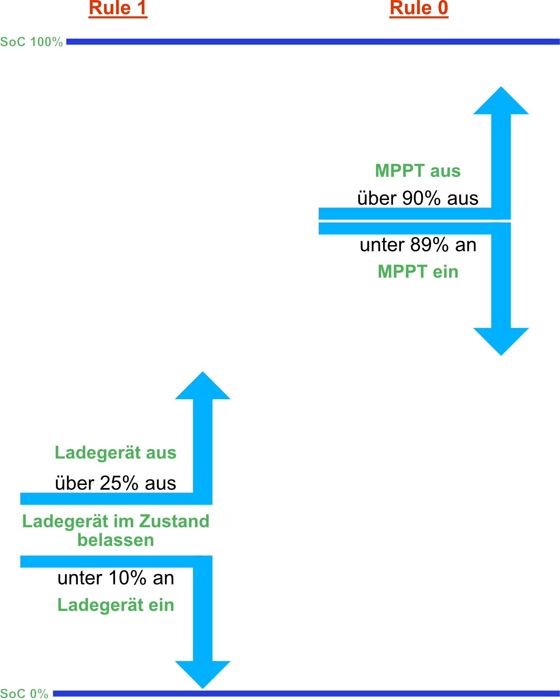

# Inverter {#wechselrichter}

Configure CAN communication and processing of measurements sent to the inverter: SoC, total voltage, current and temperature. Source selection determines which devices provide each value; multiple sources can be aggregated.

## General {#general}

```bsc-settings
version: v010
file: bmsToInverter.json
profile: off
index: 1
```

- **BMS CANbus enable:** Enables CAN communication. When disabled, no inverter data is sent.
- **CANbus protocol:** Select the inverter protocol. Most inverters require **Pylontech**.
- **Send extended data:** Adds CAN packets. Only usable with **Victron** and the [required driver](https://github.com/shining-man/dbus-bsc-can). **Not recommended for CerboGX**, as communication problems can occur.
- **Data source:** Data devices used by **all charge controls**; their values are processed and sent to the inverter. Depending on enabled controls, these sources must provide **cell voltages**. Sources used only for total voltage, current or SoC (e.g. a shunt) belong under [Valuehandling](#valuehandling-multi-bms), not here.

!!! note "Group Devices"
    With [group devices](settings_bsc_group-devices.md#group-devices-batterie-gruppen) enabled, select battery packs (groups) instead of individual data devices.

!!! note "Free Firmware"
    Also select a **master data source** here. Its battery voltage is sent to the inverter.

## Valuehandling {#valuehandling-multi-bms}

Select sources independently for SoC, total voltage and total current, and select how multiple sources are aggregated.

```bsc-settings
version: v010
file: bmsToInverter.json
profile: off
section: UI_SECT_BMSTOINVERTER_VALUEHANDLING
```

!!! note "Free Firmware"
    Only **SoC aggregation** can be configured here in the free firmware.

**Domain:** **Auto** chooses data or enabled group devices automatically; **Data devices** lists configured data devices; **Group devices** lists groups and is available only when [groups](settings_bsc_group-devices.md#group-devices-batterie-gruppen) are enabled.

**SoC source:** Select the data or group devices providing SoC. With one source, only its value determines system SoC.

**SoC aggregation:** **Average**, **Maximum**, **Minimum**, **BMS** (first selected data device), or **Capacity-weighted** using pack capacities from [Basic Data](#basisdaten).

**Capacity-Weighted Calculation**

Each pack contributes in proportion to its capacity:

```text
SoC = sum(pack SoC × pack capacity) / sum(pack capacities)
```

For example, pack 1 at **300 Ah / 80 %** and pack 2 at **100 Ah / 40 %** give **70 %**. The unweighted average is **60 %**, the maximum **80 %**. Internally, calculation uses hundredths of a percent; the result is rounded to whole percent.

!!! warning "Missing Capacity"
    Packs with **0 Ah** are excluded from capacity weighting. If **all** selected packs have no capacity, a default SoC of **100 %** is assumed.

The default per-pack capacity is **280 Ah**, so unchanged packs use that value. Other aggregation modes do not use capacity: average takes the arithmetic mean, maximum/minimum take the corresponding extreme, and BMS uses the first selected device.

**Total voltage source / aggregation:** With one source, use its voltage directly. With several, choose average, maximum or minimum. Send the resulting voltage to the inverter.

**Total current source / aggregation:** With one source, use its current directly. With several, choose sum, average, maximum or minimum. Send the result to the inverter.

## Basic Data {#basisdaten}

```bsc-settings
version: v010
file: bmsToInverter.json
profile: off
section: UI_SECT_BMSTOINVERTER_BASISDATEN
```

**Absorption charge voltage:** Voltage used to bring batteries to a nearly full state. Do not hold it permanently: doing so can harm service life and performance. For LiFePO4 cells, a sustained low current is a suitable point to move to float. [Charge-Current Cut-Off](settings_inverter_charge.md#charge-current-cut-off) automates this; without it, the battery may remain at absorption voltage, which can cause long-term damage.

**Float charge voltage:** The documentation uses this as the resting/holding voltage near open-circuit voltage (OCV), rather than the higher absorption voltage, to avoid continuing to charge a full battery.

!!! note "Entering Float"
    Only [Charge-Current Cut-Off](settings_inverter_charge.md#charge-current-cut-off) or [Autobalance](settings_inverter_charge.md#autobalance) switches the system to float.

**Float voltage SoC:** When SoC drops below this value, return from float to absorption to start a full charge again.

!!! note "Choose the Threshold Carefully"
    Too high a threshold can immediately return the system to absorption. Inaccurate BMS SoC can also distort transitions; an [external shunt](devices/externer_shunt.md) is recommended for precise SoC.

!!! note "Profiles"
    Absorption voltage, float voltage and float voltage SoC support **P1/P2**. With [profile switching](settings_bsc.md#system) enabled, the active profile's values apply.

- **Maximum charging current:** Upper limit sent to the inverter to prevent charging overload.
- **Maximum discharging current:** Upper limit sent to the inverter to avoid excessive discharge current.
- **Set SoC to 100 / 0:** Forces system SoC to the selected value when an assigned trigger is active.

**Batterypack Settings:** Per data device, configure **charge current (0–500 A)**, **discharge current (0–500 A)** and **capacity (1–1000 Ah)**. Capacity also feeds [weighted SoC](#valuehandling-multi-bms).

When a BMS disconnects a pack, remaining packs must carry its share. The BSC adjusts the transmitted limit to the number of active packs, never exceeding the configured system maximum. Example: with three packs rated **100 A** each and a **180 A** system charge limit, losing one leaves **200 A** pack capability, so the limit stays **180 A**. Losing another reduces it to **100 A**. Discharging works analogously.

## Trigger-Based Limits {#triggerbasierte-begrenzungen}

```bsc-settings
version: v010
file: bmsToInverter.json
profile: off
section: UI_SECT_BMSTOINVERTER_TRIGGER_BEGRENZUNGEN
```

- **Charging power to 0:** Sets charge current to **0 A** if any assigned trigger (**1–27**) is active.
- **Discharging power to 0:** Corresponding discharge limit.
- **Trigger-based current limits:** **3 rules**, each with selected triggers and maximum charging/discharging currents (**0–1000 A**). These are additional upper limits, not overrides of system limits: **the smaller value applies**.

## Charge Voltage Ramp {#ladespannungsrampe}

Changes in charge voltage, e.g. float to absorption, occur gradually instead of abruptly, reducing voltage steps and system stress.

!!! note "Firmware Availability"
    Not available in every firmware version.

```bsc-settings
version: v010
file: bmsToInverter.json
profile: off
section: UI_SECT_BMSTOINVERTER_LADESPANNUNGSRAMPE
```

**Mode:**

- **Off:** Apply the target immediately.
- **Time ramp:** Move in **100 mV** steps at the configured interval (default **15 s**) in either direction until the target is reached.
- **Auto:** Ramp upwards by time; ramp downwards using measured battery voltage, temporarily forcing charge current to **0 A**.

**Time per voltage step:** **1–240 s**, default **15 s**, per 100 mV step.

### Auto Mode in Detail {#auto-modus-im-detail}

Upwards, increase by **0.1 V** per interval while charging remains allowed. Downwards:

1. A lower target (e.g. float) starts the downward phase.
2. While battery voltage exceeds the target, force charging current to **0 A**, regardless of other current limits.
3. Each **1 s** control cycle sets the setpoint to measured battery voltage, rounded to **0.1 V**, but never above its previous value.
4. Once battery voltage reaches or falls below the target, apply the exact target and release charging current again.

Example: target changes from **56.0 V to 54.0 V** at a measured **56.0 V**. Charging immediately becomes **0 A**. As voltage falls (56.0 → 55.7 → 55.4 → …), the setpoint follows in 0.1 V resolution. At **54.0 V**, release current. A later target increase uses the time ramp.

!!! note "Special Cases"
    - Without a valid battery voltage measurement, apply the target immediately.
    - If voltage is already below the new target when lowering starts, apply it immediately without blocking current.
    - Changes caused by the **dynamic charge voltage offset** also count as target changes. The ramp is applied last, after target adjustments.
    - The downward phase lasts as long as battery voltage takes to reach the target, with no charging and possibly a load.

When enabled, the ramp acts on every setpoint change.

## Battery Temperature {#batterietemperatur}

Select the data device or extended sensors providing battery temperature to the inverter.

```bsc-settings
version: v010
file: bmsToInverter.json
profile: off
section: UI_SECT_BMSTOINVERTER_BATTERIETEMPERATUR
```

- **Source:** Data device; **unused = 255** disables temperature transmission. With [groups](settings_bsc_group-devices.md#group-devices-batterie-gruppen), select a group instead.
- **Sensor type** (groups only): **Data-device sensors 0–5** or **extended sensors 0–31**.
- **Sensor number:** Number within the selected type.

!!! note "Free Firmware"
    Temperature always comes from the master source.

## Cell Temperature {#zelltemperatur}

Select which sensors of the configured data sources determine minimum and maximum cell temperature transmitted to the inverter.

```bsc-settings
version: v010
file: bmsToInverter.json
profile: off
section: UI_SECT_BMSTOINVERTER_ZELLTEMPERATUR
```

!!! note "Firmware Availability"
    Cell temperature selection is not available in every firmware version.

## Inverter Alarms {#alarme-inverter}

```bsc-settings
version: v010
file: bmsToInverter.json
profile: off
section: UI_SECT_BMSTOINVERTER_ALARME_INVERTER
```

Report **High battery voltage**, **Low battery voltage**, **High Temperature** or **Low Temperature** when at least one of the alarm's assigned triggers (**1–27**) is active.

## SoC Triggers {#trigger-bei-soc}

Four rules activate triggers above or below a configured SoC, e.g. for external devices.

```bsc-settings
version: v010
file: bmsToInverter.json
profile: off
section: UI_SECT_BMSTOINVERTER_TRIGGER_BEI_SOC
```

**SoC trigger on:** Activation threshold, default **95 %**. **SoC trigger off:** Deactivation threshold, default **80 %**.

{ width="450" }

- **Rule 0, MPPT controller relay:** On at **<= 89 %**, off at **>= 90 %**.
- **Rule 1, off-grid charger relay:** On at **<= 10 %**, off at **>= 25 %**. Starting from 0 %, it charges until 25 %, then remains off until 10 % or below: **15 percentage points of hysteresis**.