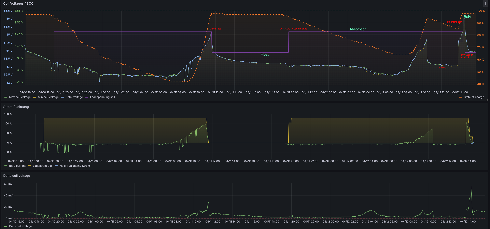
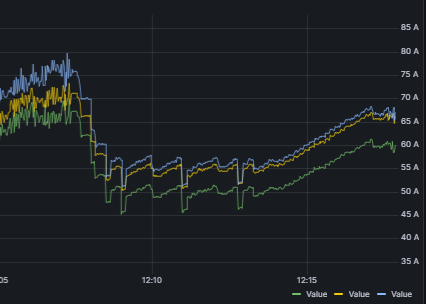
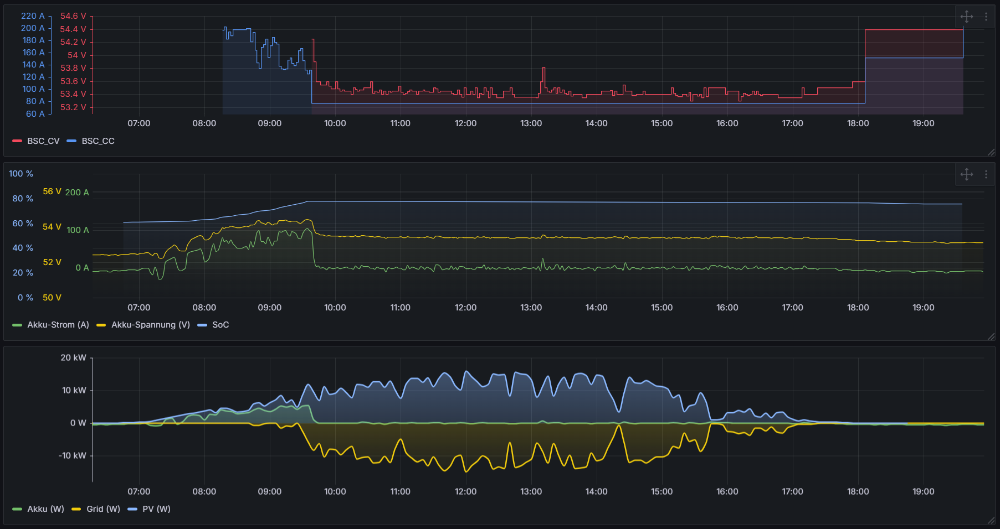
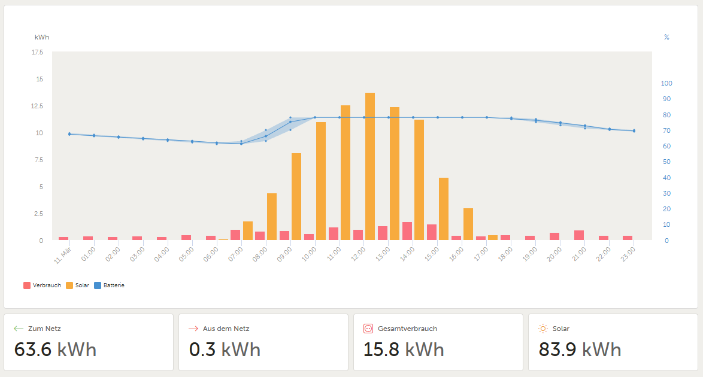

Configure BSC charge control: limits based on cell voltage, cell voltage difference, SoC and temperature, plus **Autobalance** for periodic balancing and **Charge-Current Cut-Off** to finish charging. Percentage limits refer to [Basic Data](settings_inverter.md#basisdaten). Communication, sources and basic values are configured under [Inverter](settings_inverter.md).

Example charge cycle with balancing, float and absorption voltage, visualised in Home Assistant/Grafana:

{ width="1300" }

## Dynamic Charge Voltage Offset {#dynamischer-ladespannungsoffset}

Adjusts charging voltage linearly with charging current, using the **lowest pack charging current**. This can compensate cable voltage drop.

```bsc-settings
version: v010
file: inverterCharge.json
profile: off
section: UI_SECT_INVERTERCHARGE_DYNAMISCHER_LADESPANNUNGSOFFSET
```

- **On/Off:** Enables the function.
- **Current [A]:** Current where maximum offset applies.
- **Minimum offset [mV]:** Added at **0 A**.
- **Maximum offset [mV]:** Added at the configured current, default **500 mV**.

## Excessive Charging Current per Pack {#ladestrom-pro-pack-zu-gro}

```bsc-settings
version: v010
file: inverterCharge.json
profile: off
section: UI_SECT_INVERTERCHARGE_LADESTROM_PRO_PACK_ZU_GROSS
```

Dynamically adjusts charging current to keep each pack within its maximum.

- **Off:** Disabled.
- **On:** Uses configured [per-pack currents](settings_inverter.md#basisdaten).
- **C-Rate:** Calculates each pack's current from its configured **capacity (Ah)** and temperature profile (**C-rate = current/capacity**). Without a capacity, limits current to **0 A**.

{ width="600" }

Green is pack 1, yellow pack 2 and blue pack 3. In the middle, pack 1's limit is temporarily reduced to **50 A**. The BSC dynamically reduces charging and holds that pack at its new limit.

## Cell-Voltage-Dependent Charge Reduction {#ladestrom-zell-spannungsabhangig-drosseln}

Progressively reduces current when a cell exceeds a defined voltage, approaching the target gently and avoiding individual-cell overcharging.

```bsc-settings
version: v010
file: inverterCharge.json
profile: off
section: UI_SECT_INVERTERCHARGE_LADESTROM_ZELL_SPANNUNGSABHAENGIG_DROSSELN
```

- **On/Off:** Enables reduction.
- **Start above cell voltage [mV]:** Starts when the highest cell exceeds this value.
- **Maximum cell voltage [mV]:** At this voltage, only the minimum current remains. Must exceed start voltage.
- **Maximum cell voltage (Float) [mV]:** Separate float threshold. **0** disables it and uses the normal maximum during float too.
- **Minimum charging current [A]:** Lower current bound at maximum cell voltage.

!!! warning "Autobalance Override"
    Once enabled Autobalance reaches **Wait for start cell voltage**, its **maximum cell voltage** replaces this rule's normal maximum. See [Autobalance](#autobalance).

## Cell Voltage Difference Reduction {#ladestrom-reduzieren-bei-zelldrift}

Reduces current when the difference between highest and lowest cell voltage becomes excessive, allowing a balancer to work and preventing further divergence.

```bsc-settings
version: v010
file: inverterCharge.json
profile: off
section: UI_SECT_INVERTERCHARGE_LADESTROM_REDUZIEREN_BEI_ZELLDRIFT
```

- **On/Off:** Enables the rule.
- **Start above cell voltage [mV]:** Voltage where difference monitoring/current reduction becomes active.
- **Start above difference [mV]:** Highest-to-lowest cell difference in a pack where reduction starts.
- **Reduction per additional mV [A]:** Current reduction per millivolt beyond the configured difference threshold, based on the [maximum charging current](settings_inverter.md#basisdaten).

## SoC-Dependent Charge Reduction {#ladestrom-reduzieren-soc}

Progressively reduces current at or above the configured SoC.

```bsc-settings
version: v010
file: inverterCharge.json
profile: off
section: UI_SECT_INVERTERCHARGE_LADESTROM_REDUZIEREN_SOC
```

- **On/Off:** Enables the rule.
- **Reduce from SoC [%]:** Starting SoC.
- **Reduce by x A per 1 %:** Reduction for each additional SoC percentage point, based on the [configured maximum](settings_inverter.md#basisdaten).
- **Minimum charging current [A]:** Current floor.

!!! warning "Autobalance"
    This rule is automatically disabled once Autobalance waits for start cell voltage.

## Temperature-Dependent Charge Reduction {#ladestrom-reduzieren-temperatur}

Up to **4** separately configurable rules progressively limit charging using only selected data/group sources. Cold-side reduction uses the **minimum**, hot-side reduction the **maximum** selected temperature. Rules can reduce current as temperatures rise **or** fall.

!!! note "Firmware Availability"
    Not available in every firmware version.

```bsc-settings
version: v010
file: inverterCharge.json
profile: off
groups: 1
section: UI_SECT_INVERTERCHARGE_LADESTROM_REDUZIEREN_TEMPERATUR
```

- **Data-device sensors:** Select sensors **0–5**.
- **Extended sensor sources / sensors 0–31:** Select additional data/group sources and their extended sensors.
- **Reduction start:** Temperature where reduction starts; may be higher or lower than the end.
- **Reduction end:** Temperature where current becomes **0 A**. A value below start produces cold-side reduction.

**Rising temperatures (start < end):** Below start, full current; between thresholds, linear reduction; at/above end, **0 A**. Example: **100 A**, start **20 °C**, end **40 °C** gives **100 A at 20 °C**, **50 A at 30 °C**, **0 A at 40 °C**.

**Falling temperatures (start > end):** Above start, full current; between thresholds, linear reduction; at/below end, **0 A**. Example: **100 A**, start **40 °C**, end **20 °C** gives **100 A at 40 °C**, **50 A at 30 °C**, **0 A at 20 °C**.

```text
Current = maximum current × (end temperature − current temperature)
          / (end temperature − start temperature)
```

## Temperature-Profile Charge Reduction {#ladestrom-reduzieren-temperaturprofil}

A **10-point** profile assigns a maximum **C-rate** to each temperature. It limits charging in cold or hot conditions. Values are linearly interpolated; outside the profile, the first/last point applies.

```bsc-settings
version: v010
file: inverterCharge.json
profile: off
section: UI_SECT_INVERTERCHARGE_LADESTROM_REDUZIEREN_TEMPERATURPROFIL
```

**Configuration**

- **On/Off:** Default off.
- **Sources:** Uses the active data/group sources. Select data-device sensors **0–5**, extended sources and extended sensors **0–31**. With no sources selected, the function has no effect.
- **Profile:** **10** points, temperature **0–60 °C** in **0.1 °C** steps, C-rate **0–1 C** in **0.01 C** steps.

**Choosing Minimum or Maximum Temperature**

Find the minimum and maximum over all selected sensors. Use the temperature of the profile point with the **highest C-rate** as a reference. If the measured minimum is **below** this reference, use that minimum; otherwise use the maximum.

**Current Calculation**

Interpolate the C-rate between adjacent points. Below the first/above the last temperature, use that endpoint. If multiple points have the same temperature, the **first** counts.

Allowed current is **C-rate × capacity (Ah)**, using the sum of capacities of active packs whose data is **no older than 5 s** ([Batterypack Settings](settings_inverter.md#basisdaten)). With **0 Ah**, current is **0 A**. Cap the result at maximum charging current and round to **0.1 A**.

**Examples: Default Profile, 100 Ah**

- Sensors **12 °C and 18 °C**: minimum 12 °C is below the **25 °C** reference. Between **10 °C / 0.20 C** and **15 °C / 0.40 C**, interpolate **0.28 C → 28 A**.
- Sensors **28 °C and 32 °C**: minimum exceeds the reference, so use maximum 32 °C. Between **25 °C / 1.00 C** and **45 °C / 0.50 C**, interpolate **0.825 C → 82.5 A**.
- Below **0 °C**: first point **0.00 C → 0 A**.
- Above **60 °C**: last point **0.00 C → 0 A**.

**Interaction with Other Rules**

The BSC evaluates every active limit, including [cell voltage](#ladestrom-zell-spannungsabhangig-drosseln), [SoC](#ladestrom-reduzieren-soc), [cell difference](#ladestrom-reduzieren-bei-zelldrift), [temperature rules](#ladestrom-reduzieren-temperatur), [Cut-Off](#charge-current-cut-off) and per-pack limits, then uses the **lowest**. The temperature profile remains active during Autobalance. **C-Rate** mode of [per-pack current control](#ladestrom-pro-pack-zu-gro) also uses this profile, with each pack's own capacity and pack-current ceiling.

## Voltage Control for Charging Current Limitation {#spannungsregelung-zur-ladestrombegrenzung}

Dynamically adjusts charge voltage to keep current within the configured corridor. Outside that corridor it corrects voltage; additionally, the transmitted current limit is set to **0 A**. This can limit charging to a chosen SoC to extend battery life.

!!! note "Firmware Availability"
    Not available in every firmware version.

```bsc-settings
version: v010
file: inverterCharge.json
profile: off
section: UI_SECT_INVERTERCHARGE_SPANNUNGSREGELUNG_ZUR_LADESTROMBEGRENZUNG
```

- **On/Off:** Always on, off, or enabled only by a selected trigger (**1–27**), e.g. seasonal home automation.
- **Active from SoC:** Starting SoC, default **80 %**.
- **Control corridor (±):** Permitted current range, default **10.00 A**. No adjustment within it; outside it, voltage is adjusted.

!!! note "Autobalance Takes Priority"
    This function operates only when Autobalance is not active.

The diagrams show a Victron system with voltage control: current is limited, excess energy feeds into the grid instead of the battery, and SoC stays nearly constant.

{ width="950" }
{ width="950" }

## Autobalance {#autobalance}

Automates periodic cell balancing by raising charge voltage into the range where the BMS's own balancers or external balancers equalise cell voltages.

!!! note "The BSC Does Not Balance Cells Itself"
    The BSC has **no cell-level passive or active balancing circuits**. It only raises voltage to the configured **balance charge voltage**, enabling BMS passive balancers or external active balancers such as NEEY to operate.

See [Interaction with Other Charge Controls](#zusammenwirken-mit-anderen-laderegelungen) for coordinated or suspended rules.

=== "Version >= V0.10.0"
    **Changes in V0.10.0:** New **Balance cell voltage** combines with **Cell difference finished** to define the target. **Maximum cell voltage** (formerly Balance cell voltage) now defines the end voltage of current reduction during balancing. **Run-on time** replaces **Minimum balance time**. **Skip ‘Wait for charge voltage’** is new. Sending balance voltage once the start time is reached is now standard, not an option.

    ```bsc-settings
    version: v010
    file: inverterCharge.json
    profile: off
    section: UI_SECT_INVERTERCHARGE_AUTOBALANCE
    ```

    **Start Autobalance (trigger):** Starts immediately while waiting for the next interval. Manually return the trigger to **low** after starting.

    **Balance interval:** Time between balancing cycles.

    **Start criteria:** The interval expires (or the start trigger activates), then the **highest cell voltage** of configured data devices must reach the start cell voltage.

    **Balance charge voltage:** Raised system voltage used during balancing. Sent to the inverter from **Wait for start cell voltage** onwards.

    **Maximum cell voltage:** Upper cell voltage used as the current-reduction endpoint during balancing.

    **Balance cell voltage / Cell difference finished:** The target is reached when the **highest cell voltage reaches the balance cell voltage AND the greatest cell difference does not exceed the configured tolerance**. The state then becomes **Wait for charge voltage**.

    **Run-on time:** Starts when pack voltage reaches **99 % of balance charge voltage**. Balancing ends only after this timer expires, then voltage returns to float.

    **Timeout:** Aborts a cycle that exceeds the configured maximum time. The state becomes **Wait for next day**, with a **12-hour** wait before retrying.

    **Advanced Options**

    - **Return to ‘Wait for start cell voltage’ if below start voltage:** Resets the state and running timers when the highest cell falls below the start threshold.
    - **Disable Cut-Off from ‘Wait for start cell voltage’:** Disables it earlier. Without this option, Cut-Off is disabled from **Wait for cell voltage/difference**.
    - **Skip ‘Wait for charge voltage’:** After the balance target is reached, enter run-on immediately and start its timer. The **99 % pack-voltage requirement and fallback are omitted**.

    !!! note "Timing Notes"
        After restarting the BSC, there is no interval delay before the first balance cycle. The configured interval starts after the first cycle. Starting at **22:00** with a **5-day** interval means the next due time is the evening of day five, not its morning; without solar energy then, balancing waits for a following sunny day. Run-on time can help some BMS units, e.g. Seplos, synchronise to SoC 100 %.

    **MQTT States: `/Inverter/autoBalState`**

    | State | Meaning |
    | --- | --- |
    | 0 | Autobalance disabled |
    | 1 | Wait for start day; interval running |
    | 2 | Incomplete cycle; wait 12 h before retry |
    | 3 | Due; wait for start cell voltage |
    | 4 | Start voltage reached; wait for balance cell voltage and cell difference target |
    | 5 | Balance target reached; wait for pack voltage >= 99 % of balance charge voltage |
    | 6 | Charge voltage reached; run-on timer running |

    **Sequence:** Enable → wait for start day → interval elapsed or trigger → wait for start cell voltage → highest cell reaches start → wait for cell voltage/difference → balance target reached → wait for charge voltage → pack reaches **99 %** → run-on → timer expires → cycle complete and wait for next start day.

    **Other transitions:** Timeout from states **4–6** aborts to the 12-hour wait. Optional low-start-voltage fallback from **4–6** returns to state **3**, resetting timers. During run-on, falling below **99 %** returns to state **5**, unless **Skip wait** is enabled.

    ??? info "State Diagram"
        ```mermaid
        stateDiagram-v2
            s0: Off
            s1: Wait for start day
            s2: Wait 12 hours
            s3: Wait for start cell voltage
            s4: Wait for balance voltage and difference
            s5: Wait for pack charge voltage
            s6: Run-on timer
            s0 --> s1: Enable
            s1 --> s3: Interval elapsed or start trigger
            s2 --> s3: 12 h elapsed or start trigger
            s3 --> s4: Start cell voltage reached
            s4 --> s5: Balance target reached
            s4 --> s6: Target reached and skip-wait option
            s5 --> s6: Pack voltage at least 99 percent
            s6 --> s5: Below 99 percent unless skip-wait
            s4 --> s3: Optional low-start-voltage fallback
            s5 --> s3: Optional low-start-voltage fallback
            s6 --> s3: Optional low-start-voltage fallback
            s4 --> s2: Timeout, set float
            s5 --> s2: Timeout, set float
            s6 --> s2: Timeout, set float
            s6 --> s1: Run-on finished, set float
        ```

=== "Version < V0.10.0"
    **Start Autobalance (trigger):** Available in some firmware versions; starts while waiting for the interval. Reset the trigger to **low** afterwards.

    **Balance interval:** Days between cycles; the historical example uses **5 days**, range **1–30 days**. Set the correct cell count in Serial settings.

    **Start cell voltage:** Highest cell voltage required to start; historical example **3300 mV**, range **2500–5000 mV**.

    **Minimum balance time:** Minimum balancing duration even if cell voltages are already equal. Example **0 minutes**, range **0–600 minutes**.

    **Balance charge voltage:** Raised system voltage while balancing; historical example **55.20 V**, range **20–60 V**, step **0.1 V**.

    **Balance cell voltage:** Maximum individual cell voltage during balancing; historical example **3450 mV**, range **2500–5000 mV**. This older parameter is not the V0.10.0 finish-target parameter.

    **Cell difference finished:** Ends the balancing target phase when the greatest difference reaches or drops below this value. Example **5 mV**, range **0–50 mV**.

    **Timeout:** Aborts an unfinished cycle; historical example **60 minutes**, range **0–600 minutes**.

    **Advanced options** (not available in every version): send balance voltage as soon as the start time is reached; return to **Wait for start cell voltage** and reset timers if voltage falls below start; disable Cut-Off already in that waiting state.

    After completion, voltage returns to float. There is no interval delay before the first balance after restart. A five-day interval from **22:00** becomes due in the evening, possibly waiting until solar energy is available the next day. Minimum time can help BMS units such as Seplos reach SoC 100 %.

    **MQTT `/Inverter/autoBalState`:** 0 = off; 1 = wait for next start; 2 = unfinished, retry next day; 3 = due, wait for start cell voltage; 4 = balancing active; 5 = cell difference reached but pack charge voltage not reached; 6 = charge voltage reached, wait for minimum time.

    ??? info "State Diagram"
        ```mermaid
        stateDiagram-v2
            s0: Off
            s1: Wait for start day
            s2: Retry next day
            s3: Wait for start cell voltage
            s4: Balancing
            s5: Wait for charge voltage
            s6: Finish minimum balance time
            s0 --> s1: Enabled
            s0 --> s2: Enabled with unfinished cycle
            s1 --> s3: Due
            s2 --> s3: Due
            s3 --> s4: Start cell voltage reached
            s4 --> s5: Cell difference reached
            s4 --> s6: Charge voltage reached and minimum timer started
            s5 --> s6: Minimum timer started
            s4 --> s3: Optional low-start-voltage fallback
            s5 --> s3: Optional low-start-voltage fallback
            s6 --> s3: Optional low-start-voltage fallback
            s4 --> s2: Timeout
            s5 --> s2: Timeout
            s6 --> s0: Minimum time elapsed, set float
        ```

### Interaction with Other Charge Controls {#zusammenwirken-mit-anderen-laderegelungen}

During balancing, the BSC suspends or adjusts its own controls that would otherwise prevent reaching the balancing voltage range:

- [SoC reduction](#ladestrom-reduzieren-soc) is disabled from **Wait for start cell voltage**.
- [Cut-Off](#charge-current-cut-off) is suspended and its timer reset from **Wait for cell voltage/difference**, or earlier with the corresponding option.
- [Cell-voltage reduction](#ladestrom-zell-spannungsabhangig-drosseln) remains active but uses Autobalance **maximum cell voltage** (older versions: **balance cell voltage**) as its endpoint.
- Zero-Charge-Current controls, both [voltage-based](#spannungsregelung-zur-ladestrombegrenzung) and current-based, are skipped.
- Charge voltage is raised to and held at **balance charge voltage**, with the **99 %** pack-voltage criterion as described above.

## Charge-Current Cut-Off {#charge-current-cut-off}

Stops charging after current remains below a threshold for a specified duration. The voltage target then changes from [absorption to float](settings_inverter.md#basisdaten).

```bsc-settings
version: v010
file: inverterCharge.json
profile: off
section: UI_SECT_INVERTERCHARGE_CHARGE_CURRENT_CUT_OFF
```

- **On/Off:** Enables the function.
- **Cut-Off time:** Required duration below the current threshold before current becomes **0 A**.
- **Cut-Off current:** Threshold for **total charging current**, averaged since the optional start cell voltage was exceeded. If average current exceeds the threshold again, **both timer and average reset**.
- **Start cell voltage:** Activates Cut-Off evaluation. Once exceeded with current below threshold, the timer continues even if voltage falls below start again. Only current exceeding the Cut-Off threshold resets that running timer.

!!! note "Returning to Absorption"
    The configured [float voltage SoC](settings_inverter.md#basisdaten) controls the return to absorption. Too high a threshold or inaccurate BMS SoC can cause an immediate return. Consider an [external shunt](devices/externer_shunt.md) for precise SoC.

## SoC Below a Cell Voltage Threshold {#soc-beim-unterschreiten-der-zellspannung}

Sends a selected SoC to the inverter when cell voltage falls below a threshold, for example to request recharging. Normal SoC transmission resumes when the charge-end cell voltage is reached or exceeded.

```bsc-settings
version: v010
file: inverterCharge.json
profile: off
section: UI_SECT_INVERTERCHARGE_SOC_BEIM_UNTERSCHREITEN_DER_ZELLSPANNUNG
```

- **On/Off:** Enables the function.
- **Charge-start cell voltage [mV]:** Recharging begins below this threshold.
- **Charge-end cell voltage [mV]:** Ends recharging at this threshold. **0** means charge until cell voltage rises above the start threshold again.
- **SoC [%]:** Value sent during the recharge request.
- **Lockout between recharges [s]:** Minimum interval between recharge cycles.