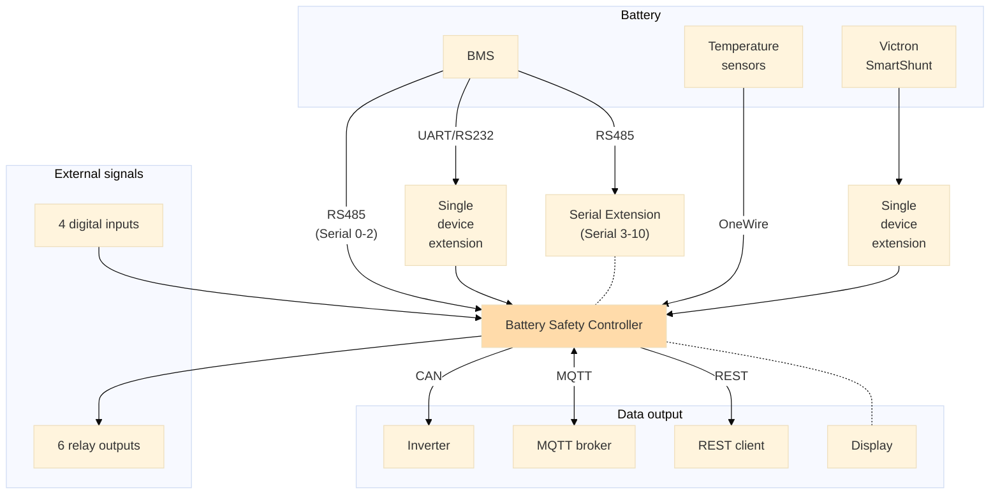

## System Overview {#systemuberblick}

The BSC is a freely configurable controller linking components of a DIY battery system. It can handle monitoring and control tasks, including central charge control.

## Components {#komponenten}

- **BSC:** PCB and software with Wi-Fi, Bluetooth, RS485, CAN, OneWire and digital inputs/outputs. Available support depends on hardware and firmware.
- **Display:** Optional I²C display. See [Hardware](hardware.md#bsc-display) and a [suitable enclosure](https://bsc-shop.com/produkt-kategorie/gehaeuse/).
- **Single device extension:** Connects a non-RS485 device to the BSC.
- **Serial Extension:** Adds **8** RS485 ports to the BSC's **3**. See the [extension repository](https://github.com/shining-man/bsc_extension_serial).
- **BMS:** Provides battery state including cell voltages, SoC and temperatures. Connections can include RS485, CAN or Bluetooth where supported; see [Supported BMS Units](devices/bms.md) and current [interface limitations](settings_bsc_interfaces.md#bluetooth).
- **Temperature sensors:** Additional sensors via OneWire or digital/analogue inputs can supplement BMS data.
- **Shunt:** Provides external SoC. Currently Victron SmartShunt is supported through the Single device extension. See [External Shunts](devices/externer_shunt.md).
- **Inverter:** CAN communication with devices such as Victron, Solis or Deye reports battery state and control values such as charging limits. See [Inverters](devices/wechselrichter.md).

## Available Interfaces {#verfugbare-schnittstellen}

- **Wi-Fi:** Web interface access and MQTT transmission.
- [**RS485**](hardware.md#rs485-bms): BMS data.
- [**CAN bus**](hardware.md#canrs485): Inverter communication.
- [**OneWire**](hardware.md#onewire): Sensor data, e.g. temperature.
- [**Digital inputs**](hardware.md#digitale-eingange): Galvanically isolated digital signals.
- **Digital outputs:** External device control through relays.
- [**MQTT broker**](mqtt.md): Battery/system state for home automation, long-term storage and visualisation, e.g. Grafana.
- [**REST client**](restapi.md): HTTP API access to battery and BSC state.