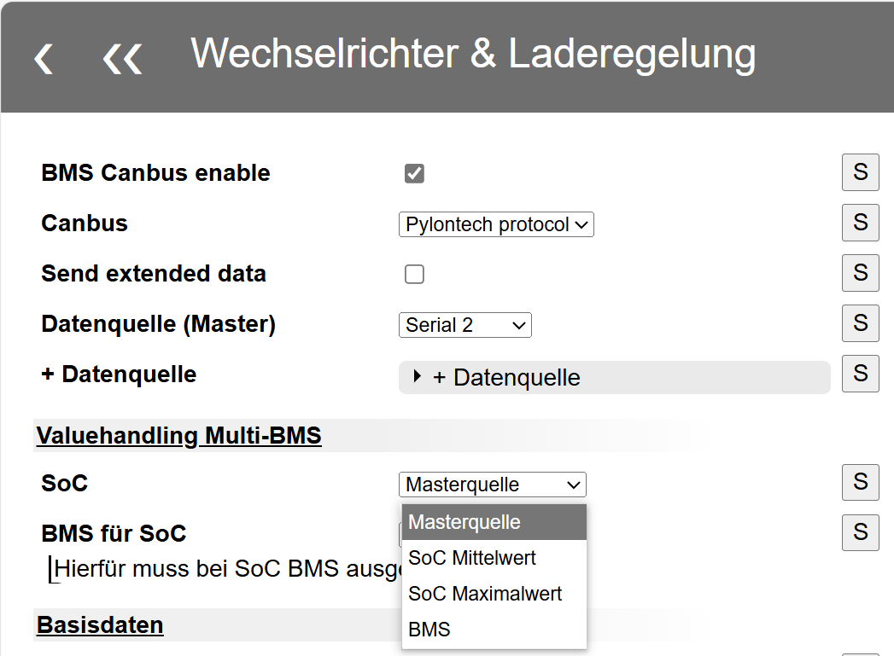
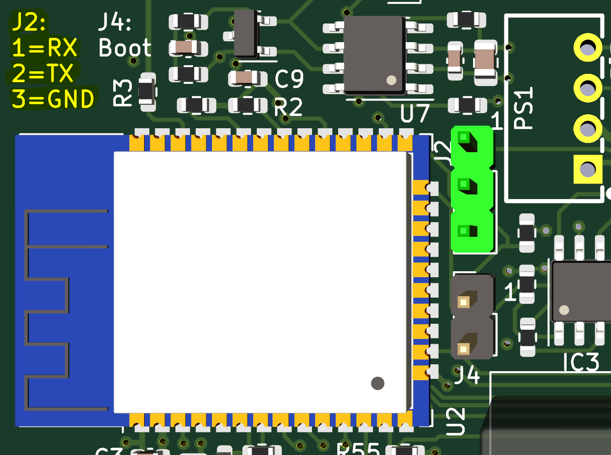
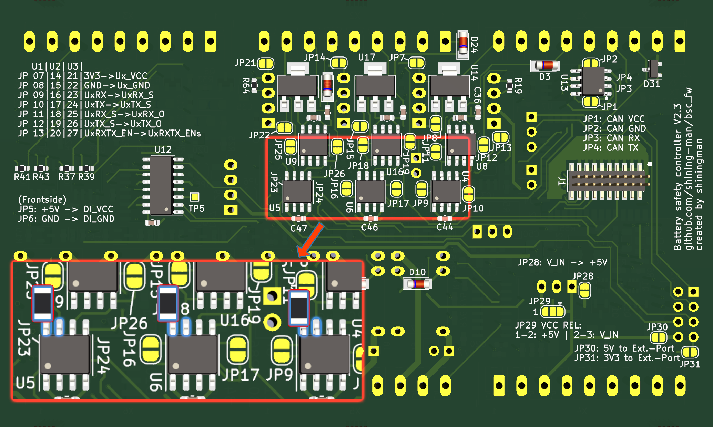
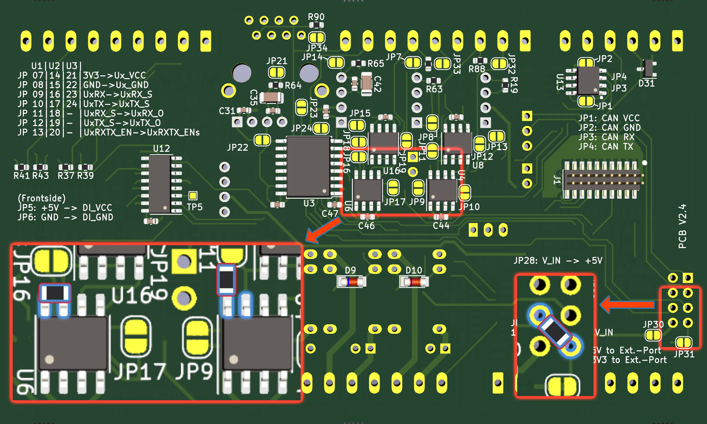
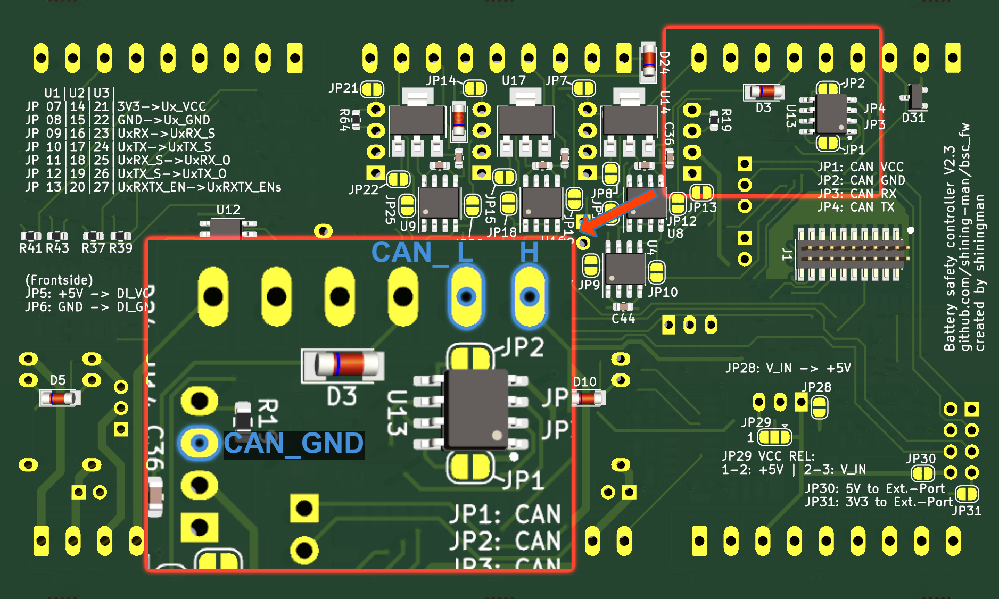

## Software {#software}

### Restarting the Device {#neustart-des-gerates}

Besides disconnecting power, restart through your browser at `http://BSCIP/restart/`, replacing **BSCIP** with the BSC's current IP address. If Wi-Fi has failed, its access point may be active; it retries the original network every **5 minutes**. Connect to the AP [as described here](first_steps_programming.md#verbinden-mit-dem-bsc) and issue the restart.

### BMS SoC Differs from the Value Sent to the Inverter {#der-soc-wert-des-bms-und-der-zum-inverter-ubertragene-wert-stimmen-nicht-uberein}

Three possible causes:

1. Incorrect SoC source selection. See [Valuehandling](settings_inverter.md#valuehandling-multi-bms).

    { width="400" }

2. A selected SoC source has not sent data for **more than 5 seconds** and is excluded. SoC uses the remaining available sources. It is included automatically when data returns.
3. **SoC linearisation** is enabled under value adjustments. Under **Settings / Interfaces / Data devices / Value adjustments**, leave *Cellvoltage for SoC 100%* and *Cellvoltage for SoC 0%* empty or disable linearisation when using the BMS's own SoC calculation. See [Value Adjustment](settings_bsc_data_devices.md#value-adjustment).

### Log Message: “MQTT Queue ist voll” {#log-eintrag-mqtt-queue-ist-voll}

The MQTT queue is full if the broker cannot process queued data quickly enough. One user encountered this with several applications in a single Docker container; splitting them into separate containers resolved it. Distributing load may help in a similar setup.

### Serial Debugging {#serial-debugging}

Special diagnostic firmware can send extended information through the programming interface. It uses **Serial 0**, so **no external RS485 device may be connected there during debugging**. The web UI log is disabled in these builds and displays only previous firmware events.

Use a UART/USB converter with **3.3 V logic levels** and a PC terminal program. FT232R adapters have worked well; CP340G adapters often work too. **Adapters not designed for 3.3 V can permanently damage the controller.**

Connect through the three-pin **J2** header beside the processor; labels are printed at the PCB's upper left: **TX to RX**, **RX to TX**, **GND to GND**.

{ width="400" }

Windows terminals include **PuTTY**, **YAT** and **HTerm**. Find the COM port in Device Manager under **Ports (COM & LPT)**. Use **115200 baud, 8 data bits, no parity, 1 stop bit**. Power-cycle the BSC to test whether boot information arrives. [Video](mov/serial_debugging.mp4).

## Hardware {#hardware}

### Communication with External Hardware Fails {#kommunikation-mit-externer-hardware-funktioniert-nicht}

Recheck every connection. Every connector has a **PCB-printed pin-1 mark**, which must agree with the function label and connected conductor.

#### Checking CAN Connections {#can-kontaktierung-prufen}

1. **Termination:** Disconnect power from both devices and disconnect their linking cable. Measure resistance between **CAN_L and CAN_H** at each device: normally **120 ohms per side**. Some devices lack built-in termination; if only the BSC has 120 ohms, carefully recheck pin assignments as this is unusual. With both 120-ohm terminations connected together and power still off, the bus should measure **60 ohms**.
2. **Signals:** Verify **CAN_H to CAN_H**, **CAN_L to CAN_L** and GND between both sides, observing any device-specific connection instructions.

#### Serial 2 Has Only Timeouts {#serial-2-ohne-funktion-keine-datenverbindung-moglich-nur-timeouts-im-log}

Check whether **J6** is fitted. See [J6 for Normal Operation](hardware.md#j6-fur-den-regularen-betrieb).

### Sporadic Serial CRC Errors (HW2.3 and HW2.4) {#sporadische-crc-fehler-an-den-seriellen-schnittstellen-hw23-und-hw24}

Missing RX pull-ups can leave signals floating. Add **10 kohm pull-up resistors**. Package choice depends on soldering skill: **0603** fits between pins, **0805** can also work; vertical placement suits **1206** or **0805**; between J3 through-hole pins, **0805** or **1206** works.

#### HW2.3 {#hw23}

**Serial 0, 1 and 2:** Fit **10 kohms between pins 7 and 8 of U4, U5 and U6** respectively. Higher contact points on each IC can make soldering easier. PCB underside:

{ width="800" }

#### HW2.4 {#hw24}

**Serial 0 and 1:** Fit **10 kohms between pins 7 and 8 of U4 and U6**. For U4, the illustrated contact location may be easier.

**Serial 2:** Fit **10 kohms between pins 6 and 7 of J3**; a through-hole resistor also works. PCB underside:

{ width="800" }

### CAN_GND Connection (HW2.3) {#can_gnd-kontaktierung-hw23}

The screw terminals expose CAN_L and CAN_H but not CAN_GND. Obtain CAN_GND from the voltage regulator pins on the PCB underside as shown:

{ width="800" }